# Rewriting Magic by Hand

Oct 24, 2026 · @Jeremy

## Before you start

Rebuild Magic beside this checkout as a thinner, more functional engine: the same gems-and-contracts shape, but each frame is data handed down a pipeline, state lives in four named places, and every long operation is an `Async` method that takes progress and a cancellation token. The original, [Slop-Magic](https://github.com/Konfus-org/Slop-Magic), is the reference for what each part must do, not for how; the links in each step point into it on its `dev` branch.

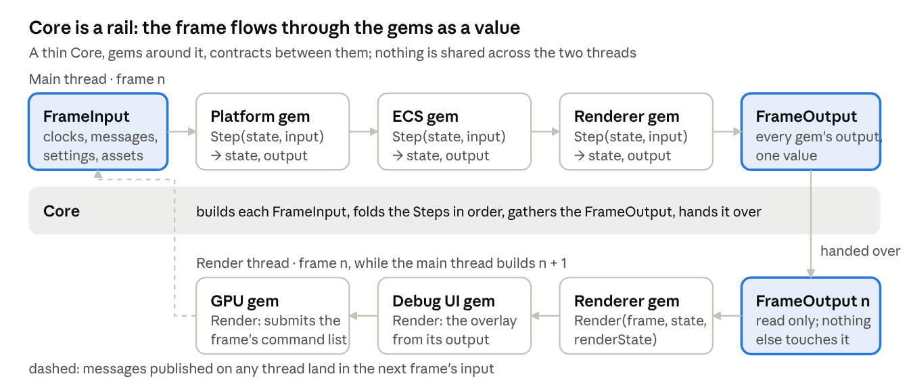

Read the top row left to right and the bottom row right to left: that is the order Core calls the gems on each thread.

**What stays.** A gem is the unit of everything, a class library Core loads by name from the project's `.magic` file and talks to only through Core's contracts. Core stays thin: it opens the project, makes the gems, runs the frames and ends the gems. The file formats stay, `.magic`, `.meta`, `.prefab`, `.domain`, `.preset`, and so do the engine's resources and the samples, which become the final test. The strict build stays, every warning an error.

**What changes.**

1. _The frame is data._ Core builds a `FrameInput` value each frame: the clocks, the messages published since last frame, the settings snapshot, the assets that arrived, the input state. Each gem is a step function from its own state record and that input to its next state record and a `GemOutput`. Core gathers the outputs into one immutable `FrameOutput` and hands it to the render thread, which draws a value nobody else can touch. No double buffers, no `Sync`, no swap.
2. _Less state._ State lives in four places only: the ECS's columns, each gem's one state record, the snapshots Core builds (assets, settings), and the caches on disk. Nothing else holds a field that changes between frames.
3. _Strict async._ Anything that takes longer than a frame is `NameAsync(args, IProgress<float>? progress, CancellationToken cancel)` returning a `Task<Result<T>>`, and nothing waits on another engine thread.

**How to read a step.** Each one is _What it must do_, the behaviour this repository already has; _The shape_, how the functional version does it; _Reference_, links into this repository as worked examples; and a _Checkpoint_. Lines marked _Nugget_ are the why behind a command or a rule.

**How to work.**

- Part 0 makes the repository. Keep this checkout open beside it as the reference, and when a step's link shows you a thousand lines, read what it does, not how it is arranged.
- Keep the original's public names where the samples and resources touch them: component and asset type names, settings keys, file formats, the console commands. Inside Core and inside a gem, the names are yours.
- Paths are relative to this repository's root. Commands are PowerShell. Links pin to commit `fb0cceed` on [Konfus-org/Magic](https://github.com/Konfus-org/Slop-Magic/tree/dev).

| Part            | What you build                                                   | Where the reference is                                                                                                                                                                                     |
| --------------- | ---------------------------------------------------------------- | ---------------------------------------------------------------------------------------------------------------------------------------------------------------------------------------------------------- |
| 0               | The repository, `main`, the first push                           | this repository's root files                                                                                                                                                                               |
| Rules           | The frame pipeline, the state map, the async convention          | [`src/Core/README.md`](https://github.com/Konfus-org/Slop-Magic/blob/dev/src/Core/README.md)                                                                               |
| 1, steps 1 to 5 | The host, the frame pipeline, the services, the world, the proof | [`src/Core`](https://github.com/Konfus-org/Slop-Magic/tree/dev/src/Core)                                                                                                   |
| 2               | The 18 gems, one at a time                                       | [`src/Bundled/Gems`](https://github.com/Konfus-org/Slop-Magic/tree/dev/src/Bundled/Gems)                                                                                   |
| 3               | The sample project, the tools and CI                             | [`samples`](https://github.com/Konfus-org/Slop-Magic/tree/dev/samples), [`tools`](https://github.com/Konfus-org/Slop-Magic/tree/dev/tools) |

## Part 0: the repository, main and the first push

By the end of this part a new repository is on GitHub with a `main` branch holding an empty solution and a `dev` branch to work on, all from the command line. Every block below is one thing to type; the nugget under it is why.

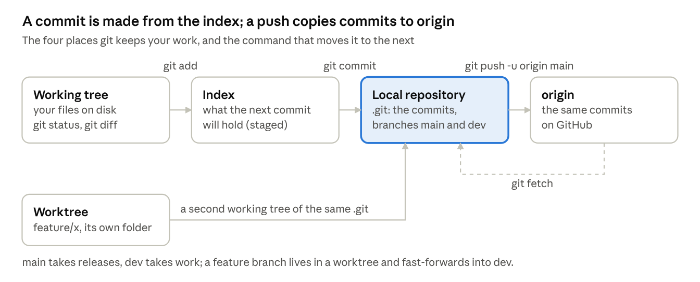

Every command in this part moves work one box to the right; `fetch` is the only one that brings something back, and it never touches your branches.

**The folder and git.**

```powershell
mkdir "..\Hex Magic"; cd "..\Hex Magic"
git init -b main
```

_Nugget._ A repository is only the `.git` folder; everything beside it is the working tree. `-b main` names the first branch, since git's historical default is `master`; `git config --global init.defaultBranch main` makes that the default for every future `git init`.

**What never goes in, first.**

```powershell
dotnet new gitignore
```

Then add `Build/`, `Logs/` and `Screenshots/` to it, as [this repository's `.gitignore`](https://github.com/Konfus-org/Slop-Magic/blob/dev/.gitignore) does. _Nugget._ A file once committed stays in history for ever, even after you delete it, so the ignore file comes before the first `git add`. `git status --ignored` shows what the rules are hiding, which matters when a rule swallows an asset folder by accident.

**The SDK pin and the editor rules.**

```powershell
dotnet new globaljson --sdk-version 10.0.100 --roll-forward latestFeature
dotnet new editorconfig
```

_Nugget._ `global.json` makes every machine and CI build with the same SDK feature band; `latestFeature` still accepts newer 10.0.x patches. Replace the generated `.editorconfig` with [this repository's](https://github.com/Konfus-org/Slop-Magic/blob/dev/.editorconfig), which holds every analyzer rule.

**The solution and Core.**

```powershell
dotnet new sln -n Magic --format slnx
dotnet new console -n Core -o src/Core
dotnet sln Magic.slnx add src/Core/Core.csproj
```

Copy [`Directory.Build.props`](https://github.com/Konfus-org/Slop-Magic/blob/dev/Directory.Build.props), [`Directory.Packages.props`](https://github.com/Konfus-org/Slop-Magic/blob/dev/Directory.Packages.props), [`BannedSymbols.txt`](https://github.com/Konfus-org/Slop-Magic/blob/dev/BannedSymbols.txt) and [`nuget.config`](https://github.com/Konfus-org/Slop-Magic/blob/dev/nuget.config) to the root, set `AssemblyName` and `RootNamespace` to `Magic` in [`Core.csproj`](https://github.com/Konfus-org/Slop-Magic/blob/dev/src/Core/Core.csproj), replace the generated top-level `Program.cs` with a class holding `Main`, and `dotnet build`. _Nugget._ `.slnx` is the XML solution format every .NET SDK since 9.0.200 reads; the old `.sln` is a text format from the nineties. `Directory.Build.props` is read by every project under it, so build rules live in one place; `Directory.Packages.props` pins every package version centrally so no two projects disagree.

**The first commit.**

```powershell
git status
git add -A
git commit -m "build(core): the empty solution, Core and the build rules"
git log --oneline
```

_Nugget._ `git add` copies files into the index, the staging area, and a commit is made from the index, never straight from the working tree; `git status` shows the two apart. `git add -p` stages hunk by hunk when a change mixes two things. This repository's subjects read `type(scope): what`, enforced by a hook; start that habit on commit one.

**The remote and the push.** The GitHub CLI is installed and signed in on this machine, so one command makes the repository, adds the remote and pushes:

```powershell
gh repo create Magic --private --description "A plugin-driven game engine written in C#." --source . --remote origin --push
```

Without it, make an empty repository named `Magic` on github.com with that description and no README, then:

```powershell
git remote add origin https://github.com/<you>/Magic.git
git push -u origin main
```

_Nugget._ A remote is a name for a URL, and `origin` is only the conventional name for the one you cloned from or pushed to first. `-u` records `origin/main` as `main`'s upstream, so a bare `git push` or `git pull` knows where to go from then on. HTTPS authenticates through the credential manager with a token, SSH through a key pair; `gh auth login` set up the first for you.

**dev, and how this repository works.**

```powershell
git switch -c dev
git push -u origin dev
```

_Nugget._ Work lands on `dev`; `main` takes only what is released, and CI publishes a release when `main` moves. A change is made on a short-lived branch in a worktree, a second checkout of the same repository in another folder, so two branches build and run side by side with nothing stashed:

```powershell
git worktree add "..\Hex Magic-worktrees\feature\frame-pipeline" -b feature/frame-pipeline dev
```

When it is done: `git switch dev`, `git merge --ff-only feature/frame-pipeline`, `git worktree remove "..\Hex Magic-worktrees\feature\frame-pipeline"`, `git branch -d feature/frame-pipeline`. `--ff-only` refuses to make a merge commit, so `dev` stays a straight line; if it refuses, rebase the branch onto `dev` first with `git rebase dev` from the worktree.

**Daily commands.**

| Command                            | What it does                                               | Why it matters                                                   |
| ---------------------------------- | ---------------------------------------------------------- | ---------------------------------------------------------------- |
| `git status`                       | staged, unstaged, untracked                                | run it before every commit                                       |
| `git diff` and `git diff --staged` | the working tree against the index, the index against HEAD | read your own change before committing it                        |
| `git log --oneline --graph --all`  | every branch as a tree                                     | the fastest way to see where `dev`, `main` and `origin` stand    |
| `git fetch`                        | update `origin/*` without touching your branches           | look before you merge                                            |
| `git rebase dev`                   | replay your branch's commits onto `dev`'s tip              | keeps a fast-forward merge possible                              |
| `git restore <file>`               | throw away an unstaged change                              | the safe undo; `reset --hard` throws away everything             |
| `git stash` and `git stash pop`    | park uncommitted work                                      | rarely needed once you use worktrees                             |
| `git worktree list`                | every checkout of this repository                          | the first command of every session in this repository's workflow |

**Checkpoint.** `gh repo view --web` opens the repository showing `main` and `dev`. `git log --oneline --graph --all` shows one commit on both, with `origin/main` and `origin/dev` on it. A fresh `git clone` into another folder builds with `dotnet build Magic.slnx`.

## The design rules

Three rules shape every step after this one: the frame is a value that flows one way, state lives in four named places, and every long operation is an `Async` method with progress and cancellation. This repository breaks all three in places; its [Core README](https://github.com/Konfus-org/Slop-Magic/blob/dev/src/Core/README.md) is still the best statement of what the engine must do.

**Rule 1: the frame is a pipeline of values.** Core builds one `FrameInput` per frame and hands it down the gems in the order they were made. A gem is a step function: its own state record and the input go in, its next state record and its output come out. Nothing in a gem changes between frames except the record Core hands back to it.

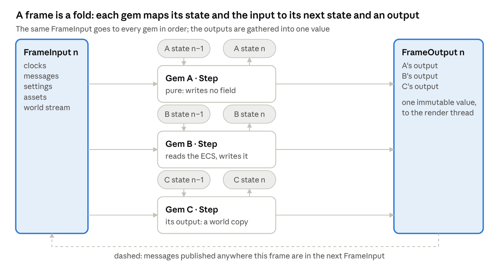

The state pills are the only thing a gem keeps between frames, and Core is the one that keeps them.

```csharp
// What Core hands every gem each frame. Immutable: records and frozen collections only.
public readonly record struct FrameInput(
    Frame Frame,              // index, both clocks, IsPaused
    Messages Messages,        // every message published last frame: Messages.Of<KeyDown>()
    SettingsSnapshot Settings,// the layered values as of this frame: Settings.Of<MySettings>()
    AssetSnapshot Assets,     // loaded values by handle, plus what arrived this frame
    WorldStream Stream);      // where the world is in being replaced

// A gem: one state record per thread it runs on, both owned by Core and handed back each call.
public interface IGem<TState, TRenderState>
{
    TState Start(in StartContext context);                                   // main thread, once
    (TState State, GemOutput Output) Step(in FrameInput input, TState state); // main thread, per frame
    TState FixedStep(in FrameInput input, TState state) => state;            // k times per frame
    TRenderState Render(in FrameOutput frame, TState state, TRenderState render); // render thread
    void Stop(TState state, TRenderState render);                            // once, in reverse
}
```

`FrameOutput` is every gem's `GemOutput` for the frame, gathered by Core into one value with the `Frame` it belongs to, and handed to the render thread once the main thread is done with the frame. The render thread draws frame n from that value while the main thread builds frame n + 1, and nothing is shared: the original's `LateUpdate` copy, `Sync` swap and double buffers ([`IGem.cs`](https://github.com/Konfus-org/Slop-Magic/blob/dev/src/Core/Interfaces/IGem.cs)) go. A gem that draws keeps its GPU-side resources in `TRenderState`, returned from `Render`, so each thread owns exactly one record of the gem's. Messages are the one way back: anything, on any thread, may publish a message, and it is in the next frame's input; there are no callbacks and no `Watch`. _Nugget._ A `record` copied `with` one field changed copies references, not collections, so a state record holding an `ImmutableArray` or a `FrozenDictionary` costs almost nothing per frame; a mutable `List<T>` inside a state record is the one thing to refuse in review.

**Rule 2: state lives in four places.**

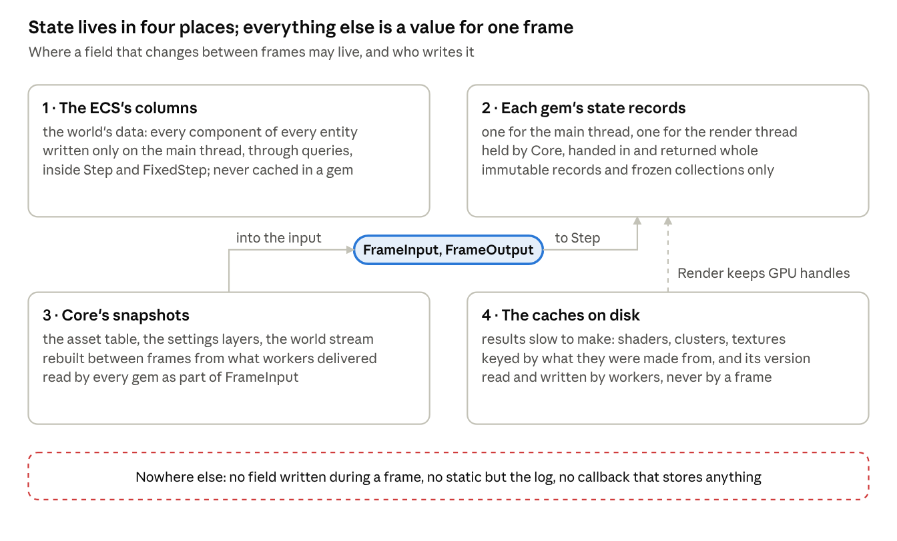

When a review asks where a value lives, the answer is one of the four boxes or "it is part of the frame".

1. The ECS's columns: the world's data, written on the main thread through queries inside `Step` and `FixedStep`, never cached in a gem.
2. Each gem's state records, one per thread, replaced whole every call.
3. Core's snapshots: the asset table, the settings layers, the world stream, each rebuilt between frames from what workers delivered, and read by every gem as part of `FrameInput`.
4. The caches on disk: results slow to make, keyed by what they were made from.

Everything else is a value that lives for one frame or one call. The log is the one static, because it must work before anything exists and after something broke. Compare the original, where [`Assets`](https://github.com/Konfus-org/Slop-Magic/blob/dev/src/Core/Services/Assets.cs) keeps slots, weak references and in-flight tasks under a lock, [`Settings`](https://github.com/Konfus-org/Slop-Magic/blob/dev/src/Core/Services/Settings.cs) keeps layers, held objects and pending changes under another, and [`Domains`](https://github.com/Konfus-org/Slop-Magic/blob/dev/src/Core/Internal/Domains.cs) is 1,600 lines because its state machine and its I/O are one class. The functional version of the last is the pattern to copy everywhere a thing has stages: a pure `Step(state, inputs)` that returns the next state and a list of actions, and a thin shell that runs the actions and feeds their results back as inputs next frame.

**Rule 3: the async convention.** Anything that may take longer than a frame has this shape, with no defaults, so every caller decides about both:

```csharp
Task<Result<T>> NameAsync(/* inputs */, IProgress<LoadProgress>? progress, CancellationToken cancel);
```

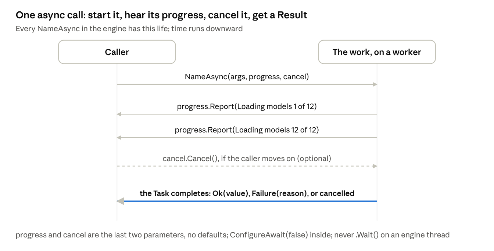

A loading screen is only this picture drawn for every call at once, which is why they all report the same `LoadProgress`.

- The suffix is `Async` on everything that returns a `Task` or `ValueTask`, and on nothing else.
- Progress is a `LoadProgress`, a piece of work's name and its done-of-total, such as `Loading models 5 of 12`; this repository just added it ([`LoadProgress.cs`](https://github.com/Konfus-org/Slop-Magic/blob/dev/src/Core/Contexts/ECS/LoadProgress.cs)). Report it from any thread, never less than last time for the same work. _Nugget._ .NET's `Progress<T>` posts to the synchronization context it was made on, which an engine has none of, so write your own tiny `IProgress<T>` that forwards; see [`GemProgress`](https://github.com/Konfus-org/Slop-Magic/blob/dev/src/Core/Internal/Domains.cs) in the original.
- A failure that content or the machine can cause comes back as `Result<T>` with a reason for the log; a thrown exception is a bug. Cancellation ends the task cancelled, through `OperationCanceledException`, never swallowed into a result.
- `ConfigureAwait(false)` on every await inside the engine. Never `.Wait()` or `.Result` on an engine thread. The frame loop awaits nothing: a `Step` that needs something async starts it and reads the arrival from a later `FrameInput`, or keeps the task in its state record and checks `IsCompleted` next frame.
- Fire and forget only through an extension that logs a fault at the call site, as [`FireAndForget`](https://github.com/Konfus-org/Slop-Magic/blob/dev/src/Core/Extensions/TaskExtensions.cs) does; a timeout is the caller's, through a linked token source; the engine's own ceiling is `App.Quitting`.
- Worked examples in the original: [`World.OpenAsync`](https://github.com/Konfus-org/Slop-Magic/blob/dev/src/Core/Services/World.cs#L157), [`IPreloader`](https://github.com/Konfus-org/Slop-Magic/blob/dev/src/Core/Interfaces/IPreloader.cs), [`Caches.ReadAsync`](https://github.com/Konfus-org/Slop-Magic/blob/dev/src/Core/Services/Caches.cs). [`Assets.LoadAsync`](https://github.com/Konfus-org/Slop-Magic/blob/dev/src/Core/Services/Assets.cs#L238) takes a token but no progress and uses defaults: the rewrite gives it the full shape.

**What the rules buy.** A `Step` is a pure function, so it is unit-testable without an engine, which rewrites step 5. There is no sync point, so the render thread never waits on a gem. A bug in frame n cannot reach frame n + 1 except through a record you can diff. And a loading screen can show every piece of work by name, because every long operation reports the same thing.

## Part 1, step 1: the empty engine

The first checkpoint is `Magic --project Hello --headless --frames 1 --fail-on-error` exiting 0 on a project that lists no gems, and 1 with a clear line when the project is missing or broken. About 1,000 lines.

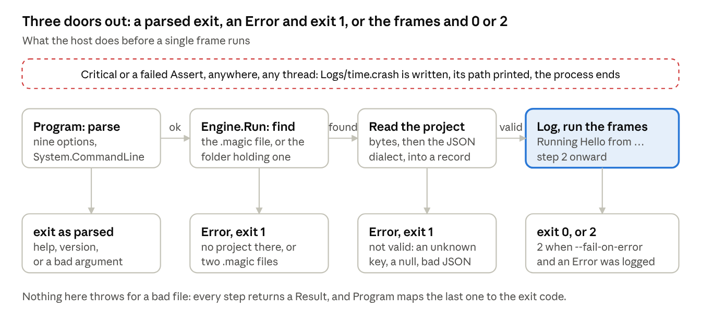

The five checks at the end of this step are the five arrows in this picture.

**What it must do.**

- Parse nine options and answer `--help`, `--version` and a bad argument itself: `--project` (a `.magic` file or the folder holding exactly one), `--frames`, `--seconds` (a ceiling, above 0), `--headless`, `--set Gem.setting=value` repeatable, `--preset name`, `--fail-on-error`, `--bake`, `--verbose`.
- Find and read the project as JSON in one strict dialect: camelCase keys matched exactly, snake\_case enums, comments and trailing commas allowed, an unknown key or a null where none is allowed refused with a reason, a byte order mark skipped.
- Log from any thread without ever waiting on the terminal, with `Verbose`, `Info`, `Warn`, `Error` and `Critical`; count errors for the exit code; on `Critical` or a failed `Assert` write `Logs/<time>.crash` beside the executable with the unprinted lines and the stack, print its path, break an attached debugger and end the process.
- Exit 0 clean, 1 for bad arguments or a project that will not open, 2 when `--fail-on-error` and anything was logged as an error.

**The shape.** `Program` is the imperative shell: it parses, sets `GCLatencyMode.SustainedLowLatency`, routes unhandled exceptions to `Critical`, calls `Engine.Run(Args)` without awaiting anything first so the engine starts on the process's first thread, flushes the log, and maps the result to an exit code. `Engine.Run` is `Result` in, `Result` out: find the file, read the bytes, parse the `Project` record, log `Running <name> from <folder>`. `Json` is static pure functions over `System.Text.Json` with one options object. `IFileSystem` is the only place that touches the disk, and its reads are `ReadAsync(path, progress, cancel)` in the convention from the start, with a synchronous `Read` only for the project file before any thread exists. The log is the one static. _Nugget._ `Result<T>` with `[MemberNotNullWhen(true, nameof(Value))]` lets the compiler prove `Value` is there after `if (!r.Ok) return`, which is why Core never throws for a bad file. _Nugget._ `required` on `Project.Name` plus the dialect's unknown-key refusal means a misspelt `.magic` fails loudly at parse time rather than quietly at run time.

**Reference.** [`Program.cs`](https://github.com/Konfus-org/Slop-Magic/blob/dev/src/Core/Program.cs#L22) for the options and exit codes; [`Engine.Run`](https://github.com/Konfus-org/Slop-Magic/blob/dev/src/Core/Engine.cs#L148) with `FindProject` and `ReadProject` under it; [`Debugging.cs`](https://github.com/Konfus-org/Slop-Magic/blob/dev/src/Core/Services/Debugging.cs) and its [`Crash`](https://github.com/Konfus-org/Slop-Magic/blob/dev/src/Core/Services/Debugging.cs#L280); [`Json.cs`](https://github.com/Konfus-org/Slop-Magic/blob/dev/src/Core/Services/Json.cs) for the dialect's options; [`FileSystem.cs`](https://github.com/Konfus-org/Slop-Magic/blob/dev/src/Core/Internal/FileSystem.cs) for the write-beside-then-move trick; [`Result.cs`](https://github.com/Konfus-org/Slop-Magic/blob/dev/src/Core/Contexts/Utils/Result.cs), [`Args.cs`](https://github.com/Konfus-org/Slop-Magic/blob/dev/src/Core/Contexts/CmdLine/Args.cs), [`Project.cs`](https://github.com/Konfus-org/Slop-Magic/blob/dev/src/Core/Contexts/Assets/Project.cs), [`LogLine.cs`](https://github.com/Konfus-org/Slop-Magic/blob/dev/src/Core/Contexts/Logging/LogLine.cs). Core's packages are `System.CommandLine`, `Microsoft.Extensions.DependencyInjection` and `System.IO.Hashing`, all `PrivateAssets="all"` so no gem inherits them.

**Checkpoint.** Make a folder `Hello` holding `Hello.magic`:

```json
{ "name": "Hello", "gems": [] }
```

```powershell
dotnet run --project src/Core -- --project Hello --headless --frames 1 --fail-on-error; $LASTEXITCODE
```

1. One `Info` line, `Running Hello from <folder>`, and exit code 0.
2. `--project Nowhere` logs `There is no project at Nowhere` as an `Error` and exits 1.
3. A second `.magic` in the folder exits 1 with `must hold exactly one .magic file; it holds 2`.
4. A misspelt key, say `"gemz"`, exits 1 with `is not a valid project`.
5. A `Debugging.Critical("boom")` anywhere writes `Logs/<time>.crash` beside Magic, prints its path and ends the process. Remove it again.

## Part 1, step 2: gems and the frame pipeline

The checkpoint is a `Hello` gem run for ten frames: its constructor on the render thread, ten `Step` calls, ten `Render` calls, a message it publishes on frame n read from frame n + 1's input, `Quitting: ran 10 frames`, and a second gem that throws leaving the loop without ending the run. About 2,000 lines.

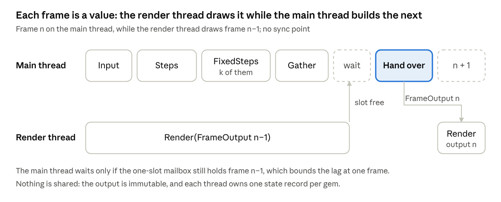

**What it must do.**

- Load each gem the project lists from `Gems/<Name>/<Name>.dll` beside Magic into a load context of its own, with its NuGet and native dependencies, a native library loaded once per name for every gem. Exactly one gem class with one public constructor; `Name@1.2` checked against the assembly's version; a name listed twice, a gem providing what Core or an earlier gem provides, and a gem that fails to construct are each an `Error`, and the rest are made.
- Make gems in dependency order: after every interface the constructor takes, else in listed order; a cycle refused with its two names.
- Run frames on two threads. The render thread is the process's first, the one the OS ties windows to: constructors, `Render` and `Stop` run there. The main thread runs `Step` and `FixedStep`. Fixed steps accumulate world time at `Core.fixedRate`, 60 a second, at most `Core.maxFixedSteps`, 4, per frame, the rest dropped.
- End on `--frames`, `--seconds`, `App.Quit`, or Ctrl+C when headless; hold while `App.IsPaused`, idling about 60 times a second on both threads so the window still answers the OS, with `App.Step` running one frame; `App.Restart` runs the whole thing again in the same process with the clocks and the world carried over.
- Deliver every message published during frame n to every gem in frame n + 1, in publish order, whatever thread published it.
- Run work handed to either thread there, in order, between frames. A gem that throws in a hook is logged and leaves the loop; its `Stop` still runs. Time every hook on the `Magic.Core` meter, only while something listens.

**The shape.** Loading stays imperative, because it happens once: `GemAssembly` reads a dll into a `GemLoadContext`, `GemLoader` registers the class and each provided interface with the service collection, and the provider makes each gem after its constructor parameters, so dependency order falls out of DI. Core wraps each gem in a `GemRunner<TState, TRenderState>` made by reflection from the gem's interface arguments; the runner holds the gem's two records and is the only place they are stored. The loop is a fold: build the `FrameInput` from the drained messages and the clocks, run each runner's `Step` and the fixed steps, gather the outputs into a `FrameOutput`, put it in the render thread's one-slot mailbox, and go on; the main thread waits only when the slot still holds the frame before, which bounds the lag at one frame. The render thread takes the slot and runs each runner's `Render` in reverse, giving each its render record back. `Messages` is a queue per type any thread appends to and Core freezes into the input at the frame's start; `input.Messages.Of<T>()` is a span. `Threads` is two work queues and the mailbox, with `PostAsync(thread, work, progress, cancel)` and `RunAsync(name, work)` for a thread that lives as long as the run. _Nugget._ An `AssemblyLoadContext` per gem is what lets two gems carry different versions of one package, and `Private="false" ExcludeAssets="runtime"` on the reference to Core is what makes a gem compile against Magic without carrying a copy of it. _Nugget._ Finding which hooks a gem implements through `GetInterfaceMap` once at load, so a default method is never called or timed, is a trick worth keeping.

**Reference.** [`IGem.cs`](https://github.com/Konfus-org/Slop-Magic/blob/dev/src/Core/Interfaces/IGem.cs) for the original contract and the doc comment that explains the two threads; [`Engine.RunFrames`](https://github.com/Konfus-org/Slop-Magic/blob/dev/src/Core/Engine.cs#L487), [`RunFixedSteps`](https://github.com/Konfus-org/Slop-Magic/blob/dev/src/Core/Engine.cs#L653), [`HoldFrames`](https://github.com/Konfus-org/Slop-Magic/blob/dev/src/Core/Engine.cs#L603) and [`RunHook`](https://github.com/Konfus-org/Slop-Magic/blob/dev/src/Core/Engine.cs#L728) for the loop, the accumulator, the pause and the throw handling; [`CreateCoreServices`](https://github.com/Konfus-org/Slop-Magic/blob/dev/src/Core/Engine.cs#L306) for what a gem may ask for; [`GemAssembly.cs`](https://github.com/Konfus-org/Slop-Magic/blob/dev/src/Core/Internal/GemAssembly.cs), [`GemLoadContext.cs`](https://github.com/Konfus-org/Slop-Magic/blob/dev/src/Core/Internal/GemLoadContext.cs) and [`GemLoader.CreateGem`](https://github.com/Konfus-org/Slop-Magic/blob/dev/src/Core/Internal/GemLoader.cs#L213) for loading; [`Threads.PostAsync`](https://github.com/Konfus-org/Slop-Magic/blob/dev/src/Core/Services/Threads.cs#L85) and [`Events.Deliver`](https://github.com/Konfus-org/Slop-Magic/blob/dev/src/Core/Services/Events.cs#L63) for the queues; [`Frame.cs`](https://github.com/Konfus-org/Slop-Magic/blob/dev/src/Core/Contexts/Frames/Frame.cs), [`Metrics.cs`](https://github.com/Konfus-org/Slop-Magic/blob/dev/src/Core/Contexts/Telemetry/Metrics.cs) and the gems' [`Directory.Build.props`](https://github.com/Konfus-org/Slop-Magic/blob/dev/src/Bundled/Gems/Directory.Build.props).

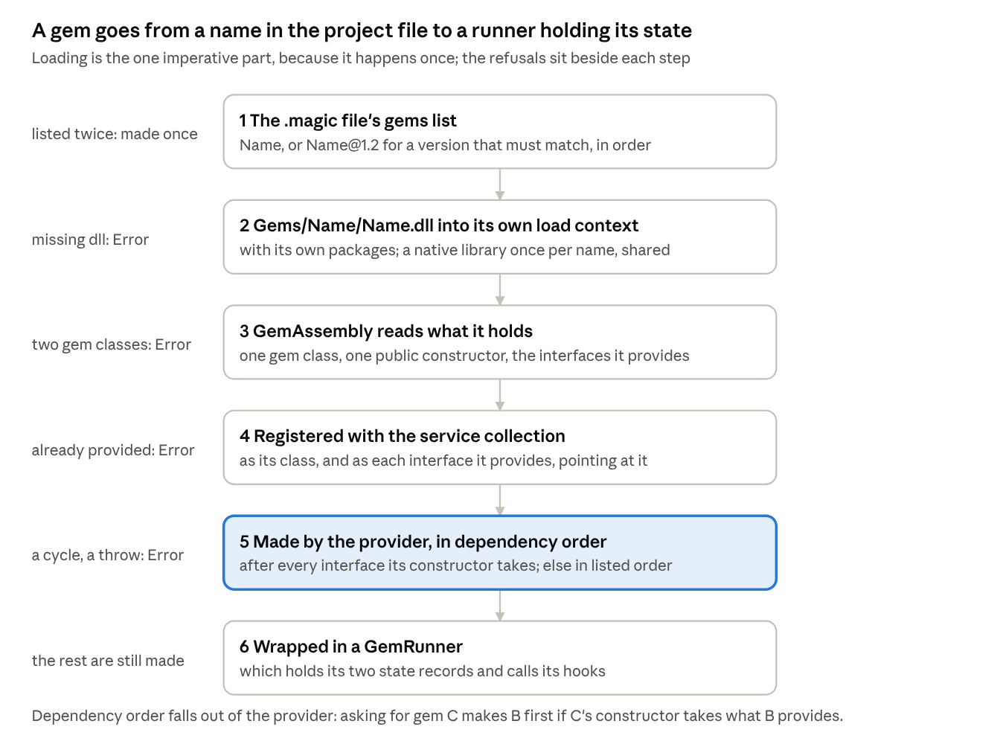

Checks 4 and 5 below walk the refusals on the left.

**Checkpoint.** Make `src/Bundled/Gems/Hello/` with `HelloGem : IGem<HelloState, Nothing>`, where `HelloState` is a record of three counts and `Step` returns `state with { Steps = state.Steps + 1 }`; `Stop` logs the counts. Add it to the solution, list `"Hello"` in `Hello.magic`, and run with `--frames 10`.

1. `Gem Hello 1.0.0 by <you> started`, the constructor on the thread named `Render`, `Stop` reporting 10 steps and 10 renders, `Quitting: ran 10 frames`, exit 0.
2. `--seconds 1` instead: about 60 fixed steps however many frames ran.
3. Publish a `Ping(frame.Index)` from `Step`; on the next frame `input.Messages.Of<Ping>()` holds exactly one, with the previous index.
4. A `Boom` gem that throws in `Step` on frame 3, taking `HelloGem` in its constructor: one `Error` naming it, `Hello` still reaches 10, `Hello` made first and stopped last, exit 2 under `--fail-on-error`.
5. A listed gem that does not exist: `Gem Nope was not found`, and the run goes on. A gem listed twice: made once.
6. Without `--frames`, Ctrl+C: `Quitting: Ctrl+C`, then each gem's `Stop` in reverse. `dotnet-counters monitor --counters Magic.Core` meanwhile shows the frame and hook durations.

## Part 1, step 3: files, settings and assets

The checkpoint is `Hello` reading its settings record from the frame's input, layered from a preset, `--set` and a live change, and reading a `.domain` file's value from the asset snapshot the frame after it was asked for, with a new version the moment you save the file. About 2,000 lines, half of them pure functions you can unit test.

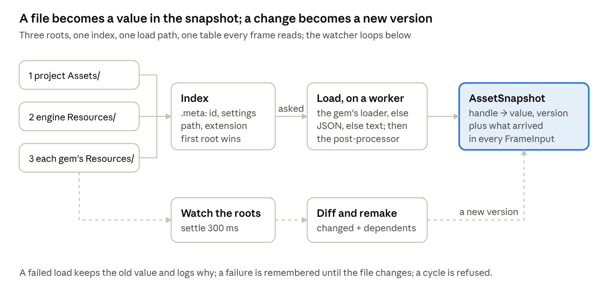

The solid path is step 3's pure functions in order; the dashed loop is the one shell that runs them.

**What it must do.**

- An asset is a file under a root with a `.meta` sidecar beside it holding `id`, a 64-bit number above 0, and the loader's import settings. A `Handle<T>` is only the id. Paths are relative to their root with `/`. A type's files end in one of its `Extensions`. Roots in order: the project's `Assets/`, the engine's `Resources/`, each gem's `Resources/`; the first wins a shared path. A type's default is `<Type>s/Default.<ext>` and a failure stand-in `<Type>s/Failures/<Kind>.<ext>`, engine root only.
- Index every root before any gem is made, then watch them; after 300 ms of quiet re-index, remake every loaded asset whose file or sidecar changed and every asset made from one of those, dependencies first, and announce it. A failed load keeps the old value and logs why.
- Read a file through the `IAssetLoader<T>` a gem provides, else as JSON or text, then through the `ILoadPostProcessor<T>` if one is provided; record what an asset loaded while being made as its dependencies; refuse a cycle; give every caller the same object; remember a failure until the file changes; version an asset as a hash of file and sidecar.
- Settings come in layers, each winning over the one before: class initialisers, `Presets/Default.preset`, `--preset`, each `--set`, then live changes until another preset is applied. A key is `Gem.path`. A gem's settings are made when the gem is, from its section of the layers, through the JSON dialect, so a misspelt key is a loud failure. Every setting is listable for a UI with its doc comment; a live change reaches the gem the next frame; one marked `[RequireRestart]` restarts the run with every setting as it is.
- Cache results slow to make on disk by type, key and the version they were made from; a project's own `Cache/` is read first and never written.

**The shape.** Two snapshots and two shells. `AssetSnapshot` is an immutable table, handle to loaded value and version, plus the index, rebuilt by Core between frames from what workers delivered; `input.Assets.Get(handle)` is the value or null, and `input.Assets.Arrived` lists what came or changed this frame with its new version, so a gem compares versions in its state record instead of watching an event. `Assets.LoadAsync(handle, progress, cancel)` starts a load and also returns the task, for code off the main thread. The shell is one worker loop: read sidecars, build the index, load what was asked for, watch, settle, diff, remake, deliver. The pure parts are the index from a list of sidecar reads, the path and extension rules, the dependency closure, the version hash and the diff of two indexes; each is a static function over values with a test. `SettingsSnapshot` is the merged layers as of this frame, `input.Settings.Of<HelloSettings>()` a typed record read from it; `Settings.TrySet(key, value)` and `ApplyPresetAsync(preset, progress, cancel)` produce the next snapshot, and Core restarts when a changed key is marked. Settings classes become records. `Caches` stays as it is in the original, which is already a pair of pure functions over a file. _Nugget._ A loaded asset stays in the snapshot until the world empties and no open domain names it, which is the one unload policy; the original's weak references let the garbage collector decide, which is simpler to write and harder to reason about. _Nugget._ XxHash3 over file plus sidecar as the version means a reimport with other settings is a different asset to every cache downstream.

**Reference.** [`Assets.LoadAsync`](https://github.com/Konfus-org/Slop-Magic/blob/dev/src/Core/Services/Assets.cs#L238), [`IndexAsync`](https://github.com/Konfus-org/Slop-Magic/blob/dev/src/Core/Services/Assets.cs#L370) and [`WatchAsync`](https://github.com/Konfus-org/Slop-Magic/blob/dev/src/Core/Services/Assets.cs#L656) for the behaviours; [`IAsset.cs`](https://github.com/Konfus-org/Slop-Magic/blob/dev/src/Core/Interfaces/IAsset.cs), [`IAssetLoader.cs`](https://github.com/Konfus-org/Slop-Magic/blob/dev/src/Core/Interfaces/IAssetLoader.cs), [`ILoadPostProcessor.cs`](https://github.com/Konfus-org/Slop-Magic/blob/dev/src/Core/Interfaces/ILoadPostProcessor.cs) and [`Handle.cs`](https://github.com/Konfus-org/Slop-Magic/blob/dev/src/Core/Contexts/Assets/Handle.cs) for the contracts; the [Resources README](https://github.com/Konfus-org/Slop-Magic/blob/dev/src/Bundled/Resources/README.md) and a [sidecar](https://github.com/Konfus-org/Slop-Magic/blob/dev/src/Bundled/Resources/Textures/Default.png.meta) for the formats; [`Settings.Create`](https://github.com/Konfus-org/Slop-Magic/blob/dev/src/Core/Services/Settings.cs#L267), [`TrySet`](https://github.com/Konfus-org/Slop-Magic/blob/dev/src/Core/Services/Settings.cs#L185) and [`ApplyChanges`](https://github.com/Konfus-org/Slop-Magic/blob/dev/src/Core/Services/Settings.cs#L307) for the layers and the restart; [`Setting.cs`](https://github.com/Konfus-org/Slop-Magic/blob/dev/src/Core/Contexts/Settings/Setting.cs), [`Preset.cs`](https://github.com/Konfus-org/Slop-Magic/blob/dev/src/Core/Contexts/Assets/Preset.cs), [`DocComments.cs`](https://github.com/Konfus-org/Slop-Magic/blob/dev/src/Core/Internal/DocComments.cs); [`Caches.cs`](https://github.com/Konfus-org/Slop-Magic/blob/dev/src/Core/Services/Caches.cs) and [`ICache.cs`](https://github.com/Konfus-org/Slop-Magic/blob/dev/src/Core/Interfaces/ICache.cs).

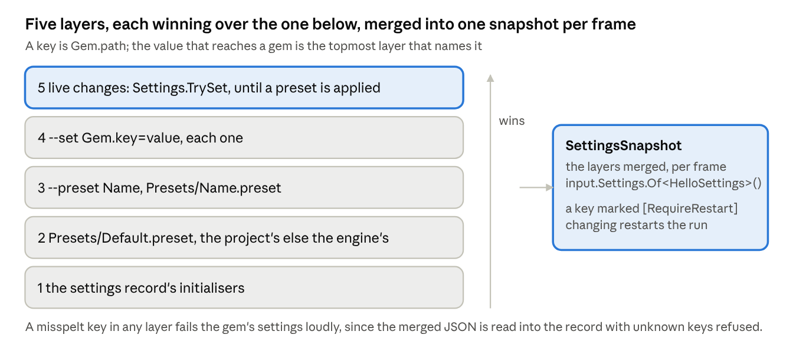

Checks 1 and 2 below walk the stack from the bottom bar to the top one.

**Checkpoint.** Give `Hello` a `HelloSettings` record with `Greeting = "hello"` and `IntervalSec = 1`, doc comments on both, read each frame from `input.Settings.Of<HelloSettings>()`. Make the engine's `Resources/Presets/Default.preset` and `Resources/Domains/Default/Default.domain` with its `.meta` as the original has them. In `Hello`, make `Assets/Presets/Default.preset` setting `Hello.greeting` to `"hi from the preset"`, `Assets/Presets/Loud.preset` setting it to `"HI"`, and `Assets/Domains/Main/Main.domain` with a `.meta` of `{ "id": 1 }`; set `firstDomain` to `{ "id": 1 }`.

1. `--frames 3` logs `Indexed N assets under 2 folders`, then `hi from the preset`. `--preset Loud`: `HI`. `--set Hello.greeting=cli`: `cli`. `--set Hello.greting=x`: exit 1 before anything runs. `--set Hello.intervalSec=abc`: `Gem Hello was not made: its settings are not valid`, and the run goes on.
2. A second gem calls `Settings.TrySet("Hello.greeting", "live")` on frame 5: `Hello` sees `live` in frame 6's input. Mark `IntervalSec` `[RequireRestart]`, set it the same way, and see `Restarting: Hello.intervalSec changed` then `Running Hello from` again in the same process with the new value.
3. In `Step`, find `Domains/Main/Main.domain` once, call `LoadAsync` with a progress that logs, and from then read `input.Assets.Get(handle)`: null for a frame or two, then the `Domain` with its `CellSize`. Edit the file and save: within a second `Arrived` lists the handle with a new version and the value changed. Break the JSON: one `Error` with the reason, and the old value stays.
4. `Assets.GetDefault<Domain>()` is 702; delete the engine's `Default.domain` and it is none, with one `Error` however often you ask.

## Part 1, step 4: the world

The checkpoint is a unit test that drives the domain state machine through a whole replace with no ECS, no disk and no threads, plus a run that warns `no gem the project lists provides the ECS` and still pauses, scales time and restarts. Core's world holds entities only through a gem that provides `IEcs`, so the world's run-time checkpoint is Part 2's first two gems. About 2,500 lines, down from 3,800, because the state machine and its I/O come apart.

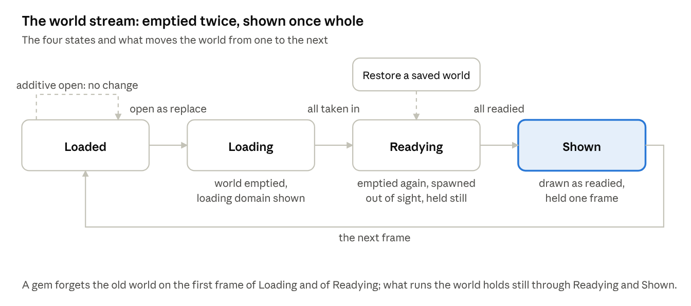

The pure `Domains.Step` is this picture as a function: the state, an input, and the arrow that applies.

**What it must do.**

- A component is an unmanaged struct with public fields, named in files by its type name; `Transform` in metres, +Y up, left-handed; `Tags` holds 8 tags, `Scripts` 8 script handles; `Entity` is `(Id, EcsWorld, Version)` laid out as the ECS gem's own, its id as JSON.
- The world is entities, components, queries and systems over the `IEcs` a gem provides, plus domains. Spawning a `Prefab`, a tree of parts, makes one entity per part with transforms placed under their parents and attaches scripts; a script is a `.cs` asset whose class takes its entity first, has its public settable properties as values, starts once they are set, and runs its `IBehavior` hooks until the entity dies.
- A domain is a folder with a `.domain` file and the prefabs it spawns: `x_y_z.prefab` cells at their corners times `CellSize`, any other at the origin. Opening one in place of the world closes the others, empties the world but its globals, shows the loading domain, reads the folder on a worker, loads the models the prefabs draw, has every preloader take it in, empties the world again and spawns it out of sight with the player at the entity tagged `spawn`, has every preloader ready it, and shows it whole in one frame. Opening one beside the others skips the loading domain and the player. Closing destroys what a domain spawned. A prefab saved while its domain is open respawns in place; one added or removed spawns or goes.
- The opening is told in four steps, reading prefabs, loading models, taking in, readying, each piece of work as `LoadProgress` to whoever opened it and on the messages as `DomainOpening`, and logged with the time into its step when done.
- The stream state is `Loaded`, `Loading`, `Readying`, `Shown`, then `Loaded`, the world emptied as `Loading` and `Readying` begin and held still from `Readying` through `Shown`. The world can be paused, its time standing still with only `[Unpausable]` things running, and scaled. It saves as data, domains, entities, components, scripts, pause and scale, and restores from it with no loading domain, readied out of sight; a restart carries it across.

**The shape.** The ECS's columns are the first of the four places state lives, and `World` is a thin facade over them; systems are functions `Run(in FrameInput, query)` with writes only through the query's spans. Domains are the functional core with an imperative shell: a `DomainsState` record, the open domains with their stage, placements and entity ids, the loading domain kept, the stream state, and one pure function `Step(DomainsState, DomainInputs)` returning the next state and an `ImmutableArray<DomainAction>`. Inputs are what arrived since last frame: an open or close asked for, a `DomainRead`, a `PrefabRead`, a `DomainTakenIn`, a `WorldReadied`, a file change. Actions are what the shell runs: `ReadDomainAsync`, `PreloadAsync` on every preloader, `Spawn` against the ECS on the main thread, `ReadyAsync`, `Show`, `Destroy`, `Report`. Each async action gets a progress that forwards into the next frame's inputs and the token of the domain it belongs to, and its result comes back as an input. `WorldState` is already data in the original and stays so. Scripts are the one place game code keeps fields of its own, since each entity owns its copy; everything engine-side around them is a value. _Nugget._ The original's `Pump` is this shell already, draining one channel of hand-off records at the start of each frame; what the rewrite changes is that the decisions move into a function you can call in a test with a list of inputs, and the 1,600 lines split into about 400 of state machine and 500 of shell. _Nugget._ Create every saved entity empty before giving any its components, so an `Entity` inside a component or a script resolves whichever comes first; the original's `Restore` does this and it is easy to forget.

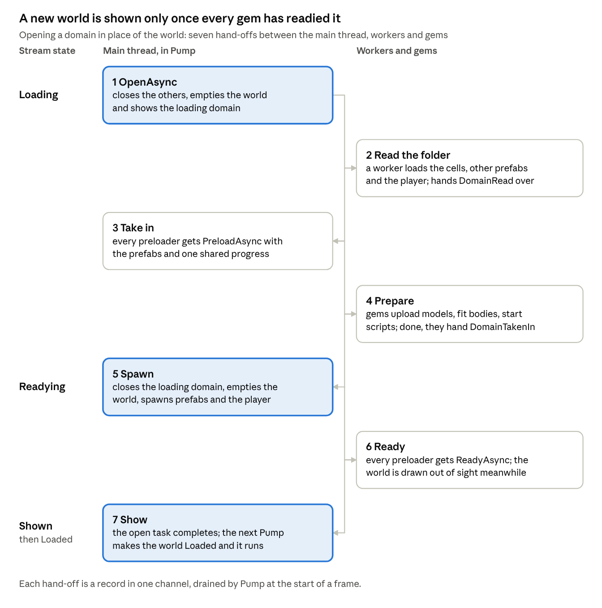

**Reference.** [`World.OpenAsync`](https://github.com/Konfus-org/Slop-Magic/blob/dev/src/Core/Services/World.cs#L157), [`SaveAsync`](https://github.com/Konfus-org/Slop-Magic/blob/dev/src/Core/Services/World.cs#L183), [`Restore`](https://github.com/Konfus-org/Slop-Magic/blob/dev/src/Core/Services/World.cs#L229) and [`CreateGlobal`](https://github.com/Konfus-org/Slop-Magic/blob/dev/src/Core/Services/World.cs#L309); in [`Domains.cs`](https://github.com/Konfus-org/Slop-Magic/blob/dev/src/Core/Internal/Domains.cs) the shell is [`Pump`](https://github.com/Konfus-org/Slop-Magic/blob/dev/src/Core/Internal/Domains.cs#L247) and [`TakeInHandOffs`](https://github.com/Konfus-org/Slop-Magic/blob/dev/src/Core/Internal/Domains.cs#L677), the worker is [`ReadAndHandOffDomainAsync`](https://github.com/Konfus-org/Slop-Magic/blob/dev/src/Core/Internal/Domains.cs#L578), and the decisions are [`SpawnDomain`](https://github.com/Konfus-org/Slop-Magic/blob/dev/src/Core/Internal/Domains.cs#L910), [`ReadyWorld`](https://github.com/Konfus-org/Slop-Magic/blob/dev/src/Core/Internal/Domains.cs#L760) and [`EmptyWorld`](https://github.com/Konfus-org/Slop-Magic/blob/dev/src/Core/Internal/Domains.cs#L555); the contracts [`IEcs.cs`](https://github.com/Konfus-org/Slop-Magic/blob/dev/src/Core/Interfaces/IEcs.cs), [`IScripts.cs`](https://github.com/Konfus-org/Slop-Magic/blob/dev/src/Core/Interfaces/IScripts.cs), [`IPreloader.cs`](https://github.com/Konfus-org/Slop-Magic/blob/dev/src/Core/Interfaces/IPreloader.cs), [`ISystem.cs`](https://github.com/Konfus-org/Slop-Magic/blob/dev/src/Core/Interfaces/ISystem.cs), [`IScript.cs`](https://github.com/Konfus-org/Slop-Magic/blob/dev/src/Core/Interfaces/IScript.cs) and [`IBehavior.cs`](https://github.com/Konfus-org/Slop-Magic/blob/dev/src/Core/Interfaces/IBehavior.cs); the data [`Prefab.cs`](https://github.com/Konfus-org/Slop-Magic/blob/dev/src/Core/Contexts/Assets/Prefab.cs), [`WorldStream.cs`](https://github.com/Konfus-org/Slop-Magic/blob/dev/src/Core/Contexts/ECS/WorldStream.cs), [`StreamState.cs`](https://github.com/Konfus-org/Slop-Magic/blob/dev/src/Core/Contexts/ECS/StreamState.cs), [`WorldState.cs`](https://github.com/Konfus-org/Slop-Magic/blob/dev/src/Core/Contexts/ECS/WorldState.cs), [`DomainOpening.cs`](https://github.com/Konfus-org/Slop-Magic/blob/dev/src/Core/Contexts/ECS/DomainOpening.cs), [`Tag.cs`](https://github.com/Konfus-org/Slop-Magic/blob/dev/src/Core/Contexts/ECS/Tag.cs), [`Transform.cs`](https://github.com/Konfus-org/Slop-Magic/blob/dev/src/Core/Contexts/Components/Transform.cs) and [`CodeReloader.cs`](https://github.com/Konfus-org/Slop-Magic/blob/dev/src/Core/Internal/CodeReloader.cs); the formats in the [Domains](https://github.com/Konfus-org/Slop-Magic/blob/dev/src/Bundled/Resources/Domains/README.md) and [Prefabs](https://github.com/Konfus-org/Slop-Magic/blob/dev/src/Bundled/Resources/Prefabs/README.md) READMEs.

**Checkpoint.**

1. A unit test on `Domains.Step` alone: from an empty state, feed an open-as-replace and expect `ReadDomainAsync` plus the loading domain shown and state `Loading`; feed a `DomainRead` with two placements and expect `PreloadAsync`; feed `DomainTakenIn` and expect `Spawn` with the cells at their corners and state `Readying`; feed `WorldReadied` and expect `Show` and `Shown`; step once more and expect `Loaded`. Then the same with a close in the middle and expect every pending action cancelled and `Destroy`. No ECS, no disk, no threads.
2. A run of `Hello` logs the `Warn` that no gem provides the ECS, and exits 0.
3. `world.IsPaused = true` on frame 10: from frame 11 `input.Frame.IsPaused`, `WorldDeltaSec` 0, `RealDeltaSec` still moving, no fixed steps; `TimeScale = 2` doubles the world's clock and the fixed steps.
4. `app.IsPaused = true` on frame 20 and `app.Step()` from the third idle: the frame index stands still, one frame runs, idling resumes, `--seconds 2` still ends it.
5. `app.Restart("test")` on frame 30: `Restarting: test`, every gem stopped, `Running Hello from` again in the same process, and `RealSec` carrying on.

## Part 1, step 5: proving Core

Core is proved three ways, each one command: `dotnet test` over its values and its pure functions, a headless run of a `Checks` gem that exits 2 when an engine invariant breaks, and `tools/Scripts/Validate.ps1`, which runs both and later every gem's checkpoint. The functional shape moves most of the proof into the first.

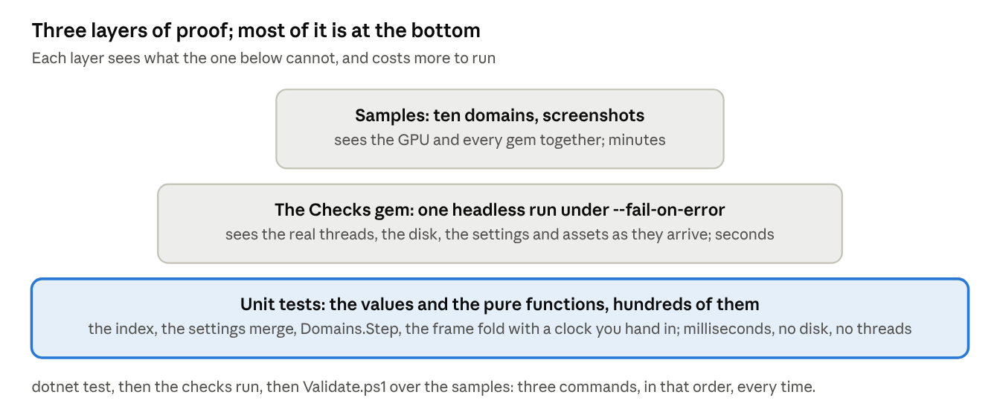

The base is wide because the functional shape put the decisions into functions; the original could only test its values.

**What it must do.** Every test is one class through its public API with no disk, network, native library, clock or unseeded random; a fake is a small private class in the test file, used only for the edge interfaces such as `IFileSystem`; no fixtures, no shared state; arrange, act and assert once each; one behaviour per test, named as a sentence; `[Theory]` with `[InlineData]` instead of loops; assert behaviour, not wording. The original's [`tests/README.md`](https://github.com/Konfus-org/Slop-Magic/blob/dev/tests/README.md) is that rule set in full, and its [`tests/Directory.Build.props`](https://github.com/Konfus-org/Slop-Magic/blob/dev/tests/Directory.Build.props) and [`Core.Tests.csproj`](https://github.com/Konfus-org/Slop-Magic/blob/dev/tests/Core.Tests/Core.Tests.csproj) are the project to copy: xunit.v3 on the Microsoft.Testing.Platform runner that `global.json` names, results under `Build/TestOutput/`.

**The unit tests.** Two kinds. First the values, ported from the original and made to fail against a stub before they pass: [`ResultTests`](https://github.com/Konfus-org/Slop-Magic/blob/dev/tests/Core.Tests/Contexts/Utils/ResultTests.cs), [`JsonTests`](https://github.com/Konfus-org/Slop-Magic/blob/dev/tests/Core.Tests/Services/JsonTests.cs), [`AppTests`](https://github.com/Konfus-org/Slop-Magic/blob/dev/tests/Core.Tests/Services/AppTests.cs), [`TagTests`](https://github.com/Konfus-org/Slop-Magic/blob/dev/tests/Core.Tests/Contexts/ECS/TagTests.cs), [`TagsTests`](https://github.com/Konfus-org/Slop-Magic/blob/dev/tests/Core.Tests/Contexts/Components/TagsTests.cs), [`ScriptsTests`](https://github.com/Konfus-org/Slop-Magic/blob/dev/tests/Core.Tests/Contexts/Components/ScriptsTests.cs), [`TransformTests`](https://github.com/Konfus-org/Slop-Magic/blob/dev/tests/Core.Tests/Contexts/Components/TransformTests.cs), [`PrefabTests`](https://github.com/Konfus-org/Slop-Magic/blob/dev/tests/Core.Tests/Contexts/Assets/PrefabTests.cs) and the subscription tests: 68 of the original's 114, the rest testing contracts Part 2 brings. Second the pure functions the functional shape created, which the original could not test at all: the asset index from a list of sidecars, the diff of two indexes, the dependency closure, the settings merge of five layers and the typed read, `Domains.Step` through a whole replace and a cancelled one, and the frame fold itself over two fake gems with a clock you hand in, checking the fixed-step count, the one-frame lag of `Render`, message delivery order and that a gem throwing leaves the loop with its last state kept. _Nugget._ Inject time as data: a loop that takes `Func<double> now` is testable at any speed, and the original's loop, which reads `Stopwatch` inside, is not.

```powershell
dotnet test Magic.slnx
```

**The checks gem.** What the unit tests cannot reach is the real threads and the real disk, so `tests/CoreChecks/` holds a project listing one gem, `Checks`, that lives only in your repository. Each failed check is a `Debugging.Error` with expected and seen, so `--fail-on-error` makes it exit 2. It checks the thread names a constructor, `Step` and `Render` run on; that `PostAsync` to the render thread runs there and its task ends, cancelled when cancelled first; that a message published from `Render` is in the next frame's input; that `TrySet` reaches the next frame's settings snapshot and a restart-marked key restarts; that `LoadAsync` on a real file lands in the snapshot, that saving the file brings a new version within a second, and that a broken file keeps the old value with one `Error`; and that `Verbose` prints only under `--verbose`.

```powershell
dotnet run --project src/Core -- --project tests/CoreChecks --headless --seconds 5 --fail-on-error; $LASTEXITCODE
```

**Keep it as a tool.** Write the first [`tools/Validate.ps1`](https://github.com/Konfus-org/Slop-Magic/blob/dev/tools/Validate.ps1) now: build, test, the checks run, stopping at the first failure and printing `PASSED` or `FAILED`. From here every gem's checkpoint joins it, so the proof of the whole engine stays one command.

## Part 2: the gems, one at a time

Eighteen gems, about 30,000 lines of C# and 7,000 of Slang in the original, in three stages: a headless world you can script, a window with a lit frame in it, then everything else. The order is the one the constructors force, dependency first, smallest first where there is a choice. Each entry says what the gem must do, how the functional shape changes it, where the original is, and the checkpoint; every checkpoint joins `tools/Scripts/Validate.ps1`.

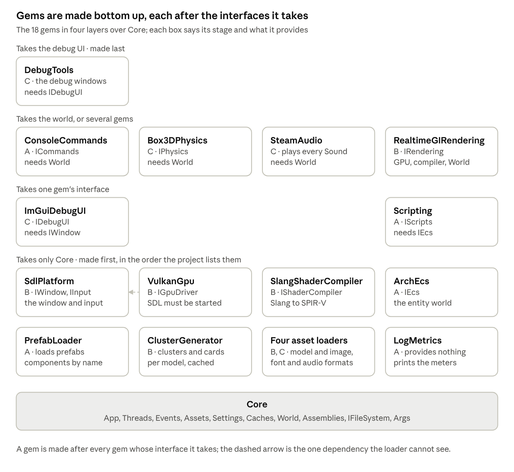

Two rules from the loader decide the order. A gem is made after every interface its constructor takes, and `World` is made from `IEcs` and `IScripts`, so anything taking `World` comes after those two gems. Loaders, post-processors and caches are looked up only when an asset loads, so they are run-time dependencies and a gem can be listed without them. One hidden dependency breaks the pattern: the Vulkan gem's constructor throws unless SDL is already started, so the platform gem must be listed before it. In the functional shape a gem's `Step` reads other gems only through the frame's input and the interfaces it took; a gem that needs another's per-frame result finds it in `FrameOutput` on the render thread, or in next frame's messages.

### Stage A: a headless world

| Gem                                                                                                                                     | Provides                                         | Takes                                                                  | Original             | Native or NuGet      |
| --------------------------------------------------------------------------------------------------------------------------------------- | ------------------------------------------------ | ---------------------------------------------------------------------- | -------------------- | -------------------- |
| [`ArchEcs`](https://github.com/Konfus-org/Slop-Magic/tree/dev/src/Bundled/Gems/ArchEcs)                 | `IEcs`                                           | `Threads`                                                              | 733 lines, 1 file    | Arch 2.1.0           |
| [`PrefabLoader`](https://github.com/Konfus-org/Slop-Magic/tree/dev/src/Bundled/Gems/PrefabLoader)       | `IAssetLoader<Prefab>`                           | `Assets`, `Assemblies`                                                 | 302 lines, 2 files   | none                 |
| [`Scripting`](https://github.com/Konfus-org/Slop-Magic/tree/dev/src/Bundled/Gems/Scripting)             | `IScripts`, `IAssetLoader<Script>`, `IPreloader` | settings, `IEcs`, `Assets`, `Assemblies`, `Events`, `IServiceProvider` | 1,204 lines, 3 files | none                 |
| [`ConsoleCommands`](https://github.com/Konfus-org/Slop-Magic/tree/dev/src/Bundled/Gems/ConsoleCommands) | `ICommands`                                      | `App`, `IFileSystem`, `World`, `Assets`, `IRendering?`                 | 548 lines, 2 files   | System.IO.Hashing    |
| [`LogMetrics`](https://github.com/Konfus-org/Slop-Magic/tree/dev/src/Bundled/Gems/LogMetrics)           | nothing                                          | settings, `Events`                                                     | 576 lines, 2 files   | OpenTelemetry 1.20.1 |

**ArchEcs.** _What:_ every `IEcs` member over one Arch world on the main thread; systems and parallel systems run in their phase in the order registered, skipped while the world is paused unless `[Unpausable]`, a throwing one logged and taken off; a destroyed entity's slot is reused with a new version; a structural change inside a query throws. _Shape:_ the ECS is the first of the four places state lives, so this gem is allowed its mutable store; its own state record holds only the registered systems as an immutable array, and `Step` runs them with the `FrameInput`. _Reference:_ [`ArchEcsGem.cs`](https://github.com/Konfus-org/Slop-Magic/blob/dev/src/Bundled/Gems/ArchEcs/ArchEcsGem.cs), [`IEcs.cs`](https://github.com/Konfus-org/Slop-Magic/blob/dev/src/Core/Interfaces/IEcs.cs). _Checkpoint:_ `Hello` creates 1,000 entities with a `Transform` in one typed batch, a system moves them, a parallel system counts them, a query's span shows the result, a destroyed one reads dead with its slot reused, and `Set` of a new component type inside a query throws. Listing it clears step 4's warning.

**PrefabLoader.** _Core first:_ `Camera`, `Sky`, `RenderTexture` and `Material` as plain data, since the engine's loading domain spawns a camera and a sky. _What:_ read the `.prefab` shape, entities each with `name`, `tags`, `components` keyed by type name, `scripts` as a script id plus property values, `children` and an optional `prefab` placed under it; a component's type from `Assemblies.TryGet<IComponent>(name)` and its fields from the dialect; scripts and nested prefabs loaded through `Assets` so they are dependencies and a change remakes the prefab; a prefab that places itself refused by the cycle check. _Shape:_ a pure function from the file's record to a `Prefab` given a resolver, wrapped in `LoadAsync(path, bytes, settings, progress, cancel)`. _Reference:_ [`PrefabLoaderGem.cs`](https://github.com/Konfus-org/Slop-Magic/blob/dev/src/Bundled/Gems/PrefabLoader/PrefabLoaderGem.cs), [`PrefabFile.cs`](https://github.com/Konfus-org/Slop-Magic/blob/dev/src/Bundled/Gems/PrefabLoader/PrefabFile.cs), the [Prefabs README](https://github.com/Konfus-org/Slop-Magic/blob/dev/src/Bundled/Resources/Prefabs/README.md). _Checkpoint:_ `Hello`'s `Main` domain gets `globals.prefab` with a `spawn`-tagged entity and `0_0_0.prefab` and `1_0_0.prefab` cells; the log says `Opened Domains/Main/Main.domain: N entities in 3 prefabs`, the second cell sits at x = 64, the stream runs `Loading`, `Readying`, `Shown`, `Loaded` on four frames, each step's `DomainOpening` message arrives with its `LoadProgress`, and a player prefab lands at the spawn; an additive open and close from `Hello` adds and removes entities; a saved prefab respawns in place.

**Scripting.** _Build kit first:_ copy [`src/Core/Sdk/`](https://github.com/Konfus-org/Slop-Magic/tree/dev/src/Core/Sdk), make [`Resources.csproj`](https://github.com/Konfus-org/Slop-Magic/blob/dev/src/Bundled/Resources/Resources.csproj) and a `Hello.csproj` importing `Project.props`. _What:_ a `.cs` asset is a `Script` whose class is found by name in the code loaded; each entity gets its own copy, constructor filled from the provider with the entity first, values set, `Start` called, `IBehavior` hooks run each frame near the player and less often beyond `FullRateDistance` up to every `MaxIntervalFrames`; system scripts register on `IEcs`; scripts save and restore their values; a rebuilt assembly remakes them. _Shape:_ scripts keep their own fields, the one exception to the state rules; the gem's record maps entities to their script copies in an immutable dictionary, and a new `Script` version in `input.Assets.Arrived` triggers the remake. _Reference:_ [`ScriptingGem.cs`](https://github.com/Konfus-org/Slop-Magic/blob/dev/src/Bundled/Gems/Scripting/ScriptingGem.cs), the template's [`Spin.cs`](https://github.com/Konfus-org/Slop-Magic/blob/dev/tools/Templates/Project/Assets/Scripts/Spin.cs), [`CodeReloader.cs`](https://github.com/Konfus-org/Slop-Magic/blob/dev/src/Core/Internal/CodeReloader.cs). _Checkpoint:_ `Spin` turns an entity; a saved prefab changes its speed; a rebuilt `Hello.csproj` while running logs `code loaded again` and shows new behaviour; `World.IsPaused` stops it unless `[Unpausable]`; `App.Restart` keeps a counter in a field.

**ConsoleCommands.** _Core first:_ [`ICommands`](https://github.com/Konfus-org/Slop-Magic/blob/dev/src/Core/Interfaces/ICommands.cs). _What:_ lines from the terminal, `help`, `quit`, `wait N` frames or `wait 7.5s` or `wait loaded`, `open <asset path>`, `screenshot`, `pause`, `resume`, `step`, `timescale`; `quit` logs `quit typed in the terminal`, the line Validate looks for. _Shape:_ a reader thread publishes a `LineTyped` message per line; `Step` dispatches the frame's lines over a registry held in its state record, waits included. _Reference:_ [`ConsoleCommandsGem.cs`](https://github.com/Konfus-org/Slop-Magic/blob/dev/src/Bundled/Gems/ConsoleCommands/ConsoleCommandsGem.cs). _Checkpoint:_

```powershell
'wait loaded', 'open Domains/Second/Second.domain', 'quit' | dotnet run --project src/Core -- --project Hello --headless --seconds 60 --fail-on-error; $LASTEXITCODE
```

Exit 0 with that line in the log, and this run becomes Validate's headless step: every domain of the project but the first and the loading one, opened in turn.

**LogMetrics.** _What:_ a `MeterListener` over the meters `Meters` names, off unless `IsEnabled`, a line per instrument every `IntervalSec` and the slowest frame at `Stop`. _Reference:_ [`LogMetricsGem.cs`](https://github.com/Konfus-org/Slop-Magic/blob/dev/src/Bundled/Gems/LogMetrics/LogMetricsGem.cs). _Checkpoint:_ `--set LogMetrics.isEnabled=true --set LogMetrics.intervalSec=1` prints the frame histogram once a second with the hook durations by gem and phase.

### Stage B: a window and a lit frame

| Gem                                                                                                                                             | Provides                                                | Takes                                                                                                                                    | Original                                    | Native or NuGet                                  |
| ----------------------------------------------------------------------------------------------------------------------------------------------- | ------------------------------------------------------- | ---------------------------------------------------------------------------------------------------------------------------------------- | ------------------------------------------- | ------------------------------------------------ |
| [`SdlBindings`](https://github.com/Konfus-org/Slop-Magic/tree/dev/src/Bundled/Gems/SdlBindings)                 | nothing, a shared library project                       | nothing                                                                                                                                  | generated code only                         | SDL3 3.4.18, SDL3\_image, SDL3\_ttf, SDL3\_mixer |
| [`SdlPlatform`](https://github.com/Konfus-org/Slop-Magic/tree/dev/src/Bundled/Gems/SdlPlatform)                 | `IWindow`, `IInput`                                     | settings, `Args`, `App`, `Assets`, `Events`                                                                                              | 1,080 lines, 3 files                        | SdlBindings                                      |
| [`SdlTextureLoader`](https://github.com/Konfus-org/Slop-Magic/tree/dev/src/Bundled/Gems/SdlTextureLoader)       | `IAssetLoader<Texture>`                                 | nothing                                                                                                                                  | 195 lines, 2 files                          | SdlBindings                                      |
| [`VulkanGpu`](https://github.com/Konfus-org/Slop-Magic/tree/dev/src/Bundled/Gems/VulkanGpu)                     | `IGpuDriver`                                            | settings, `Threads`                                                                                                                      | 4,838 lines, 12 files                       | Vortice.Vulkan 3.3.0, SdlBindings                |
| [`SlangShaderCompiler`](https://github.com/Konfus-org/Slop-Magic/tree/dev/src/Bundled/Gems/SlangShaderCompiler) | `IShaderCompiler`, `ICache<GpuShader>`                  | `Assets`, `Caches`, settings                                                                                                             | 1,620 lines, 7 files                        | slang 2026.20 prebuilt, bound by hand            |
| [`AssimpModelLoader`](https://github.com/Konfus-org/Slop-Magic/tree/dev/src/Bundled/Gems/AssimpModelLoader)     | `IAssetLoader<Model>`                                   | nothing                                                                                                                                  | 281 lines, 2 files                          | assimp 6.0.5                                     |
| [`RealtimeGIRendering`](https://github.com/Konfus-org/Slop-Magic/tree/dev/src/Bundled/Gems/RealtimeGIRendering) | `IRendering`, `IPreloader`, `ICache<BlockTexture>`      | `IGpuDriver`, `IShaderCompiler`, `Assets`, `Caches`, `World`, `Events`, `Threads`, `App`, settings, `IWindow?`, `IDebugUI?`, `IScripts?` | 8,724 lines, 29 files, 4,170 lines of Slang | bc7enc, System.IO.Hashing                        |
| [`ClusterGenerator`](https://github.com/Konfus-org/Slop-Magic/tree/dev/src/Bundled/Gems/ClusterGenerator)       | `ILoadPostProcessor<Model>`, `ICache<ClustersAndCards>` | `Assets`, `Caches`, settings, `Events`                                                                                                   | 1,419 lines, 4 files                        | meshoptimizer 1.3                                |

**SdlBindings and the native build.** _Core first:_ [`CString`](https://github.com/Konfus-org/Slop-Magic/blob/dev/src/Core/Contexts/Utils/CString.cs), UTF-8 at the C boundary. _What:_ a `NativeLibrary` item in a csproj says where a C library comes from, how CMake builds it and what is bound; the build makes one CMake superbuild of every item into `%LOCALAPPDATA%/Magic/NativeLibs/` once per machine, generates `<lib>.g.cs` from the headers with ClangSharpPInvokeGenerator using the machine's own C headers, and copies the binary under `runtimes/<rid>/native/` beside the gem, where the load context from step 2 finds it. _Shape:_ copy the root [`Directory.Build.targets`](https://github.com/Konfus-org/Slop-Magic/blob/dev/Directory.Build.targets) as it is; it is build plumbing, the one file in this tutorial not worth rewriting, and the [gems README](https://github.com/Konfus-org/Slop-Magic/blob/dev/src/Bundled/Gems/README.md#native-libraries) explains the item's metadata. [`SdlBindings.csproj`](https://github.com/Konfus-org/Slop-Magic/blob/dev/src/Bundled/Gems/SdlBindings/SdlBindings.csproj) has no C# of its own: four items, SDL3 and its image, font and mixer libraries. _Nugget._ The generated API keeps C's names; `using static` the library's class, read and make strings with `CString`, and mark a callback `[UnmanagedCallersOnly(CallConvs = [typeof(CallConvCdecl)])]`. _Checkpoint:_ the first build fetches and builds all four, minutes once per machine; a throwaway gem calling `SDL_GetVersion()` logs 3.4.18.

**SdlPlatform.** _Core first:_ [`IWindow`](https://github.com/Konfus-org/Slop-Magic/blob/dev/src/Core/Interfaces/IWindow.cs), [`IInput`](https://github.com/Konfus-org/Slop-Magic/blob/dev/src/Core/Interfaces/IInput.cs), [`Control`](https://github.com/Konfus-org/Slop-Magic/blob/dev/src/Core/Contexts/Input/Control.cs), `InputDevice` and the `Icon` asset, about 430 lines. _What:_ start SDL in the constructor on the render thread; open the window at `Width` by `Height` with the project's name and icon, or only the gamepad subsystem when headless; pump SDL's events on the render thread, in `Render` and while idling, so the window answers the OS while the app is paused; make them input state and key, text and mouse messages for the main thread; the close button quits. _Shape:_ `Render` publishes the pumped events as messages; `Step` folds them into an `InputState` record kept in the gem's state, and `IInput`'s indexers read that record for the frame. _Reference:_ [`SdlPlatformGem.cs`](https://github.com/Konfus-org/Slop-Magic/blob/dev/src/Bundled/Gems/SdlPlatform/SdlPlatformGem.cs). _Checkpoint:_ a window titled `Hello` opens, closing it ends the run cleanly, `--headless` opens none, `--set SdlPlatform.width=640` resizes it, `Hello` logs the space bar's state from `IInput`, and `App.IsPaused` from a gem leaves the window responsive.

**SdlTextureLoader.** _Core first:_ [`Texture`](https://github.com/Konfus-org/Slop-Magic/blob/dev/src/Core/Contexts/Assets/Texture.cs). _What:_ decode with SDL\_image to RGBA8 with mipmaps as the sidecar's `wrap`, `filter` and `hasMipmaps` say. _Reference:_ [`SdlTextureLoaderGem.cs`](https://github.com/Konfus-org/Slop-Magic/blob/dev/src/Bundled/Gems/SdlTextureLoader/SdlTextureLoaderGem.cs). _Checkpoint:_ the window shows the engine's icon; `Hello` reads `Textures/Default.png` from the snapshot and logs its size and levels.

**VulkanGpu.** _Core first:_ [`IGpuDriver`](https://github.com/Konfus-org/Slop-Magic/blob/dev/src/Core/Interfaces/IGpuDriver.cs) and [`Contexts/Gpu/`](https://github.com/Konfus-org/Slop-Magic/tree/dev/src/Core/Contexts/Gpu), about 1,100 lines of plain data: four handles that are ids into one bindless heap, descriptions, formats, and the command list [`GpuCommands`](https://github.com/Konfus-org/Slop-Magic/blob/dev/src/Core/Contexts/Gpu/GpuCommands.cs), a value a gem records and the driver submits; port the four `Gpu*Tests` with it. _What:_ pick the GPU `Device` names, else the fastest with Vulkan 1.3 or the integrated one when `IsLowPower`; a descriptor heap every shader reads by id; make, upload and read back buffers and textures; build pipelines from SPIR-V; turn the command list into Vulkan commands with the barriers each pass's reads and writes imply, a pass's writes after its reads; a swapchain composed as `Composition` says, `sdr`, `sdr_linear`, `hdr10` or `hdr_linear`, with `HasVsync`; stamp each top-level debug group's GPU time; log a device fault instead of crashing. _Shape:_ everything is `TRenderState` and `Render`: the gem submits the frame's command list last, since `Render` runs in reverse. _Nugget._ Bound every bindless id a shader reads with `min()`, since one driver hoists the fetch above the guard. _Reference:_ [`VulkanGpuGem.cs`](https://github.com/Konfus-org/Slop-Magic/blob/dev/src/Bundled/Gems/VulkanGpu/VulkanGpuGem.cs), [`VulkanRecorder.cs`](https://github.com/Konfus-org/Slop-Magic/blob/dev/src/Bundled/Gems/VulkanGpu/VulkanRecorder.cs), [`VulkanHeap.cs`](https://github.com/Konfus-org/Slop-Magic/blob/dev/src/Bundled/Gems/VulkanGpu/VulkanHeap.cs), [`VulkanWindows.cs`](https://github.com/Konfus-org/Slop-Magic/blob/dev/src/Bundled/Gems/VulkanGpu/VulkanWindows.cs). _Checkpoint:_ a throwaway gem records a render pass clearing the window target to a colour each frame and the window shows it; `--set VulkanGpu.hasVsync=false` frees the frame rate; `--set VulkanGpu.isValidating=true` with the Vulkan SDK logs nothing from the validation layer; headless, `Render` still runs with no window target.

**SlangShaderCompiler.** _Core first:_ [`IShaderCompiler`](https://github.com/Konfus-org/Slop-Magic/blob/dev/src/Core/Interfaces/IShaderCompiler.cs), the text `Shader` asset, [`ShaderEntry`](https://github.com/Konfus-org/Slop-Magic/blob/dev/src/Core/Contexts/Gpu/ShaderEntry.cs) and [`ShaderStruct`](https://github.com/Konfus-org/Slop-Magic/blob/dev/src/Core/Contexts/Gpu/ShaderStruct.cs); then the shared library's first files, [`Shaders/Core/`](https://github.com/Konfus-org/Slop-Magic/tree/dev/src/Bundled/Resources/Shaders/Core) `Heap`, `Pass`, `Compute`, `Math`, where `import Core.Heap` loads `Shaders/Core/Heap.slang` through the assets. _What:_ compile an entry specialised by the types it names to SPIR-V on a worker, as `CompileAsync(entry, format, progress, cancel)`; read from reflection what a pass takes and how a struct is laid out so the `[ShaderStruct]` twin is checked at startup; cache the bytes under a hash of the sources; recompile everything when `HasDebugInfo` changes. _Reference:_ [`SlangShaderCompilerGem.cs`](https://github.com/Konfus-org/Slop-Magic/blob/dev/src/Bundled/Gems/SlangShaderCompiler/SlangShaderCompilerGem.cs), the hand-bound [`Slang.cs`](https://github.com/Konfus-org/Slop-Magic/blob/dev/src/Bundled/Gems/SlangShaderCompiler/Slang.cs), the [Shaders README](https://github.com/Konfus-org/Slop-Magic/blob/dev/src/Bundled/Resources/Shaders/README.md). _Checkpoint:_ a `Shaders/Fill.slang` whose compute entry writes a gradient through the heap, dispatched by the throwaway gem and shown by a fullscreen pass, the first pixels you drew; the second run logs the cache hit; a syntax error logs file and line and writes no entry.

**AssimpModelLoader.** _Core first:_ [`Model`](https://github.com/Konfus-org/Slop-Magic/blob/dev/src/Core/Contexts/Assets/Model.cs), `Vertex`, the [`Renderer`](https://github.com/Konfus-org/Slop-Magic/blob/dev/src/Core/Contexts/Components/Renderer.cs) component, `MaterialParamDictionary` and `Color`. _What:_ assimp built with only the FBX, glTF and OBJ importers, a file read into meshes per material slot, import settings from `ModelMeta`. _Nugget._ An FBX's slots follow the order faces first use them, so export faces in slot order. _Reference:_ [`AssimpModelLoaderGem.cs`](https://github.com/Konfus-org/Slop-Magic/blob/dev/src/Bundled/Gems/AssimpModelLoader/AssimpModelLoaderGem.cs). _Checkpoint:_ `Models/Monkey.fbx` logs its meshes, vertex and index counts and slot names, and its triangles drawn flat make a silhouette.

**RealtimeGIRendering.** The mountain: 13,000 lines plus 3,000 of shared shaders in the original. _Core first,_ about 1,400 lines: [`IRendering`](https://github.com/Konfus-org/Slop-Magic/blob/dev/src/Core/Interfaces/IRendering.cs), [`IRenderPipeline`](https://github.com/Konfus-org/Slop-Magic/blob/dev/src/Core/Interfaces/IRenderPipeline.cs), `IOverlayScript`, the effect interfaces, [`Contexts/Rendering/`](https://github.com/Konfus-org/Slop-Magic/tree/dev/src/Core/Contexts/Rendering), the three light components, `Weather`, `PostProcessing`, `Curve`, `ClusterHierarchy` and `Card`; then the rest of the shared shaders under [`Shaders/`](https://github.com/Konfus-org/Slop-Magic/tree/dev/src/Bundled/Resources/Shaders). _What,_ from its [README](https://github.com/Konfus-org/Slop-Magic/blob/dev/src/Bundled/Gems/RealtimeGIRendering/README.md): draw the world GPU-driven as clusters at the detail each part of the view needs; the frame is a pipeline script, by default [`DefaultPipeline.cs`](https://github.com/Konfus-org/Slop-Magic/blob/dev/src/Bundled/Gems/RealtimeGIRendering/Resources/Scripts/DefaultPipeline.cs), recording the renderer's steps in order; cull by frustum, occlusion and under a pixel, never by size; voxels of distances around the player's camera, every shadow a ray through them; post effects run as one pass where they can; nothing drawn until it can be drawn properly, a domain appearing whole; failures drawn magenta with a banner. _Shape:_ `Step` produces the world copy, cameras, instances and lights, as this frame's `GemOutput`, the original's `LateUpdate` copy without the swap; `Render` reads it from `FrameOutput` and keeps the GPU tables, resident models and voxel bricks in `TRenderState`; the preloader's `PreloadAsync` awaits each model and material arriving and `ReadyAsync` ends the frame the held world draws settled, both reporting `LoadProgress` by name. Build it in eight sub-steps, each drawn and screenshotted:

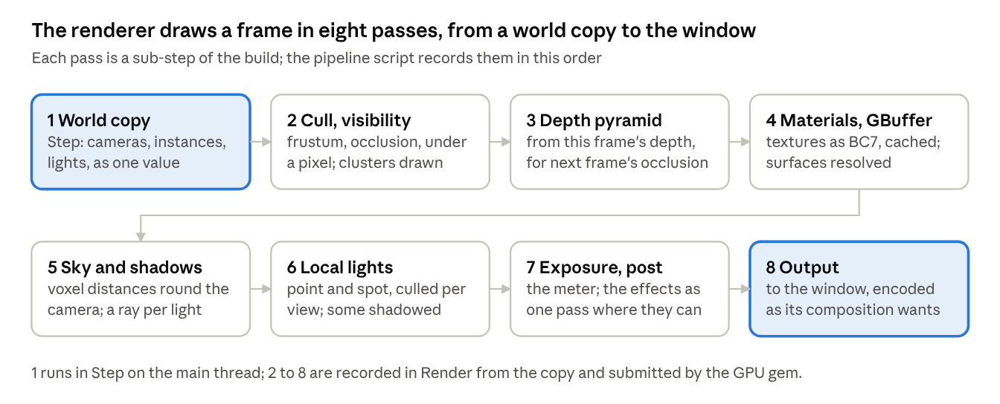

1. [`WorldCopy`](https://github.com/Konfus-org/Slop-Magic/blob/dev/src/Bundled/Gems/RealtimeGIRendering/WorldCopy.cs), [`Views`](https://github.com/Konfus-org/Slop-Magic/blob/dev/src/Bundled/Gems/RealtimeGIRendering/Views.cs), [`Instances`](https://github.com/Konfus-org/Slop-Magic/blob/dev/src/Bundled/Gems/RealtimeGIRendering/Instances.cs): the copy as a value and every instance drawn flat, through the pipeline script made with `IScripts.Create`.
2. [`Culling`](https://github.com/Konfus-org/Slop-Magic/blob/dev/src/Bundled/Gems/RealtimeGIRendering/Resources/Shaders/Renderer/Culling.slang), [`Pieces`](https://github.com/Konfus-org/Slop-Magic/blob/dev/src/Bundled/Gems/RealtimeGIRendering/Resources/Shaders/Renderer/Pieces.slang), [`DepthPyramid`](https://github.com/Konfus-org/Slop-Magic/blob/dev/src/Bundled/Gems/RealtimeGIRendering/Resources/Shaders/Renderer/DepthPyramid.slang): clusters at the detail the view needs, a model without clusters flattened into one, the depth pyramid for next frame's occlusion.
3. [`Materials`](https://github.com/Konfus-org/Slop-Magic/blob/dev/src/Bundled/Gems/RealtimeGIRendering/Resources/Shaders/Renderer/Materials.slang) and the surfaces: [`GpuMaterials`](https://github.com/Konfus-org/Slop-Magic/blob/dev/src/Bundled/Gems/RealtimeGIRendering/GpuMaterials.cs), [`GpuTextures`](https://github.com/Konfus-org/Slop-Magic/blob/dev/src/Bundled/Gems/RealtimeGIRendering/GpuTextures.cs) compressing to BC7 through the cache, [`GpuModels`](https://github.com/Konfus-org/Slop-Magic/blob/dev/src/Bundled/Gems/RealtimeGIRendering/GpuModels.cs) uploading at `ModelUploadRate`, the GBuffer resolve.
4. [`Sky`](https://github.com/Konfus-org/Slop-Magic/blob/dev/src/Bundled/Gems/RealtimeGIRendering/Resources/Shaders/Renderer/Sky.slang), [`Lighting`](https://github.com/Konfus-org/Slop-Magic/blob/dev/src/Bundled/Gems/RealtimeGIRendering/Resources/Shaders/Renderer/Lighting.slang) and [`Voxels`](https://github.com/Konfus-org/Slop-Magic/blob/dev/src/Bundled/Gems/RealtimeGIRendering/Resources/Shaders/Renderer/Voxels.slang): the procedural sky, the directional light, `VoxelLevels` of `VoxelSize` holding distances, shadows in `ShadowSteps` steps.
5. [`Lights`](https://github.com/Konfus-org/Slop-Magic/blob/dev/src/Bundled/Gems/RealtimeGIRendering/Resources/Shaders/Renderer/Lights.slang) and [`LocalLights`](https://github.com/Konfus-org/Slop-Magic/blob/dev/src/Bundled/Gems/RealtimeGIRendering/LocalLights.cs): point and spot lights up to `LightCapacity`, `ShadowedLights` of them shadowed, and [`Occlusion`](https://github.com/Konfus-org/Slop-Magic/blob/dev/src/Bundled/Gems/RealtimeGIRendering/Resources/Shaders/Renderer/Occlusion.slang).
6. [`Exposure`](https://github.com/Konfus-org/Slop-Magic/blob/dev/src/Bundled/Gems/RealtimeGIRendering/Resources/Shaders/Renderer/Exposure.slang), [`PostPasses`](https://github.com/Konfus-org/Slop-Magic/blob/dev/src/Bundled/Gems/RealtimeGIRendering/PostPasses.cs) and [`Output`](https://github.com/Konfus-org/Slop-Magic/blob/dev/src/Bundled/Gems/RealtimeGIRendering/Output.cs): the meter, the effects as one pass where they can, the image in the window as its composition wants.
7. [`Preloader`](https://github.com/Konfus-org/Slop-Magic/blob/dev/src/Bundled/Gems/RealtimeGIRendering/Preloader.cs): a domain appears whole, and what had to wait fades in.
8. [`FailureHandler`](https://github.com/Konfus-org/Slop-Magic/blob/dev/src/Bundled/Gems/RealtimeGIRendering/FailureHandler.cs), the presets in [`Resources/Presets/`](https://github.com/Konfus-org/Slop-Magic/tree/dev/src/Bundled/Gems/RealtimeGIRendering/Resources/Presets) and the overlay script hook.

_Checkpoint:_ the project template's `Main` domain, a sky, a camera, a sun and a monkey with `Spin`, shows a lit spinning monkey; `screenshot` in the console writes `Screenshots/<time>.png`; `--preset Toaster` lowers the voxel and shadow settings; a domain never shows half there; a broken model draws as a magenta cube; `--bake` fills the cache and the next run compiles no shader.

**ClusterGenerator.** _What:_ each model's cluster hierarchy with meshoptimizer and its far-away cards baked into atlases, cached as `ClustersAndCards`; lock cluster borders when simplifying or the leaves vanish. Port [`ClusterHierarchyTests`](https://github.com/Konfus-org/Slop-Magic/blob/dev/tests/Core.Tests/Contexts/Assets/ClusterHierarchyTests.cs). _Reference:_ [`ClusterBuilder.cs`](https://github.com/Konfus-org/Slop-Magic/blob/dev/src/Bundled/Gems/ClusterGenerator/ClusterBuilder.cs), [`CardBaker.cs`](https://github.com/Konfus-org/Slop-Magic/blob/dev/src/Bundled/Gems/ClusterGenerator/CardBaker.cs). _Checkpoint:_ a large model's first load logs its cluster count and the cache write, the second run reads the cache, and a model walked away from drops to coarser clusters and then a card with nothing popping.

### Stage C: physics, sound and the debug UI

| Gem                                                                                                                                   | Provides                 | Takes                                                                                            | Original                          | Native or NuGet                         |
| ------------------------------------------------------------------------------------------------------------------------------------- | ------------------------ | ------------------------------------------------------------------------------------------------ | --------------------------------- | --------------------------------------- |
| [`Box3DPhysics`](https://github.com/Konfus-org/Slop-Magic/tree/dev/src/Bundled/Gems/Box3DPhysics)     | `IPhysics`, `IPreloader` | `World`, `Assets`, `Threads`, settings                                                           | 1,437 lines, 3 files              | box3d 0.1.0                             |
| [`SdlAudioLoader`](https://github.com/Konfus-org/Slop-Magic/tree/dev/src/Bundled/Gems/SdlAudioLoader) | `IAssetLoader<Audio>`    | nothing                                                                                          | 159 lines, 1 file                 | SdlBindings                             |
| [`SteamAudio`](https://github.com/Konfus-org/Slop-Magic/tree/dev/src/Bundled/Gems/SteamAudio)         | `IPreloader`             | `World`, `Assets`, `Threads`, `Args`, settings                                                   | 3,318 lines, 9 files              | phonon 4.8.1 prebuilt, SdlBindings      |
| [`SdlFontLoader`](https://github.com/Konfus-org/Slop-Magic/tree/dev/src/Bundled/Gems/SdlFontLoader)   | `IAssetLoader<Font>`     | nothing                                                                                          | 260 lines, 2 files                | SdlBindings                             |
| [`ImGuiDebugUI`](https://github.com/Konfus-org/Slop-Magic/tree/dev/src/Bundled/Gems/ImGuiDebugUI)     | `IDebugUI`               | settings, `Assets`, `IWindow`, `App`, `World`, `Events`, `IInput?`                               | 2,089 lines, 11 files, one shader | imgui docking headers, dcimgui bindings |
| [`DebugTools`](https://github.com/Konfus-org/Slop-Magic/tree/dev/src/Bundled/Gems/DebugTools)         | `ILogSink`               | settings, `IDebugUI`, `Settings`, `Assets`, `App`, `Events`, `ICommands?`, `IInput?`, `IWindow?` | 1,449 lines, 7 files              | OpenTelemetry                           |

**Box3DPhysics.** _Core first:_ [`Physics`](https://github.com/Konfus-org/Slop-Magic/blob/dev/src/Core/Contexts/Components/Physics.cs), [`Contacts`](https://github.com/Konfus-org/Slop-Magic/blob/dev/src/Core/Contexts/Components/Contacts.cs), [`IPhysics`](https://github.com/Konfus-org/Slop-Magic/blob/dev/src/Core/Interfaces/IPhysics.cs) and `RayHit`. _What:_ an entity with a `Transform` and a `Physics` is a body sized from its model; step on a `Physics` thread of its own, `Substeps` per fixed step on `Workers` threads, for bodies within `Range` of the player's camera; writing a transform moves a body and a velocity throws it; `Contacts` fills with what a body touched; ray and sphere casts; shaping bodies like their models is the preloader's work; the world's pause holds everything. _Shape:_ the physics thread owns the box3d world; `FixedStep` hands it this step's writes as a value and takes its last results back as a value, so no lock is held across a frame. _Reference:_ [`Box3DPhysicsGem.cs`](https://github.com/Konfus-org/Slop-Magic/blob/dev/src/Bundled/Gems/Box3DPhysics/Box3DPhysicsGem.cs), [`ModelShapes.cs`](https://github.com/Konfus-org/Slop-Magic/blob/dev/src/Bundled/Gems/Box3DPhysics/ModelShapes.cs). _Checkpoint:_ the samples' Physics domain, or your own: a stack settles, dominoes fall, a platform carries a box; `World.IsPaused` holds every body in the air; a ray cast from the camera logs the entity it hits.

**SdlAudioLoader and SteamAudio.** _Core first:_ [`Audio`](https://github.com/Konfus-org/Slop-Magic/blob/dev/src/Core/Contexts/Assets/Audio.cs), [`Sound`](https://github.com/Konfus-org/Slop-Magic/blob/dev/src/Core/Contexts/Components/Sound.cs) and [`Acoustics`](https://github.com/Konfus-org/Slop-Magic/blob/dev/src/Core/Contexts/Components/Acoustics.cs). _What:_ the loader decodes with SDL\_mixer; Steam Audio plays every `Sound` heard from the player's camera, traced through what is solid, the device opened at `SampleRate` with `FrameSize` frames and `Voices` voices, acoustic meshes fitted from the bodies' models and their `Acoustics` materials, a sound set to play everywhere ignoring position; headless it plays nothing; paused, sounds hold except on `unpausable` entities. _Shape:_ the audio thread owns the device and the simulation; `Step` hands it the frame's sounds and listener as a value. _Reference:_ [`SteamAudioGem.cs`](https://github.com/Konfus-org/Slop-Magic/blob/dev/src/Bundled/Gems/SteamAudio/SteamAudioGem.cs), [`Hearing.cs`](https://github.com/Konfus-org/Slop-Magic/blob/dev/src/Bundled/Gems/SteamAudio/Hearing.cs), [`Surroundings.cs`](https://github.com/Konfus-org/Slop-Magic/blob/dev/src/Bundled/Gems/SteamAudio/Surroundings.cs), [`SdlAudioLoaderGem.cs`](https://github.com/Konfus-org/Slop-Magic/blob/dev/src/Bundled/Gems/SdlAudioLoader/SdlAudioLoaderGem.cs). _Checkpoint:_ the Audio domain: a sound muffled behind a wall, an echo in a hall, music the same everywhere, pause music that keeps playing while the world is paused.

**SdlFontLoader and ImGuiDebugUI.** _Core first:_ [`Font`](https://github.com/Konfus-org/Slop-Magic/blob/dev/src/Core/Contexts/Assets/Font.cs), [`IDebugUI`](https://github.com/Konfus-org/Slop-Magic/blob/dev/src/Core/Interfaces/IDebugUI.cs) and `OverlayContext`. _What:_ text at a world or screen position, info, warning and error reports from any thread shown for `ReportSec` seconds and logged, and immediate-mode widgets drawn from a gem's `Step`; the font loader rasterises glyphs into an atlas with SDL\_ttf. _Shape:_ Dear ImGui is one big mutable context, so it is confined: the frame's widget calls happen in `Step`, the rendered draw lists are this frame's `GemOutput` value, and the overlay script [`DebugUi.cs`](https://github.com/Konfus-org/Slop-Magic/blob/dev/src/Bundled/Gems/ImGuiDebugUI/Resources/Scripts/DebugUi.cs) draws them from `FrameOutput` with [`Overlay.slang`](https://github.com/Konfus-org/Slop-Magic/blob/dev/src/Bundled/Gems/ImGuiDebugUI/Resources/Shaders/Overlay/Overlay.slang) when the renderer runs it. _Reference:_ [`ImGuiDebugUIGem.cs`](https://github.com/Konfus-org/Slop-Magic/blob/dev/src/Bundled/Gems/ImGuiDebugUI/ImGuiDebugUIGem.cs), [`SdlFontLoaderGem.cs`](https://github.com/Konfus-org/Slop-Magic/blob/dev/src/Bundled/Gems/SdlFontLoader/SdlFontLoaderGem.cs). _Checkpoint:_ `Hello` calls `Text` at an entity's position and `Info("hello")` from a worker; the label follows the entity, the report shows and lands in the log, and a widget window with a button reacts to the mouse.

**DebugTools.** _What:_ the console on the grave key with the whole run's log, since the first sink gets the lines logged before it, and a line that runs `ICommands`; the telemetry window on F3, a tab per entry of `Tabs` over the `Magic.Core` and `Magic.Gems.<Gem>` meters; the settings window on F4 over the settings snapshot, grouped by `[Category]`, `[Range]` as sliders, `[RequireRestart]` marked; a frame-rate readout; and the opening of a domain shown step by step from the `DomainOpening` messages. _Reference:_ [`DebugToolsGem.cs`](https://github.com/Konfus-org/Slop-Magic/blob/dev/src/Bundled/Gems/DebugTools/DebugToolsGem.cs), [`ConsoleWindow.cs`](https://github.com/Konfus-org/Slop-Magic/blob/dev/src/Bundled/Gems/DebugTools/ConsoleWindow.cs), [`SettingsWindow.cs`](https://github.com/Konfus-org/Slop-Magic/blob/dev/src/Bundled/Gems/DebugTools/SettingsWindow.cs). _Checkpoint:_ the three keys open their windows, `timescale 2` typed in the console runs, dragging `RealtimeGIRendering.renderScale` changes the picture the next frame, and a restart-marked setting restarts the run with the world as it was.

## Part 3: samples, tools and CI

The rewrite is finished when this repository's `samples/` folder, copied over unchanged, passes your `tools/Scripts/Validate.ps1` end to end: every sample domain opens headless and every screenshot looks like the original's.

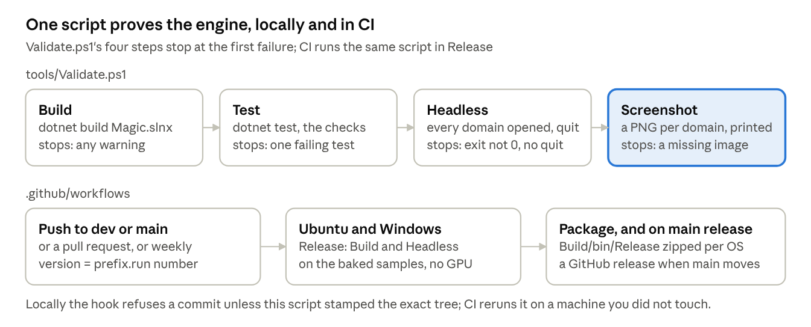

**The samples.** Copy [`samples/`](https://github.com/Konfus-org/Slop-Magic/tree/dev/samples) whole; it is content. [`Samples.magic`](https://github.com/Konfus-org/Slop-Magic/blob/dev/samples/Samples.magic) names the Hub as the first domain, the Loading domain, the player prefab and the 18 gems in order. [`samples/Directory.Build.props`](https://github.com/Konfus-org/Slop-Magic/blob/dev/samples/Directory.Build.props) is the part to write: it references Core and, build-order only, every gem and the engine's resources, so one `dotnet run --project samples` builds what changed and starts Magic on the folder, options after `--` going to Magic. The ten domains are the engine's checkpoints, each with a one-line comment in its `.domain` file saying what it shows: Hub, Annex (additive, beside the hub), Audio, Cabin (a day in three minutes), Lights (thousands of lights), Loading, Physics, Scripting, Terrain (custom shaders) and Valley.

**The tools,** one PowerShell script each, running under Windows PowerShell 5.1 and `pwsh` ([tools README](https://github.com/Konfus-org/Slop-Magic/blob/dev/tools/README.md)):

- [`Format.ps1`](https://github.com/Konfus-org/Slop-Magic/blob/dev/tools/Format.ps1): four `dotnet format` passes over the changed files, order, style, wrap and whitespace, building nothing.
- [`Validate.ps1`](https://github.com/Konfus-org/Slop-Magic/blob/dev/tools/Validate.ps1): build, test, headless, screenshot, stopping at the first failure. The headless step reads the `.magic`, lists every `.domain` under `Assets/` but the first and loading ones, pipes `wait loaded`, one `open` per domain and `quit` into `Magic --headless --fail-on-error --seconds N`, and fails unless the exit code is 0 and the log holds `quit typed in the terminal`.
- [`Screenshot.ps1`](https://github.com/Konfus-org/Slop-Magic/blob/dev/tools/Screenshot.ps1): runs the project with a window, pipes `wait loaded`, `wait 600` frames, any `-Commands`, `screenshot`, then `open`, `wait` and `screenshot` per domain, then `quit`, and prints the PNG paths parsed from the log.
- [`AgentTaskComplete.ps1`](https://github.com/Konfus-org/Slop-Magic/blob/dev/tools/AgentTaskComplete.ps1): formats, runs the validate steps a change level needs, `Docs` builds, `Code` adds tests and headless, `Visual` adds screenshots, and stamps the git tree; its `-Hook` mode refuses `git commit` and `git merge` without a stamp for that tree. _Nugget._ A hook that checks a tree hash rather than a branch or a time means a commit is provable: the exact files were validated, whatever was done since.
- [`InstallTemplates.ps1`](https://github.com/Konfus-org/Slop-Magic/blob/dev/tools/InstallTemplates.ps1) and [`tools/Templates/`](https://github.com/Konfus-org/Slop-Magic/tree/dev/tools/Templates): `dotnet new magic-gem` and `magic-project`, the latter a complete small project with a domain, a prefab and the `Spin` script, and the `MagicDir` environment variable pointing at `Build/bin/<Configuration>/`.

**Building for Magic.** [`Sdk/README.md`](https://github.com/Konfus-org/Slop-Magic/blob/dev/src/Core/Sdk/README.md) says how a gem or project outside the repository builds against a Magic folder. [`Project.targets`](https://github.com/Konfus-org/Slop-Magic/blob/dev/src/Core/Sdk/Project.targets) has one target left to understand: in `Release`, after the build, it runs Magic headless with `--bake` on the built project, every domain opening in turn so everything they use is made and cached, and copies the cache beside the project; `-p:MagicBake=false` skips it, and it needs a GPU.

**CI.** [`build.yml`](https://github.com/Konfus-org/Slop-Magic/blob/dev/.github/workflows/build.yml) runs on Ubuntu and Windows on every push and pull request to `dev` and `main`, and weekly: the shared [setup action](https://github.com/Konfus-org/Slop-Magic/blob/dev/.github/actions/setup/action.yml), the .NET SDK from `global.json`, Ninja, Mesa's lavapipe and the SDL development packages on Linux, the Vulkan SDK on Windows, NuGet and native-library caches; the version as `VersionPrefix` plus the run number; `Validate.ps1 -Configuration Release -Only Build,Headless` against the baked `Build/bin/Release/Projects/Samples`; then the release folder packaged, and published as a GitHub release on a push to `main`. [`test.yml`](https://github.com/Konfus-org/Slop-Magic/blob/dev/.github/workflows/test.yml) runs the build and the tests; `codeql.yml` and `docs.yml`, a link check over every Markdown file, round it out. _Nugget._ Headless on Linux needs `SDL_VIDEO_DRIVER=offscreen` and a software Vulkan device, which is what lavapipe is.

**The last checkpoint.**

```powershell
powershell -NoProfile -ExecutionPolicy Bypass -File tools/Scripts/Validate.ps1
```

`PASSED`, then ten screenshot paths. Open each beside the original's. Then run both engines on the same domain with `--set LogMetrics.isEnabled=true` and compare the frame histograms: the rewrite should be within a few per cent, and anything slower names the pass to look at.
