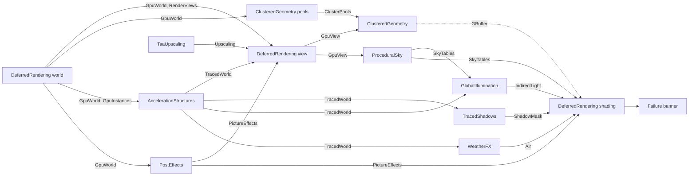

# Rendering

The rendering gems draw the world into the window. The renderer, `DeferredRendering`, keeps the world on the GPU and
lights it. The other gems add parts of the picture: the geometry, the world as rays see it, shadows, indirect light,
the air, the upscaling and the post effects. A project lists the gems that it wants in its `.magic` file.

Each gem has a `Renderer` part with one or more render steps. Core runs a step after the steps that make its inputs.
A step that takes `RenderViews`, or the output of such a step, runs one time for each view of the frame. This diagram
shows what each step makes and which steps take it.

- An input with a nullable type is optional. Without the gem that makes it, the step that takes it runs without it.
- The gems that trace rays need a GPU with ray queries. On a GPU without them, these gems make nothing.
- The settings of the rendering gems are in the `<Gem>Settings` class of each gem. `get Rendering` and `get Debug`
  list them, and `set` changes them, as `set Rendering.ShadowScale 1`.
- The shaders of a gem are the `Shaders/` modules in its `Resources` folder. They import the shader library
  ([Shaders](SHADERS.md)).
- `bake` in the console loads each asset, which makes what each gem makes of each model. Then it opens each domain
  under `Domains/` and exits. A release then ships with full caches.

## DeferredRendering

The renderer. It has four render steps:

1. The world, one time for each frame: it puts the models, materials, textures, render textures, instances and lights
   of the world on the GPU. It makes the `GpuWorld`, the `GpuInstances` and the `RenderViews` of the frame.
2. The view, one time for each view: it makes the targets and the frame buffer of the view, as its `GpuView`.
3. The shading, one time for each view: it lights the GBuffer that a geometry gem drew, with the sun, the sky and the
   lights. Then it runs the `PictureEffects` of the frame and writes the picture into the target of the view.
4. The failure banner: it draws the render failures of the frame over the top of the window.

The gem also holds the types that the rendering gems share. List it in the `.magic` file after the GPU provider, the
ECS, the model importer and the texture importer, with a gem that draws its geometry. The settings are in
`DeferredRenderingSettings`.

### Models and loading

- A model shows when it is on the GPU. A model that nothing drew for `Rendering.ModelKeepSec` leaves the GPU. It
  loads again when a frame draws it.
- When a domain replaces the world, the loading screen stays until all that the new world draws is on the GPU or
  failed. This includes the post effects and the passes of the gem.

### Cameras

- Each camera is a view. A camera draws into its section of the window, or into its render texture at the size of
  the texture. Without a camera for the window, a camera at the origin draws into it.
- A camera for a part of the window draws over the cameras for all of it. Cameras with different sections give a
  split screen.
- A camera for the window draws at `Rendering.FieldOfView` when that is more than 0.
- A material samples a render texture when a texture param names it as `renderTexture`. The cameras for render
  textures draw first, so the window shows the picture of this frame.

### Picture size

- The picture is `Rendering.Resolution` in size. At `0 0`, it is the size of the window, or 1280 by 720 without a
  window.
- The world draws at `Rendering.RenderScale` of that size. At `0`, it draws at the largest size that fits in 1920 by
  1080.
- A gem that upscales takes the picture to its full size. Without one, the renderer stretches it with
  `Rendering.UpscaleFilter`.
- A screenshot is the picture as the window shows it, without what other gems draw over it.

### Lights and the sky

- A pixel with no geometry shows the sky. The material of a sky entity draws the sky.
- A sky gem makes the sky tables. Without a sky entity or a sky gem, there are no sky tables. The shading and the
  indirect light then use `OpenSky`, and the open sky lights the world at `Rendering.SkyBrightness`.
- The directional light is the sun while it is above the horizon. Else it is the moon while the moon is above the
  horizon. Else it is the first directional light.
- Lights use physical units: lux for the sun, candela for point, spot and rect lights. A frame draws the first 1024
  lights.
- Where a gem made a shadow mask, the mask shadows the surfaces. Else nothing is shadowed.
- Where a gem made indirect light, the surfaces take it. Else the sky lights them. A surface with a roughness of 0.6
  or less shows the reflections.
- Where a gem filled the air, the picture shows the air in front of each surface.

### Glass

A translucent material, such as the `Glass` material, draws over the lit picture. The nearest pane in front of each
pixel lets the light behind it through, by its colour. Where a gem builds the world as rays see it, the light also
goes through the panes behind it. The pane reflects the light around it, and the sun lights it.

### Failures

A model that does not load draws as a flashing teal cube of one metre, with "Model failed" and its path. Other
failures flash on the mesh of their entity ([Debugging](DEBUGGING.md)).

- Each failure that a gem or Core gives to `RenderGraph.Fail` in a frame is one line of the banner. The banner shows
  eight lines. The last line counts the rest.
- A failed post effect flashes a blue frame round the window, with its line at the bottom. The other effects run.
- A failed sky flashes coral with "Sky failed". Failed clouds flash a green band with "Weather failed".
- The shader of the banner is `Embedded/FailureBanner.slang` in the assembly of the gem, at
  `Shaders/FailureBanner.slang`. To replace it, put a file at that path in the project.

### Debug views

`Debug.RenderView` shows one part of the GBuffer, or the indirect light, alone. `Final` shows the finished frame. The
names are in `DebugView`. With a gem that gives the debug UI, F2 opens the Rendering window. F5 and F6 step through
the views.

### Change the renderer

- `Renderer` has one `Render` method for each step. Each method is its step, in order from top to bottom.
- `GpuResources` reads a texture, material or model asset when a frame first asks for it.
- `GpuPacker.Pack` in Core writes the row of a shader struct from its reflected fields and an `IGpuParams` source. The
  renderer packs its material rows with it, and the post-effects gem packs its effect rows with it. A gem gets the
  heap ids of a material param's texture from `GpuWorld.Textures`.
- A pass is one `RenderGraph.Compute` or `RenderGraph.Draw` call. The call names what the pass reads and writes.
- A step draws nothing until each shader entry point that it runs is built.
- Each frame, a pass asks the graph for its textures and buffers by name and description. The same name and
  description give the same resource, with what the last frame wrote in it.
- The tables and techniques of the renderer, which the other rendering gems import, are in the folders under its
  `Shaders/`.

## ClusteredGeometry

Draws each model of the view as a hierarchy of clusters, and far away as its impostor. It draws into the depth,
GBuffer and glass targets of the view. List it in the `.magic` file after the renderer. The settings are in
`ClusteredGeometrySettings`.

- When a model loads, the gem makes its clusters of up to 128 triangles and its impostor atlas once for each change
  to its file. It keeps them in the cache.
- The GPU selects the detail of each cluster.
- An instance draws as its impostor when it is small on screen. Near that size, the clusters and the impostor blend,
  so nothing pops.
- When the clusters of a frame are near the limit of the gem, the gem draws more instances as impostors and coarser
  clusters until they fit.
- A translucent cluster draws the nearest pane into the glass targets. A glass instance that draws as its impostor
  draws opaque.
- When a domain loads, the loading screen stays until the models are on the GPU and the resolve pass of each
  material shader is built.

To change it, start at `Renderer`, which has two steps. One step keeps the models clustered on the GPU, one time for
each frame. The other step records the passes of each view, in order. `ClusterResources` keeps the clusters of each
model on the GPU. `ClusterPasses` records the passes: the cull, the draws into the visibility buffer, the depth pyramid
and the resolve of each material.

## AccelerationStructures

Builds the world as rays see it, for the gems that trace rays. List it in the `.magic` file with the renderer.

- It builds the acceleration structure of each model when the model arrives on the GPU.
- It builds the top-level acceleration structure over the instances again in each frame where they changed.
- It makes the average of each material over its texture, for a ray that hits it.

It gives the frame's `TracedWorld` to the gems that take it. Without this gem, nothing traces rays. Then there are no
traced shadows and no indirect light, and glass shows nothing behind it.

## TracedShadows

Shadows each pixel with rays through the world as rays see it. List it in the `.magic` file with the
AccelerationStructures gem. The settings are in `TracedShadowsSettings`. `Rendering.IsTracedShadowsOn` turns it off.

- The sun casts soft shadows, as wide as its disc. The first 15 point, spot and rect lights of each screen tile cast
  shadows as soft as the size of the light. `IsShadowless` does not stop them yet.
- A shadow ray goes through glass and each material with alpha under 1, by its colour. A window lets the sun in.
- The gem traces at `Rendering.ShadowScale` of the picture size. A smaller scale is faster and makes small shadows
  softer.
- The gem traces one ray for each pixel and light, then removes the noise over frames and over the screen. The
  shadows of the tile lights stay grainy at their soft edges.

## GlobalIllumination

Lights the surfaces with the light that bounces: a probe grid, the diffuse light near each surface and the
reflections of smooth surfaces. List it in the `.magic` file with the AccelerationStructures gem. The settings are in
`GlobalIlluminationSettings`. `Rendering.IsIndirectLightOn` turns it off, and `Rendering.IsReflectionsOn` turns off
the reflections.

- A grid of probes covers the world that rays see. The grid follows the world slowly.
- Each frame, rays from each surface find the light that bounces into it. A closed room gets none of the light of the
  sky, and a lit wall tints what is near it.
- A ray reads the material that it hits as the average over its texture, with no specular. A metal reflects black.
- A surface with a roughness of 0.6 or less reflects what its rays find. A mirror is sharp and a rough surface is
  blurred.
- The gem traces at `Rendering.IndirectScale` of the picture size.
- The `IndirectDiffuse` and `Reflections` debug views show what the gem traced.

## WeatherFX

Fills the air between the camera and the surfaces with the haze of the world. The sky, the sun and the local lights
light the haze. On a GPU that traces rays, the light falls in shafts through gaps. The settings are in
`WeatherFXSettings`.

To use it, list `WeatherFX` in the `.magic` file, and give the `Weather` of the world a `FogDensity` or a
`CloudCover` above 0. With the AccelerationStructures gem, the haze has shadows. Without it, the sun lights all of the
haze.

- The `Weather` component sets the haze: its density at a height, how fast it thins above it, its colour and how
  much it scatters towards the sun. A script can change it while the world runs.
- The volume goes to `Rendering.VolumetricsDistance` from the camera. Past it, the haze has no shadows.
- `CloudCover` fills the sky with clouds from `CloudHeight` up for 2 km. The `Wind` moves them. The clouds look
  correct from the ground, not from inside them. Their shadow falls on the ground and in the haze.
- Clear air costs nothing.

## ProceduralSky

Makes the sky of the Earth's air: Rayleigh and Mie scattering and ozone. List it in the `.magic` file after the
renderer. The renderer shades the sky, the sun's colour and the sky's light on the world from its tables.

- One time for each view, it hands on the shader type of the sky, `Atmosphere`, as its `SkyTables`. While an entity
  has a sky, it also makes the three sky tables of the view.
- Its `Sky` material is the material for the `Sky` component.
- Without the gem, the world is lit by the open sky.

## PostEffects

Runs the post-processing chain over the lit picture. List it in the `.magic` file after the renderer. Without it, the
renderer shows the lit picture at a fixed exposure, with a simple tonemap and no other effects.

The effects of the first `PostProcessing` component run in order over the lit picture. Each effect is a material
whose shader implements the pixel effect contract ([Shaders](SHADERS.md)). One time for each frame, the gem makes the
effects of the frame as its `PictureEffects`. The shading of the renderer runs them.

- Without a `PostProcessing`, the picture gets the `Exposure` and `Agx` materials of the gem.
  `Rendering.ExposureCompensation` sets the brightness. `Rendering.DisabledEffects` names effects to leave out. The
  settings are in `PostEffectsSettings`.
- A `PostProcessing` lists each effect that it wants. To use a different tonemap, put its material in the place of
  `Agx`.
- The `Exposure` effect measures the picture each frame and adapts in about one second. Its `compensation` param
  adds stops.
- While an effect that declares jitter runs, the camera moves to a different point in each pixel each frame.
- An effect shows when its material and its passes are built. A domain shows when its effects are built or failed.

## TaaUpscaling

Takes the picture from the render size to the size that the window shows, with temporal anti-aliasing. Without it, the
renderer stretches the picture. List it in the `.magic` file with the renderer.

- While it runs, the camera moves to a different point in each pixel each frame.
- It upscales what the renderer shows, debug views included, with a window or without.
- Use this gem or the `TemporalAntiAliasing` post effect, not both. With both, each frame blends over time two times.
