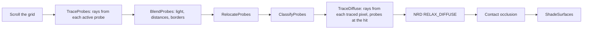

# Plan: global illumination for an open world with interiors

This plan tells an agent how to build Magic's global illumination (GI). The target is a seamless open world with
cottages, castles and dungeons to enter, a day and night cycle, and torches and braziers. The bar is the
[rendering skill](../skills/rendering/SKILL.md): no light leak, stable in motion, and the light quality of UE5 Lumen.
The GPU time is reported for each slice, at each tier.

Each fact has a source. A source in brackets, as [DDGI], is in [Sources](#sources). A fact that no primary source
confirmed is marked **unverified**.

## 1. The answer

Keep Magic's frame layout, and rebuild its probe grid to the published DDGI method. The light that a pixel sees is
traced by rays from that pixel. The probes give light only where a ray stops on a surface. A pixel never reads the
probes, except glass, which traces no diffuse rays. This is "DDGI at the secondary vertex" [DDGIR §3.2], which hides the leaks of the probes from the picture.

| Part | Decision | Why |
| --- | --- | --- |
| Light at a pixel | Keep: rays from each traced pixel, at `IndirectScale`, denoised by NRD RELAX_DIFFUSE | A ray from the pixel sees the wall that the pixel sees, so a probe behind the wall cannot light the pixel. NRD is maintained by NVIDIA. |
| Ray length | Change: one ray to the full range, then the probes at the hit, or the sky on a miss | Today a ray that stops at `IndirectRayRange` takes the probes at the pixel, which is a leak path, and a miss traces a second ray (`TraceDiffuse.slang:121`, `:142`). |
| World cache | Keep the cascaded probe grid. Rebuild its update, sampling and storage to RTXGI DDGI 1.3.7 [DDGI] | It updates probes that the camera does not see. Screen-fed caches do not: GI-1.0 §6.1 [GI1], Brixelizer GI slide 56 [BRX], SHaRC's sparse screen paths [SHARC]. A room behind the player must follow the sun and its torch. |
| Leak guards | Probe classification and relocation, the spacing-scaled bias of [P21 §4.1], backface rules, single-sided walls of a minimum thickness | These are the published DDGI guards. Each one has a debug view and a switch. |
| Contact occlusion | Replace the inline occlusion with GTAO [GTAO] in its own pass. Apply it only to detail finer than the traced size | The traced rays already find occlusion at the traced size. The present code darkens it twice. |
| Shadow fill | Remove | It gives a shadow part of the unshadowed sun (`ShadeSurfaces.slang:133`). Correct GI gives that light. |
| Later, if measured | ReSTIR GI on the pixel rays [RGI] | Lower noise at 1 ray, but 8 ms or more on an RTX 3090 in 2021. Only after the slices above pass. |

Why not the others, for this use case:

- **Lumen** needs a surface cache of mesh cards, mesh SDFs and a global SDF [L22 P33–78]. That is a large build. Its
  HWRT path still lights hits from the surface cache. The DDGI cache gives the same role at the ray's end.
- **GI-1.0, Brixelizer GI** feed their world cache from the screen. They miss light that is off the screen, and AMD
  names interiors lit by bounce light as a weak point [GI1 §6.1]. GI-1.0 runs on D3D12 only. Brixelizer is not in
  FidelityFX SDK 2.x [BRX].
- **SHaRC, NRC** are caches for a path tracer [RTXGI2]. NRC is experimental and needs Tensor Cores [NRC]. SHaRC's
  update traces paths from about 4 % of pixels [SHARC], so it has the off-screen gap too.
- **Godot SDFGI** does not support dynamic occluders or dynamic emissive surfaces. HDDAGI is not merged [GODOT].
- **Unity APV** is baked. Its time of day is a blend of baked scenarios or baked sky occlusion [APV].
- **EA GIBS** uses surfels, spawned from the screen, with a radial depth test against leaks. Its worst case is about
  7 ms on PS5 [GIBS]. No shipped title is confirmed (**unverified**).

## 2. Comparison

| System | Interiors and leaks | Cost (source's GPU) | Stability | Status |
| --- | --- | --- | --- | --- |
| RTXGI DDGI [DDGI][P19][P21] | Leaks through walls thinner than the probe spacing need. Guards: Chebyshev visibility, backface rays, relocation, classification, bias. Docs: walls "proportional to the probe density", a probe every 2–3 m | 32×8×32 probes at 64 rays: about 2.6 ms of GI passes, RTX 2080 Ti [P19 Table 2]. The text says 7 ms (§6.2). The mismatch is **unverified** | Hysteresis 0.97, gamma-5 encoding, thresholds on change. Ghosts with small bright moving lights [P21 §8.1] | v1.3.7, 2023-05-08. Last push 2024-02-05. Moved out of RTXGI 2 |
| Lumen [L22][LTD] | Indoor goal: "quality comparable to baked lighting". Walls of 10 cm or more. SDF expand against thin-wall leaks. Screen probes interpolate only in the same plane | PS5, 1080p, HWRT Matrix: 6.38 ms High, 11.31 ms Epic. Budgets 4 ms at 60 fps, 8 ms at 30 fps | No neighbourhood clamp. Global changes take "multiple seconds" | Active (UE5) |
| AMD GI-1.0 [GI1] | Screen probes avoid world-probe leaks. Hash key holds "ray shorter than a cell". Weak where bounce light dominates (§6.1) | 1.9–3.4 ms, 1080p, RX 6900 XT and RTX 3080 | Shadow-preserving hysteresis, LRU of old probes | Capsaicin v1.3, 2025-11-20, D3D12 only |
| Brixelizer GI [BRX] | GI-1.0 simplified, on a sparse SDF. Off-screen surfaces and lights count only after they are seen | About 2 ms at 4K, RX 7900 XTX | Screen-fed | Frozen at FidelityFX 1.1.4, 2025-05-08 |
| Godot SDFGI / HDDAGI [GODOT] | "Use Occlusion" and Y scale against leaks. No dynamic occluders | SDFGI 2.43 ms, HDDAGI 0.93 ms, GTX 1650 (reduz) | Visible cascade shifts. 25 frames to converge | SDFGI ships. HDDAGI PR #86267 open |
| Unity APV [APV] | Baked. Validity, dilation, virtual offset, adjustment volumes, rendering layers for interior and exterior | Not published | Baked | Active, Unity 6 |
| EA GIBS [GIBS] | Surfel radial depth, Chebyshev within the surfel | About 7 ms worst case, PS5 | Multi-scale mean estimator | Frostbite. Shipped title **unverified** |
| SHaRC [SHARC] | Keeps tracing when a segment is shorter than a voxel | Not published | Responsive-lighting option | v1.6.5.0, active |
| NRC [NRC] | Learns radiance at path vertices | About 2.6 ms, 1080p, RTX 3090 | Online training | v0.16.0.0, experimental, NVIDIA only |
| ReSTIR GI [RGI] | Screen-space reuse. Needs a denoiser | 8–18 ms in UE4, 1080p, RTX 3090 | Correlated samples can confuse a denoiser | In RTXDI v3.2.0 |
| DDGI resampling [DDGIR] | ReSTIR at the pixel, DDGI at the secondary vertex. Hides DDGI leaks. Thin sunlit outer walls still leak | 18.3–26.6 ms denoised frames, RTX 3090 | Denoiser | Paper, 2022 |
| kajiya [KAJ] | ReSTIR GI plus a clipmap irradiance cache with rank-based votes against outside light | 2.3 ms diffuse, 1080p, RX 6800 XT | Denoiser | Archived, not maintained |

No source claims zero leaks. The plan therefore keeps each leak guard measurable and switchable.

## 3. Audit of Magic's present GI

Each line is a fault against a published method. "Slice" names the slice of [section 7](#7-slices) that fixes it.

| File:line | What Magic does | The proven method | Slice |
| --- | --- | --- | --- |
| `TraceDiffuse.slang:121`, `:144` | A ray that reaches `IndirectRayRange` with something beyond takes the probes' light at the pixel. A probe behind the wall then lights the pixel. | End the ray at a hit, and read the probes there [DDGIR §3.2]. | 1 |
| `TraceDiffuse.slang:142` | A miss traces a second ray to infinity to test the sky. | One ray to the full range. | 1 |
| `ShadeSurfaces.slang:111–112` | The probes fill a pixel where the traced light does not cover it. FAULTS measured a blue-white seam from this. | An opaque pixel never reads the probes. Glass reads them (`ShadeTranslucent.slang:85`, `:163`), as it traces no diffuse rays. | 1 |
| `UpdateProbes.slang:121–155`, `GlobalIlluminationSettings.cs:60` | The probes blend with the multi-scale mean estimator of GIBS at `ProbeUpdateSpeed` 0.5. FAULTS measured 2× swings between runs. | Hysteresis 0.97 with the change thresholds [DDGI `DDGIVolume.h` L107, L120–125; `ProbeBlendingCS.hlsl` L523–549]. | 2 |
| `UpdateProbes.slang:526` | Light is stored linear. | Encode with gamma 5 before the blend [DDGI L116, `ProbeBlendingCS.hlsl` L515]. | 2 |
| `UpdateProbes.slang:344–347` | Each probe keeps one fixed rotation, so it never sees more than its 256 directions. | A new random rotation at each update. 32 fixed rays, not rotated, for relocation and classification only [DDGI `Common.hlsl` L39, `docs/DDGIVolume.md`]. | 2 |
| `UpdateProbes.slang:185–187` | A probe out of view gets 1/8 of the rays. The last cascade out of view gets none, so it does not follow the sun. | Each active probe updates [DDGI]. A budget can spread the probes over frames, but each probe gets its turn. | 2 |
| `UpdateProbes.slang:164` | `AskProbeRays` runs one thread in each group, one group a probe. | One thread a probe, groups of 64. | 2 |
| `UpdateProbes.slang:197–268`, `Probes.cs:209–223` | Three passes plan a variable ray count per probe. | A fixed ray count per cascade. Inactive probes exit early [DDGI]. | 2 |
| `UpdateProbes.slang:365` | A backface hit stores 0.9 of its distance. | Store `-0.2 × hitT`. Skip the probe's update when its backface count reaches 10 % of the random rays [DDGI `ProbeRayCommon.hlsl`, `ProbeBlendingCS.hlsl` L415–459]. | 2 |
| `UpdateProbes.slang:493` | The distance weight's exponent is 64. | 50 [DDGI L113]. | 2 |
| `UpdateProbes.slang:489`, `Probes.cs:175` | Distances clamp at 1.5 × the spacing. | 1.5 × `length(spacing)`, √3 longer for a cubic cell [DDGI `ProbeBlendingCS.hlsl` L467–482]. | 2 |
| `UpdateProbes.slang:50` | Distances blend at 0.98, the light at its own rate. | One hysteresis for both [DDGI L567]. | 2 |
| `UpdateProbes.slang:371` | Probe light at a hit is × 0.95. | Clamp the albedo at 0.9 [DDGI `ProbeTraceRGS.hlsl` L160–200]. | 2 |
| `Probes.slang:41`, `:57–71` | The light is in a buffer of R11G11B10 words. Four loads per read, clamped at the map's edge, so the octahedral edges do not join. | A texture atlas with a 1-texel border, written in the blend pass, read with one bilinear sample [DDGI `ProbeBlendingCS.hlsl` L232, L575–578]. | 3 |
| `UpdateProbes.slang:529–531` | A probe moves away from near hits, at 0.01 a frame, clamped to half a cell. | Fixed-ray rules: backface ratio over 0.25, `minFrontfaceDistance`. Reject an offset past 0.45 × spacing [DDGI `ProbeRelocationCS.hlsl` L137–233]. | 4 |
| None | No probe classification. A probe in a wall keeps its weight. | ACTIVE and INACTIVE. Skip inactive probes in the trace, the blend and the read [DDGI `ProbeClassificationCS.hlsl` L135–214]. | 4 |
| `Probes.slang:184` | The bias is `normal × 0.001`. | Normal and view bias, scaled with the spacing [P21 §4.1]. See [section 4](#4-corrections-to-the-blueprint). | 5 |
| `Probes.slang:191` | The facing weight is 99 % hard cosine, 1 % wrap. | `wrap² + 0.2` as the weight [DDGI `Irradiance.hlsl`]. | 5 |
| `Probes.slang:198`, `:205` | Chebyshev weight has no floor. Weight floor 0.01. | `max(0.05, w³)`. Floor 1e-6 [DDGI `Irradiance.hlsl`]. | 5 |
| `Probes.slang:218` | `// PROTO` fades the light to none as probes stop seeing the point. No source. | Remove. Classification and visibility do this job. | 5 |
| `Indirect.slang:309–349`, `ShadeSurfaces.slang:135` | Called GTAO, but the occlusion is `1 − cos` of the rise above the normal. 2 slices, 3 taps, white noise, no denoise, full size, inside shading. It darkens light that the rays already occluded. | GTAO's slice integral with the projected normal, multi-bounce fit [GTAO §4.2]. XeGTAO: depth prefilter, 3×3 at full size, 5×5 denoise [XEGTAO]. | 6 |
| `ShadeSurfaces.slang:101–114`, `:133` | The shadow fill. | Remove after slices 1–5 pass the inside views. | 6 |
| `Indirect.slang:22–24`, `TraceDiffuse.slang:172` | NRD's input is scaled by a constant 1/128 and clamped at 250, a clamp in absolute units against the skill's rule. | Scale by the last frame's exposure. Clamp relative to it. | 7 |
| `Traced.slang:81–84`, `Probes.cs:132` | The light grid lives after the probes in the probe table (`// PROTO`). | A buffer of its own. | 7 |
| `TraceDiffuse.slang:7` | "Adapted from Wicked Engine's ray-traced diffuse", against "No third-party shader code" (SHADER_STANDARDS). | Write it from a paper and name the paper. | 1 |

Keep, because each is the published method:

- The toroidal slot, `cell mod size` with a safe negative modulo (`Probes.slang:109–113`). A probe that moves to a
  new cell starts afresh (`UpdateProbes.slang:177–181`). RTXGI clears the scrolled plane [DDGI `ProbeIndexing.hlsl`
  L295–311].
- The distance atlas `R16G16_SFLOAT` with its border written in the blend pass (`UpdateProbes.slang:504–517`)
  [DDGI `DDGIVolume_VK.cpp` L142–162].
- Chebyshev with `w³` and the crush under 0.2 (`Probes.slang:195–207`) [DDGI `Irradiance.hlsl`].
- Probes at a hit read the probes for more bounces (`UpdateProbes.slang:371`) [DDGI `ProbeTraceRGS.hlsl`].
- `RAY_FLAG_NONE` for probe rays, so backfaces are found (`UpdateProbes.slang:350`).
- NRD RELAX_DIFFUSE (`Denoiser.cs:56`).

## 4. Corrections to the blueprint

"P21 bias" is `(n × 0.2 + v × 0.8) × 0.75 × minSpacing × 0.3` [P21 §4.1]: normal bias 0.045 × spacing, view bias
0.18 × spacing.

| Blueprint says | Correct | Source |
| --- | --- | --- |
| Right-handed, Y up | Left-handed. +Y up, +X right, +Z forward | `src/Core/Ecs/Components/Transform.cs:9` |
| C++ `VkDescriptorSetLayout` | C#. The Vulkan gem records the frame | `src/Gems/VulkanGraphics/VulkanRecorder.cs` |
| Sets 0–3 as `ParameterBlock`s, `[[vk::binding]]` per resource | One bindless heap in set 0. A shader declares no resource. It reads typed refs (`BufferRef`, `TextureRef`, `ArrayRef`) from a constants struct | `src/Resources/Shaders/Core/Heap.slang:1–26` |
| Push constants of camera data | A 16-byte header of four uints. `x` is the heap id of the pass's constants buffer | `GpuCommands.cs:191`, `Core/Pass.slang:7–17` |
| `slangc`, a SPIR-V 1.6 target | The Slang API in the process. `spirv_1_6` is a profile | `SlangShaderCompiler/ShaderCompiler.cs:639` |
| Render graph with hand-placed barriers | Each pass names its reads and writes. The recorder puts in sync2 barriers | `ComputePass.cs:17–26`, `VulkanRecorder.cs:26–49` |
| `core/platform.slang`, `shading/*.slang`, `gi/*.slang`, `passes/*.slang` | A module's path is its name: `Core/`, `Surface/`, `Material/`, `Sky/` in the library. A gem's passes are in its `Resources/Shaders/` | [SHADERS.md](../SHADERS.md) |
| `IMaterial.evaluate(materialID, uv, …)` returns `SurfaceHit` | `SurfaceOutputs Evaluate(SurfaceInputs)`. A ray hit reads the material's average over its texture, built by AccelerationStructures | `Material/IMaterial.slang:12–14`, [RENDERING.md](../RENDERING.md#accelerationstructures) |
| `IGIProbeSampler` interface | A contract is for code that games replace. The probes are one implementation: a module, not an interface | [SHADER_STANDARDS.md](../SHADER_STANDARDS.md) |
| Dynamic dispatch of materials at ray hits | Not needed: a hit uses the average albedo and emission. A pass that changes the pipeline is generic (`TraceProbes<S : ISky>`) | `UpdateProbes.slang:325` |
| `extern static const` tiers | True in Slang. Magic changes tiers with settings, so use a constants field | [SLANG-LINK] |
| 3 cascades, spacing 0.75 / 2.5 / 8 m | Ratio 3.3 then 3.2 has no source. RTXGI: "a probe every 2–3 m". Magic: 2, 4, 8 m. With pixel rays, the probes only light hits, so start at 2 m. Try 1 m for cascade 0 only if the cabin's rooms fail | [DDGI `docs/DDGIVolume.md`], `Probes.slang:93–97` |
| Grids 24×16×24 and 24×12×24 | 9,216 probes in cascade 0 at 192 rays is 1.77 M rays a frame. Magic's 32×8×32 is in the same range. Choose by the GPU time row | `GlobalIlluminationSettings.cs:27, 32` |
| Visibility 24×24 for cascade 0 | 16×16 with border (14×14 inside). P21 §7.2 picks 8×8 and 16×16 for the thread layout | [P21 §7.2], [DDGI `sponza.ini` L81–82] |
| Irradiance `R16G16B16A16_SFLOAT` | RTXGI's default is `A2B10G10R10_UNORM`. Paper: R11G11B10F. Magic's sun is 10⁴–10⁵ lux, so UNORM does not hold it. Use `B10G11R11_UFLOAT` with gamma 5, or RGBA16F | [DDGI `DDGIVolume_VK.cpp`], [P19] |
| `transientRayHits` float4 | RTXGI packs radiance R10G10B10 and hitT in `R32G32`. Magic's 16-byte ray is fine | [DDGI `DDGIVolume_VK.cpp`] |
| Walls 0.35 m or more | No source gives 0.35 m. Lumen: 10 cm. RTXGI: thickness proportional to the probe density, walls single-sided. The leak room's walls are 0.5 m. The cabin's log walls are not measured (**unverified**) | [LTD], [DDGI `docs/DDGIVolume.md`], `globals.prefab:27–39` |
| Normal bias 0.15 / 0.45 / 1.2 m, view bias 0.10 / 0.25 / 0.60 m | RTXGI default 0.1 / 0.1. P21 bias at the blueprint's spacing: normal 0.03 / 0.11 / 0.36, view 0.14 / 0.45 / 1.44. A large normal bias moves the point through a wall and leaks [P21 Fig. 3] | [DDGI L134–135], [P21 §4.1] |
| 1.5-probe cross-fade bands | P21: sample dense to sparse, stop at a weight of 1. Tighten the band by a cell, centred on the camera. Magic blends over 2 cells (`Probes.slang:231`) | [P21 §7.4] |
| `(coord + scrollOffset) % gridDims` | `%` of a negative int is negative. Use the safe modulo of `Probes.slang:112` | `Probes.slang:109–113` |
| Hysteresis 0 on the first frame of a scrolled plane | RTXGI clears the plane to black. A black texel gets hysteresis 0 | [DDGI `ProbeBlendingCS.hlsl` L371–386, L511] |
| `RAY_FLAG_NONE`, never cull backfaces | True | [DDGI `docs/DDGIVolume.md`] |
| 192 / 128 rays | RTXGI default 256. The first 32 are fixed and not rotated | [DDGI L97, `Common.hlsl` L39] |
| Store a negative distance on a backface | Store `-0.2 × hitT`, the 80 % shortening of P21 §4.1 | [DDGI `ProbeRayCommon.hlsl`] |
| Sample last frame's irradiance at a hit | True. Clamp albedo at 0.9 | [DDGI `ProbeTraceRGS.hlsl`] |
| Power-cosine exponent 50 for visibility | True | [DDGI L113] |
| Steady hysteresis 0.97 | True | [DDGI L107] |
| Hysteresis 0.82 on a fast change | Matches P21's "lower by 0.15" over 25 % change. The SDK subtracts 0.75 (0.97 → 0.22) on darkening and limits brightening to 1/4 a frame | [P21 §4.3], [DDGI `ProbeBlendingCS.hlsl` L523–549] |
| Hysteresis 0.0 for a new plane | True through the clear above | As above |
| Change found by a luminance delta | True per texel: `probeIrradianceThreshold` 0.25, `probeBrightnessThreshold` 0.10 | [DDGI L120–125] |
| Pass order: trace, update (2a blend, 2b border copy), relocate + sleep, GTAO, compose | Trace, blend (two dispatches: irradiance, then distance, and each writes its own border), relocate, classify, variability, then gather | [DDGI `DDGI_VK.cpp` L1655–1700, `DDGIVolume_VK.cpp` L394–395 and L434–435] |
| Relocate when over 25 % backfaces, along the front-most hit normal | Fixed rays only. Move along the closest backface direction by its distance plus half of `minFrontfaceDistance` | [DDGI `ProbeRelocationCS.hlsl`] |
| Relocation clamped to 0.45 × spacing | An offset past 0.45 × spacing is rejected and the old one kept | [DDGI `ProbeRelocationCS.hlsl`] |
| One backface threshold, 0.25 | Fixed rays 0.25 (relocation, classification), random rays 0.1 (blend), `minFrontfaceDistance` 1.0 | [DDGI L128–152] |
| SLEEPING if over 90 % backfaces within 0.15 m, or 100 % misses past 1.5 × spacing | The SDK has ACTIVE and INACTIVE. INACTIVE: backface ratio over 0.25, or no front face within a cell on any axis. That covers the sky. P21 §6 adds a Sleeping state woken by dynamic objects. The SDK does not have it. The 90 %, 0.15 m and 1.5 × rules have no source. The plan's earlier correction "only ACTIVE and INACTIVE" is true of the SDK, not of P21 | [DDGI `ProbeClassificationCS.hlsl`], [P21 §6] |
| Wake 1 probe in 16 frames | No source. Classification runs each frame on the fixed rays | [DDGI] |
| Backface weight `pow(…, 2.0)` | `wrap² + 0.2` | [DDGI `Irradiance.hlsl`] |
| Half-size GTAO, 4 directions, 4 steps | GTAO's paper is half size. XeGTAO is full size, High = 3 slices × 3 steps. 4 × 4 has no source | [GTAO], [XEGTAO] |
| Indirect × albedo × GTAO | Apply the occlusion only to detail finer than the trace. Lumen's contact AO covers 16 px | [L22 P168] |
| Reflection check at boot for push constants and sets | No sets to check. A check that a C# constants struct matches its Slang twin is useful: SHADER_STANDARDS says nothing checks it | [SHADER_STANDARDS.md](../SHADER_STANDARDS.md) |
| Probe spheres and an atlas view | Keep both. See [section 5](#5-the-design-in-magic) | — |
| RTXGI DDGI as a maintained base | Last release 2023-05-08. Use it as the reference method, not as a library | [DDGI] |

## 5. The design in Magic

### Modules

| Module | Gem | Holds |
| --- | --- | --- |
| `Light/Probes` | DeferredRendering | `ProbeGridConstants`, slots, cascades, `GetProbeIrradiance(position, normal, view)` with the bias, classification skip and atlas read. Shared with TracedReflections |
| `ProbeRays` | GlobalIllumination | The ray directions (fixed and rotated), the ray record and its packing |
| `TraceProbes` | GlobalIllumination | `TraceProbes<S : ISky>` |
| `BlendProbes` | GlobalIllumination | `BlendProbes`: light and distances, hysteresis, gamma, thresholds, borders |
| `RelocateProbes`, `ClassifyProbes` | GlobalIllumination | One pass each |
| `TraceDiffuse` | GlobalIllumination | `TraceDiffuse<S : ISky>`, rays to full range |
| `LightGrid` | GlobalIllumination | `ClearLightCells`, `BinLights` in its own buffer |
| `ContactOcclusion` | DeferredRendering | `PrefilterDepth`, `GetContactOcclusion`, `DenoiseOcclusion` |
| `ShowProbes`, `ShowProbeAtlas` | GlobalIllumination | The debug views |

Contracts stay as they are: `ISky` for the sky on a miss, `IMaterial` for shading. No new interface. The ray hit
keeps `HitSurface` (`Trace/HitSurface.slang:28`).

### Constants and resources

| Struct | Fields |
| --- | --- |
| `ProbeGridConstants` | dimensions, cascades, spacing, scroll offsets per cascade, irradiance atlas, distance atlas, probe data texture, sampler, normal bias, view bias |
| `ProbeUpdateConstants` | rays texture, rays per probe, fixed rays, hysteresis, irradiance and brightness thresholds, backface thresholds, `minFrontfaceDistance`, random rotation (float4 quaternion), first probe of the frame, probes per frame |

| Resource | Format | Size |
| --- | --- | --- |
| Irradiance atlas | `B10G11R11_UFLOAT`, gamma 5 | 8×8 texels a probe |
| Distance atlas | `R16G16_SFLOAT` | 16×16 texels a probe |
| Probe data | `R16G16B16A16_SFLOAT`: offset, state | 1 texel a probe |
| Probe rays | `R32G32B32A32` or Magic's 16-byte record | rays per probe × probes per frame |
| Light grid | uint words | as today |

### Passes

All are `RenderGraph.Compute` in `RenderStages.Light`, in this order.

| Pass | Reads | Writes |
| --- | --- | --- |
| `Clear light cells`, `Bin lights` | Frame, light table | Light grid |
| `Trace probes` | World, frame, constants, probe data, irradiance atlas, distance atlas, light grid | Probe rays |
| `Blend probes` | Probe rays, probe data | Irradiance atlas, distance atlas |
| `Relocate probes` | Probe rays | Probe data |
| `Classify probes` | Probe rays | Probe data |
| `Trace diffuse` | World, frame, GBuffer, probe data, atlases, light grid, last denoised light | NRD inputs |
| NRD dispatches | NRD inputs | Denoised diffuse |
| `Prefilter depth`, `Contact occlusion`, `Denoise occlusion` | Depth, normals | Occlusion |
| `Shade surfaces` | All of the above | The picture |

### Settings (`GlobalIlluminationSettings`)

`ProbesAcross`, `ProbesUp`, `ProbeSpacing` stay. Replace `ProbeUpdateSpeed` with `ProbeHysteresis` (0.97). Add
`ProbeRays` (256), `ProbesPerFrame` (all), `IsProbeRelocationOn`, `IsProbeClassificationOn`, and
`ContactOcclusionQuality` (Low, Medium, High as XeGTAO). `IndirectRayRange` becomes the full range of a pixel ray.

| Tier | Probe rays | Probes per frame | `IndirectScale` | Occlusion |
| --- | --- | --- | --- | --- |
| Low | 128 | 1/4 | 0.5 | Low |
| Medium | 192 | 1/2 | 0.5 | Medium |
| High | 256 | all | 0.5 | High |
| Epic | 256 | all | 0.75 | High |

The tiers are a start. The GPU time row of the visual tests sets them.

### Debug views and switches

| Name | Kind | Shows or turns off |
| --- | --- | --- |
| `DebugView.Probes` | View | A sphere at each probe and its offset, lit by its irradiance. Green active, red relocated, hidden inactive |
| `DebugView.ProbeAtlas` | View | The irradiance and distance atlases of one cascade, `GlobalIllumination.AtlasCascade` |
| `DebugView.ContactOcclusion` | View | The occlusion alone |
| `IndirectDiffuse` | View | As today |
| `GlobalIllumination.IsHitProbeLightOn` | Switch | The probes at a pixel ray's hit |
| `GlobalIllumination.IsDiffuseSkyOn` | Switch | The sky on a pixel ray's miss |
| `GlobalIllumination.IsProbeBounceOn` | Switch | The probes at a probe ray's hit |
| `GlobalIllumination.IsProbeRelocationOn` | Switch | Relocation |
| `GlobalIllumination.IsProbeClassificationOn` | Switch | Classification |
| `GlobalIllumination.IsContactOcclusionOn` | Switch | The contact occlusion |

`IsPixelProbeLightOn` and `IsShadowFillOn` go with their terms. Update the switch table in PROJECT.md with each slice.

## 6. Proof for each slice

- `leak-room` at hours 12 and 22: each `leak at <point>` row passes, `maxNits` 0.05.
- `cabin-wall`, `cabin-room`, `cabin-window-glow` at hour 22: no light on a wall's inner face.
- The probe view at the cabin and the leak room: no active probe inside a wall.
- Two runs of each change, since the probes' light varies between runs (FAULTS).
- No row WORSE than the baseline. The GPU time row reported.

## 7. Slices

The riskiest first. Each is `prototype` unless it says otherwise.

1. Trace pixel rays to their full range and read the probes only at the hit (prototype; check: `VisualTests.ps1 -View leak-room,cabin-wall -Hour 12,22`).
2. Add the probe and atlas debug views (prototype; check: `Run.ps1 -Headless` with `set DeferredRendering.RenderView Probes` and `screenshot`, at `leak-room` hour 12).
3. Rebuild the probe update to RTXGI: random rotation, 32 fixed rays, every probe in turn, hysteresis 0.97, gamma 5, thresholds, backface rules (prototype; check: `VisualTests.ps1` all views at hours 12 and 22, two runs).
4. Store the probes' light in an atlas with borders and read it with one bilinear sample (prototype; check: `VisualTests.ps1 -View cabin-room,cabin-outside -Hour 12`).
5. Add probe classification and relocation (prototype; check: `VisualTests.ps1 -View leak-room,cabin-wall,cabin-room -Hour 12,22` and the probe view).
6. Use the P21 bias, the RTXGI weights, and remove the coverage fade (prototype; check: `VisualTests.ps1 -View leak-room,cabin-wall,cabin-surfaces -Hour 12,22`).
7. Replace the inline occlusion with GTAO in its own pass and remove the shadow fill (prototype; check: `VisualTests.ps1 -View cabin-surfaces-close,cabin-room,cabin-outside -Hour 12,22`).
8. Scale NRD's input by the exposure and move the light grid to its own buffer (prototype; check: `VisualTests.ps1 -View cabin-outside,cabin-lantern -Hour 12,22`).
9. Add the quality tiers (prototype; check: `VisualTests.ps1` all views and hours at each tier, GPU time row).
10. Measure ReSTIR GI on the pixel rays against slice 9 (spike; check: `VisualTests.ps1 -View cabin-room,cabin-trees -Hour 8,22`, noise and GPU time rows).

## Sources

| Key | Source |
| --- | --- |
| DDGI | RTXGI-DDGI, commit f33e496: https://github.com/NVIDIAGameWorks/RTXGI-DDGI (`rtxgi-sdk/include/rtxgi/ddgi/DDGIVolume.h`, `rtxgi-sdk/shaders/ddgi/*.hlsl`, `rtxgi-sdk/src/ddgi/gfx/DDGIVolume_VK.cpp`, `docs/DDGIVolume.md`, `samples/test-harness/src/graphics/DDGI_VK.cpp`, `samples/test-harness/config/sponza.ini`), releases: https://github.com/NVIDIAGameWorks/RTXGI-DDGI/releases |
| P19 | Majercik et al., "Dynamic Diffuse Global Illumination with Ray-Traced Irradiance Fields", JCGT 2019: https://jcgt.org/published/0008/02/01/paper.pdf |
| P21 | Majercik et al., "Scaling Probe-Based Real-Time Dynamic Global Illumination for Production", JCGT 2021: https://jcgt.org/published/0010/02/01/paper.pdf |
| DDGIR | Majercik et al., "Dynamic Diffuse Global Illumination Resampling", CGF 2022: https://arxiv.org/abs/2108.05263 |
| RTXGI2 | https://github.com/NVIDIA-RTX/RTXGI |
| SHARC | https://github.com/NVIDIA-RTX/SHARC (`Docs/SharcGuide.md`) |
| NRC | https://github.com/NVIDIA-RTX/NRC (`Docs/NrcGuide.md`). Paper: https://research.nvidia.com/publication/2021-06_real-time-neural-radiance-caching-path-tracing |
| RGI | Ouyang et al., "ReSTIR GI", HPG 2021: https://research.nvidia.com/publication/2021-06_restir-gi-path-resampling-real-time-path-tracing. SDK: https://github.com/NVIDIA-RTX/RTXDI (`Doc/RestirGI.md`) |
| L22 | Wright et al., "Lumen", SIGGRAPH 2022 Advances (P = slide): https://advances.realtimerendering.com/s2022/SIGGRAPH2022-Advances-Lumen-Wright%20et%20al.pdf |
| LTD | https://dev.epicgames.com/documentation/en-us/unreal-engine/lumen-technical-details-in-unreal-engine |
| LPG | https://dev.epicgames.com/documentation/en-us/unreal-engine/lumen-performance-guide-for-unreal-engine |
| LGI | https://dev.epicgames.com/documentation/en-us/unreal-engine/lumen-global-illumination-and-reflections-in-unreal-engine |
| GI1 | Boissé et al., "GI-1.0", 2023: https://arxiv.org/abs/2310.19855. Capsaicin: https://github.com/GPUOpen-LibrariesAndSDKs/Capsaicin |
| BRX | https://gpuopen.com/manuals/fidelityfx_sdk/techniques/brixelizer-gi/, GDC 2024: https://gpuopen.com/gdc-presentations/2024/GDC2024_GI_with_AMD_FidelityFX_Brixelizer.pdf |
| GIBS | Halen et al., "Global Illumination Based on Surfels", SIGGRAPH 2021 Advances: https://www.advances.realtimerendering.com/s2021/SIGGRAPH%20Advances%202021%20-%20Surfel%20GI.pdf |
| GODOT | https://docs.godotengine.org/en/stable/tutorials/3d/global_illumination/using_sdfgi.html, https://github.com/godotengine/godot/pull/86267 |
| APV | https://docs.unity.com/en-us/engine/6000.0/manual/lighting-overview/lighting/probevolumes/ |
| KAJ | https://github.com/EmbarkStudios/kajiya/blob/main/docs/gi-overview.md |
| GTAO | Jimenez et al., "Practical Realtime Strategies for Accurate Indirect Occlusion", 2016: https://www.activision.com/cdn/research/Practical_Real_Time_Strategies_for_Accurate_Indirect_Occlusion_NEW%20VERSION_COLOR.pdf |
| XEGTAO | https://github.com/GameTechDev/XeGTAO |
| SLANG-LINK | https://github.com/shader-slang/slang/blob/master/docs/user-guide/10-link-time-specialization.md |

Unverified: the cabin's wall thickness, a shipped title for GIBS, the P19 cost mismatch (2.6 ms against 7 ms), the
ms cost of APV and SHaRC, and RTXGI's use of inline ray queries.
