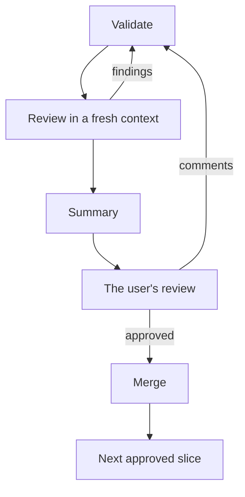

# Finish

The commands and rules are in [PROJECT.md](../PROJECT.md).

This diagram shows the flow from validation to the merge.

1. Rebase and validate:
   1. Run `git rebase --autostash <merge target>`. If the stash has a conflict when it comes back, resolve the
      conflict in your changes and drop the stash.
   2. Run the validate and stamp command at the level of the slice.
   3. If a test fails, fix the cause. Do not make the test weaker, skip it or delete it.
2. For a change at the visual level, open each screenshot that the command printed and examine it. If the change shows
   only where the samples do not go, take a screenshot there with the screenshot command.
3. Get a review in a fresh context. Give the reviewer the worktree, the merge target and the slice. Use the reviewer in
   PROJECT.md. If there is none, use a new session or subagent that follows the
   [review-slice skill](../review-slice/SKILL.md).
   - Skip this step for a small slice: 50 changed lines or fewer, or a change at the lowest validation level. Do not
     skip it when the slice changes a public API, a file format or a dependency.
   - Fix each finding at its cause. If you do not fix a finding, give the evidence. Then do step 1 again.
   - Get a new review only when the fixes add more than about 100 lines.
4. Write the summary:
   - What changed and why. Give the reason for each hunk where it is not clear. Keep the fix and the cleanup apart.
   - The level that you validated at, your assumptions, and what you did not check. For a visual change, what the
     screenshots show.
   - Each type, member, field and parameter that you added, and the caller in this slice that needs it. Remove each
     one that has no caller (Simplest first).
   - The next slice that you propose, in one line.
5. Start the user's review. From the worktree, run the user's review command in the background. Wait for it.
   - If it stops before the user decides, run it again. The comments of the user stay.
   - If the project has no review command, show `git diff --stat` and the important hunks in the chat. Wait.
6. Address each comment. If you do not address a comment, give the evidence. Validate again, and go back to step 4.
   If the user's review closes with no comments and no approval, ask the user what to do.
7. Approval in the user's review, or "approved" in the chat, means merge. Do not ask again. If the approval is in the
   chat, stop the user's review. Then:
   1. Commit on the branch of the worktree, as the commit rules say.
   2. Rebase onto the merge target. Run the validate and stamp command again at the same level. If no new work came
      in, it stops at once. If it validates again, examine the new screenshots of a visual change.
   3. Resolve conflicts only in your changes. If a conflict needs a change to the work of another agent, stop and ask
      the user.
   4. In the checkout of the merge target, fast-forward the merge target to your branch. Do not push.
   5. Release the claim. Then run `git worktree remove`. Then run `git branch -d`. Do not use `-D`.
   6. Remove each other worktree and branch that you made for the task in the same way. This includes the worktree
      that the app made for the session. For a branch that you made from a remote branch, set its upstream to that
      branch first. Then `-d` removes it.
   7. Delete the side sessions that you started and that are done
      ([tidy-worktrees skill](../tidy-worktrees/SKILL.md)).
8. Go on to the next slice:
   - If a slice of the list that the user approved is left, start it with the [slice skill](../slice/SKILL.md). If
     the context is more than half full, give its brief in one or two lines to paste after `/clear`, and stop.
   - If no approved slice is left, propose the next slice and stop. Do not start it yourself.
