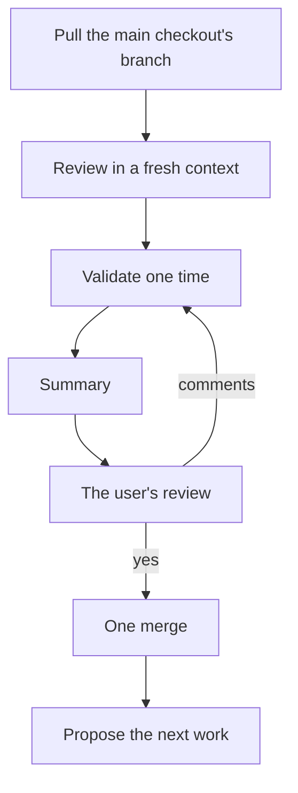

# Finish

The commands and rules are in [PROJECT.md](../PROJECT.md). The branches and merges rule is a hard rule: this skill
merges into the main checkout's branch only at step 8, one time, after the user's yes.

The validate and stamp command is the slow step. Run it one time, after the review, when the code no longer changes.
Run it again only after an edit or a pull. Do not run other checks between the steps.

This diagram shows the flow from the pull to the merge.

1. Commit your work on the branch. Pull the main checkout's branch into it: `git merge <main checkout's branch>`.
   Apply both changes (Branches and merges): each side's change holds in the result, deletions included. Build, then
   run the checks of each area that the two sides both changed. If the two changes cannot both stand, stop and ask
   the user.
2. Get one review in a fresh context. Give the reviewer the worktree, the main checkout's branch and the slice, or the
   briefs of the slices of a root branch. Use the reviewer in PROJECT.md. If there is none, use a new session or
   subagent that follows the [review-slice skill](../review-slice/SKILL.md).
   - Skip this step for a small branch: 50 changed lines or fewer, or a change at the lowest validation level. Do not
     skip it when the branch changes a public API, a file format or a dependency.
   - Fix each finding at its cause, and commit. If you do not fix a finding, give the evidence.
   - Get a new review only when the fixes add more than about 100 lines.
   - Run the reviewer in the foreground. A reviewer in the background records no review, and the merge is then
     refused.
3. Run the validate and stamp command at the level of the branch: for a root branch, the highest level of its slices.
   If a test fails, fix the cause. Do not make the test weaker, skip it or delete it.
4. For a change at the visual level, open each screenshot that the command printed and examine it. If the change shows
   only where the samples do not go, take a screenshot there with the screenshot command.
5. Write the summary:
   - What changed and why. Give the reason for each hunk where it is not clear. Keep the fix and the cleanup apart.
     For a root branch, one line for each slice.
   - The level that you validated at, your assumptions, and what you did not check. For a visual change, what the
     screenshots show.
   - Each type, member, field and parameter that you added, and the caller that needs it. Remove each one that has no
     caller (Simplest first).
   - The next work that you propose, in one line.
6. Start the user's review. It asks the user if you can merge. From the worktree, run the user's review command with
   `--base <main checkout's branch>` in the background. Wait for it.
   - If it stops before the user decides, run it again. The comments of the user stay.
   - If the project has no review command, show `git diff --stat` and the important hunks in the chat. Ask "Can I
     merge `<branch>` into `<main checkout's branch>`?" Wait.
7. Address all the comments of the round. If you do not address a comment, give the evidence. Commit, do step 3 one
   time for the round, and go back to step 5. If the user's review closes with no comments and no approval, ask the
   user what to do.
8. Approval in the user's review, or a yes in the chat, means merge. Do not ask again. If the yes is in the chat, stop
   the user's review. Then:
   1. If the main checkout's branch moved, do step 1 and step 3 again. Do not get a new review. After a pull with no
      conflict, the stamp command runs only the build.
   2. In the main checkout, run the final merge command one time. Do not push.
   3. Run `git worktree remove`. Then run `git branch -d`. Do not use `-D`.
   4. Remove each other worktree and branch that you made for the task in the same way. This includes the worktree
      that the app made for the session. For a branch that you made from a remote branch, set its upstream to that
      branch first. Then `-d` removes it.
   5. Delete the side sessions that you started and that are done
      ([tidy-worktrees skill](../tidy-worktrees/SKILL.md)).
9. Propose the next slice or effort in one line, and stop. Do not start it yourself.
