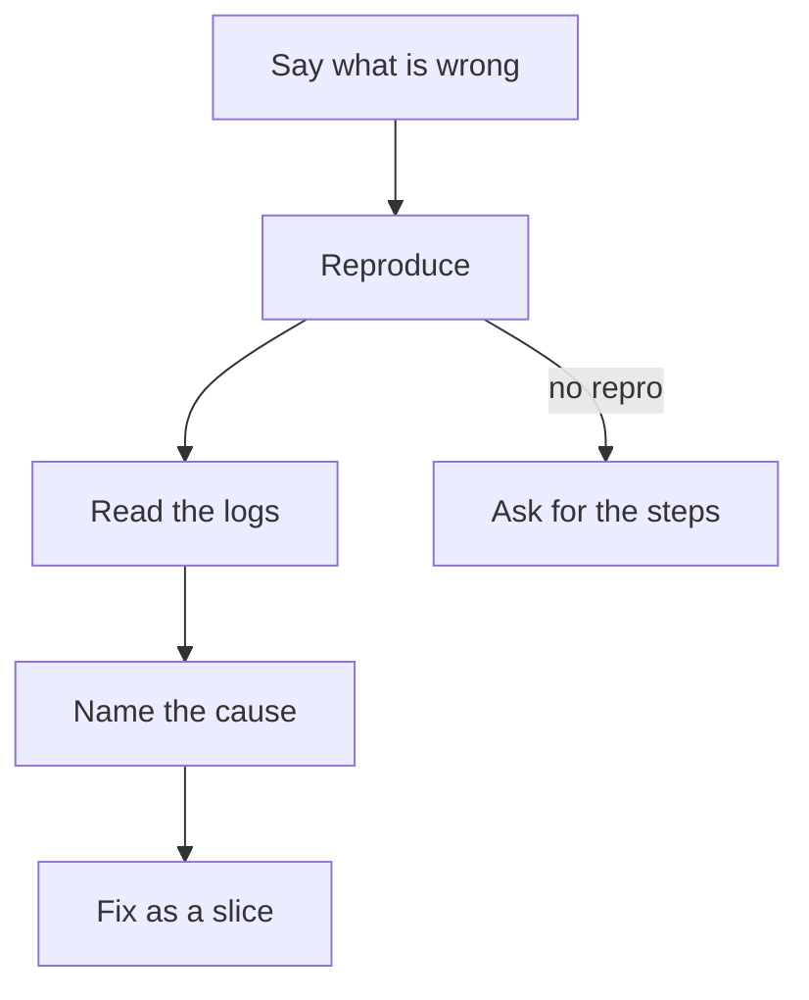

# Investigate

Find the cause first. Then fix it as a slice. The commands, paths and rules are in [PROJECT.md](../PROJECT.md).

This diagram shows the steps from the report to the fix.

1. **Say what is wrong:** what occurs, what must occur, and where. If you cannot say both, ask.
2. **Reproduce it** with the smallest run that shows it. Keep that run as the check of the slice.
   - For a run that logs an error or crashes, use the run command with the commands that get to the error.
   - For something that draws wrong, use the screenshot command. Then open the image and look at it.
   - For a test that fails, use the command for one test project.

   If it does not occur again, say what you ran and ask for the steps. Do not fix what you did not see fail.
3. **Read the evidence** before the code: the log of the run and each crash file in the logs folder. Start at the
   first error, not the last. Later errors often come from the first.
4. **Find the cause.** Follow the data back from where it is wrong to where it first goes wrong.
   - Test one idea at a time, with the cheapest check. For example, add a log line, use a smaller run, or read a
     value while the app runs.
   - Before you change code, write the cause in one sentence, with its `file:line`.
5. **Fix it as a slice** ([slice skill](../slice/SKILL.md)).
   - Fix the cause, not the place where it shows. Fix its copies too (How to implement).
   - If the user asks for a test, write it first and see it fail.
   - The run from step 2 is the check that the fix works.
6. If a fix fails two times, stop. Report what you tried and what you saw (When blocked).

A question that only needs an answer is a `spike`. Put the cause in the summary. Nothing merges.
