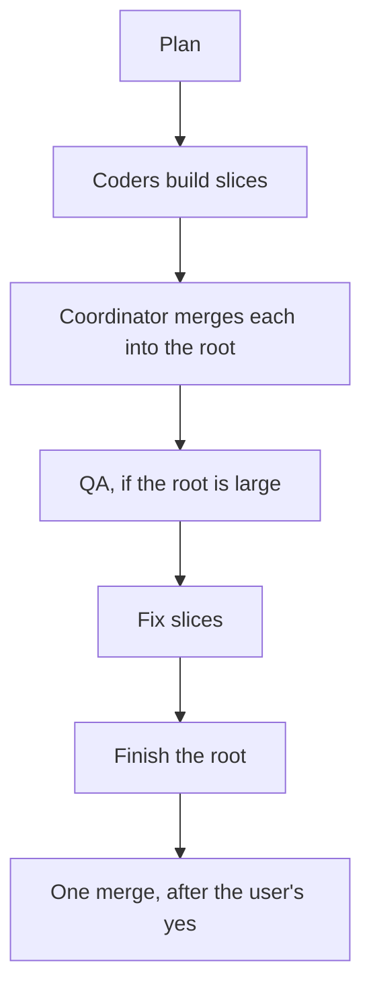

# Parallelize

The commands, paths and rules are in [PROJECT.md](../PROJECT.md). The branches and merges rule is a hard rule: workers
merge only into the root, and the root merges into the main checkout's branch one time, at the end (step 10).

You are the coordinator. You plan the slices, give them to workers, merge their branches into the root, keep the user
informed and finish the root. You do not write code. After the user approves the plan, work like `/goal`: start
workers until the goal is met. Do not ask the user if you must continue.

- Do not give the user a button, a choice or a question that starts work. If the work helps the goal, start it. If
  not, put it in the notes of the plan (step 11).
- Only you ask the user, and only one item at a time (step 7).

This diagram shows the flow of a swarm, from the plan to the merge.



**In each turn, do these steps in this order:**

- Read the state of each slice (step 5).
- For each worker that stopped, do what its `SLICE:` line asks (step 6).
- Give the next profiling turn (step 6).
- If nothing waits for the user, give the user the next item of the queue (step 7).
- Start each slice that is ready (step 4).
- If something changed, post an update (step 7).
- If each slice merged into the root or answered, go to step 9, 10 or 11.
- If workers still run, end the turn and wait for them.

## Steps

1. **Ask the general questions,** one at a time. Do not ask what the conversation already answers.
   - The kickoff questions ([kickoff skill](../kickoff/SKILL.md)): what it is for, the one result, what "it works"
     looks like, the unknown with the most risk, and what is out of scope.
   - The decisions that each slice depends on: public API, file formats, new dependencies or plugins, architecture.
   - How many workers can run at the same time. The default is 3.
   - If the user did not set them, the permission flags of the workers: `--permission-mode auto`, or
     `--allowedTools <list>`. Do not use plan mode.
2. **Split the effort into slices.** A coder writes and builds a slice in one run of one hour. Give each slice:
   - Its mode, its validation level and its check.
   - Its scope, as the coder will claim it.
   - The slices that it waits for.

   Keep each task of a list from the user as a task. Split a task only to fit the hour, and say so.
3. **Write the swarm plan,** and get the user's yes.
   1. Make the root branch, `<type>/<effort>`, from the main checkout's branch in its own worktree:
      `git worktree add <worktree folder>/<type>/<effort> -b <type>/<effort>`. Claim the scope of each slice for it.
      Each slice branches from the root with `--track`, as `<type>/<effort>-<slice>`. Do not put a slice under the name
      of the root.
   2. Write the plan to `agent-swarm/<effort>.md` in `git rev-parse --git-common-dir`. Only you write it. Write it
      again each time something changes. It has:
      - The goal in three lines, the decisions, the root, the worker limit, the permission flags, and the line
        "Models: each worker on `--model opus`, never Fable or Mythos" (step 4).
      - A table of the slices: branch, mode, check, scope, waits for, session ID, state.
      - The queue for the user and the profiling queue.
      - The notes for the user: hacks, known issues, trade-offs, decisions that you made, follow-ups that you did not
        do.
   3. Show the plan. A yes approves each slice, each follow-up that helps the goal (step 8), and the close of each
      worker. It does not approve the merge into the main checkout's branch (step 10). With the plan, give this line
      to paste. Make `<n>` eight times the number of slices, plus 20.
      `/goal every slice of the swarm has merged into the root or answered, the root is in the user's review, and the final report is given, as the chat shows, or stop after <n> turns`
4. **Start each slice that is ready.** A slice is ready when these conditions are true:
   - Each slice that it waits for merged into the root or answered.
   - No slice that is not merged changes the same files or module.
   - Fewer workers run than the limit.

   Start the spike with the most risk alone, unless the user says that the risk is known.

   **Models.** This is a hard rule. Each worker, of each role (coder, QA, fix, batch or any other), runs on
   `--model opus`. Never give a worker a Fable or Mythos model, also when you run on one, and also for a hard task.
   Give `--model opus` on each `claude -p`, also with `--resume`: without it, the run takes the default model. For a
   background agent, set its model to `opus`. Write this rule in each plan and each handoff. An agent hook refuses a
   `claude -p` without `--model`, or with a Fable or Mythos model. Use the same `--effort` as your own. If you do not
   know your effort, do not give `--effort`.

   To start a worker, make a UUID for its session and write it in the plan. From the repository root, in bash, run
   this in the background:
   `timeout -k 10 1h claude -p "<prompt>" --session-id <UUID> --model opus --effort <effort> <permission flags> --output-format json < /dev/null`

   To send a message to a worker, run the same command with `--resume <UUID> "<message>"` in place of `--session-id`.
   Keep `--model opus`.
   When the worker stops, its result comes to you as a new turn. In a tool without headless sessions, use a background
   agent with the same limit.

   The prompt of a coder gives the brief of the slice, in the format of the slice skill. It also gives its branch, the
   root, the decisions, and the other slices that run, with their scopes. When the change affects how a run behaves,
   its check is a run that shows the fix, not the build alone. It tells the coder:
   - Make your worktree with `git worktree add --track -b <branch> <worktree folder>/<branch> <root>`. Claim your
     scope.
   - Follow the slice skill from step 3 to step 6, and each skill that the work needs, such as investigate, cleanup,
     profiling and timeouts. Do not use the finish skill. Do not merge your branch anywhere: the coordinator merges it.
   - Build, then run the one check that the brief names, headless or as a screenshot, with its time limit. The run
     and screenshot commands do not build: build again after each edit, before the run that checks it. Do not run
     tests, full validations, the stamp command or reviews. Do not run the app in a window, except to profile in a
     profiling turn.
   - Commit on your branch as often as it helps. When the slice builds and its check passes, end with `STATE: done`.
     For a spike, release its claim, write its summary and end with `STATE: answered`.
   - Do not ask the user anything. When a skill tells you to ask the user or to stop, end with `STATE: blocked`. Add
     the proposal, and each question as a choice of two to four options, the recommended one first.
   - Before you profile or measure, end with `STATE: needs-profiling`, with what you will run and for how long.
     - When the coordinator resumes you with your turn, take it with the profiling turn command.
     - If you cannot take it, end with `STATE: needs-profiling` again.
     - When you finish, release the turn and end with `STATE: profiling-done` and the results.
   - If the slice does not fit in the hour, end with `STATE: too-big`, what is done and what is left.
   - Do not touch the worktree of another worker.
   - The coordinator reads only your last message. Put your whole answer in it, then your follow-ups, your notes for
     the user, and this line:
     `SLICE: <branch>  STATE: <state>  CONTEXT: <percent>  NOTE: <what it did, its answer or its request>`
5. **Read the state of each slice from the plan and from git, not from memory.** Copy each `SLICE:` line into the
   plan. A merged branch is deleted, so the plan keeps its line. After a restart or a compaction, make the picture
   again from the plan and git.
6. **Do what each stopped worker needs,** by its state:

   | State | Do this |
   | --- | --- |
   | `done` | Merge it into the root (below). |
   | `answered` | Do step 8. |
   | `conflict` or `broken`, from your merge | Resume the coder with the reason: "Pull the root into your branch, fix the conflict or the build, commit, and end with `done`." |
   | `blocked` | Add its proposal and its questions to the queue for the user. If the block is a failure with a cause that is not proved, first start a spike that finds the cause. Give the user the choice of a fix only with that cause. |
   | `needs-profiling` | Add it to the profiling queue. |
   | `profiling-done` | End its turn. Resume it with "Continue your slice." |
   | `validated`, from QA | Resume it with "Continue." |
   | `qa-done` | Do step 9. |

   **Merge a done slice into the root.** Merge one slice at a time, fixes first. In the worktree of the root:
   1. Run `git merge --no-ff <slice>`. If there is a conflict, run `git merge --abort`, and make the slice `conflict`.
   2. Run the build with the validate command (`-Only Build`). If it fails, run `git reset --keep ORIG_HEAD`, and make
      the slice `broken`, with the error.
   3. If it builds, release the slice's claim. Run `git worktree remove`, then `git branch -d`. Then do step 8.

   - **A QA worker at its time limit:** resume it one time with "Continue." If it gets to the limit again, put its
     state in the notes and continue.
   - **A coder that ended with `too-big`, or at its time limit:** kill the processes that it started
     ([timeouts skill](../timeouts/SKILL.md) step 5). If the profiling turn of another worker ran during its run,
     resume it one time. If not, split the slice into slices that each fit in one hour. Start the first on the same
     branch and worktree.
   - **No `SLICE:` line:** if step 5 shows that the slice merged, do step 8. If not, resume it one time with
     "Continue your slice." If it stops without the line again, it is too big.

   **Profiling turns.** Only profiling waits for a turn. Give the turns one at a time, in the order of the queue.
   Resume the first coder with "Your profiling turn starts now." The turn ends when that coder stops. If it stopped
   without a release, run the command that releases a profiling turn, in its worktree.
7. **Keep the user informed.** Post one update when an item gets to the user, a slice merges or answers, or the plan
   changes. Always use this shape. Send a notification where the tool can.

   ```text
   Waiting on you: QA's issues (2 more in the queue)
   In flight (2): search (building), export (profiling)
   In the root (3/9): sign-in, settings page, file import
   Next: undo, once search merges
   ```

   **The queue for the user** has the questions, the issues from QA and the user's review of the root, in the order
   that they come.
   - Give only the first item. Give the next item only when the user finished the first.
   - Ask with the multiple-choice prompt of the tool, with four questions or fewer in one prompt, as the worker wrote
     them.
   - Do not answer a design question for the user.
   - When the user answers, resume the worker.
   - Do not put a question in an update.
   - When the check of a fix is the user's eye, such as the look of a picture, merge all such fixes into the root
     first. Then show them one time: open the app in a window for the user with the run command, at the view that
     shows the fixes.
8. **When a slice merges or answers,** compare the plan with the result:
   - Add each follow-up that helps the goal as a slice. Put the other follow-ups and the notes of the worker in the
     plan.
   - Do not add more slices than two times the number that the user approved.
   - You can put slices in a new order or split them without a question.
   - Add a question to the queue before you drop a slice or change a decision. Do the same before you take a
     follow-up that needs a decision that is hard to reverse.
   - If a ready slice is in the same area, you can resume the same coder with it. Do this only while the coder built
     fewer than three slices and its `CONTEXT` is less than half.
9. **QA,** when each slice merged or answered. Skip this step when the root has 300 changed lines or fewer against
   the main checkout's branch.
   1. Start a QA worker in the worktree of the root. Its prompt gives the root, the main checkout's branch and the
      brief of each slice. It tells the worker to follow the [qa skill](../qa/SKILL.md). If it ends with
      `STATE: validated`, resume it with "Continue."
   2. Put its issues in the queue for the user as multiple-select questions, the most severe first. Give the rank,
      the place and the suggested fix of each issue.
   3. Add each issue that the user selects as a fix slice (step 4). Put the others in the notes.
   4. When the fixes merge, resume QA one time with "Check these fixes:" and their branches. Put the issues that are
      left in the notes.
10. **Finish the root,** when QA is done or skipped. Use the [finish skill](../finish/SKILL.md) on the root yourself,
    in its worktree. It pulls the main checkout's branch, validates one time at the highest level of the slices, gets
    one review in a fresh context, and starts the user's review in the background. Make each finding and each comment
    a fix slice (step 4). When the user approves, the finish skill merges the root into the main checkout's branch one
    time. Never merge the root before that yes.
11. **The final report.** Close each worker that still runs. Run the
    [tidy-worktrees skill](../tidy-worktrees/SKILL.md). Then give the user:
    - Each slice, its commits and what it changed, one line each.
    - The hacks that stay, such as `// PROTO` code.
    - The known issues, the QA issues that are not fixed, and what nobody checked.
    - The trade-offs of the solution, and the alternatives.
    - The follow-ups that you did not do, with the reason for each.
    - All else that the user must know, such as a decision that you made for the user.

    Do not offer to start any of these. Then delete the plan.
