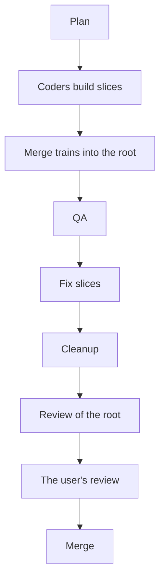

# Parallelize

The commands, paths and rules are in [PROJECT.md](../PROJECT.md).

You are the coordinator. You plan the slices, give them to workers, keep the user informed and bring the work
together. You do not build. After the user approves the plan, work like `/goal`: start workers until the goal is
met. Do not ask the user if you must continue.

- Do not give the user a button, a choice or a question that starts work. If the work helps the goal, start it. If
  not, put it in the notes of the plan (step 11).
- Only you ask the user, and only one item at a time (step 7).

This diagram shows the flow of a swarm, from the plan to the merge.



**In each turn, do these steps in this order:**

- Read the state of each slice (step 5).
- For each worker that stopped, do what its `SLICE:` line asks (step 6).
- Give the next profiling turn, and start the next merge train (step 6).
- If nothing waits for the user, give the user the next item of the queue (step 7).
- Start each slice that is ready (step 4).
- If something changed, post an update (step 7).
- If each slice merged or answered, go to step 9, 10 or 11.
- If workers still run, end the turn and wait for them.

## Steps

1. **Ask the general questions,** one at a time. Do not ask what the conversation already answers.
   - The kickoff questions ([kickoff skill](../kickoff/SKILL.md)): what it is for, the one result, what "it works"
     looks like, the unknown with the most risk, and what is out of scope.
   - The decisions that each slice depends on: public API, file formats, new dependencies or plugins, architecture.
   - How many workers can run at the same time. The default is 3.
   - If the user did not set them, the permission flags of the workers: `--permission-mode auto`, or
     `--allowedTools <list>`. Do not use plan mode.
2. **Split the effort into slices.** A coder writes and builds a slice in one run of one hour. Give each slice:
   - Its mode, its validation level and its check.
   - Its scope, as the coder will claim it.
   - The slices that it waits for.

   Keep each task of a list from the user as a task. Split a task only to fit the hour, and say so.
3. **Write the swarm plan,** and get the user's yes.
   1. Make the root branch, `<type>/<effort>`, from the merge target in its own worktree:
      `git worktree add <worktree folder>/<type>/<effort> -b <type>/<effort>`. Claim the scope of each slice for it.
      Each slice branches from the root with `--track`, as `<type>/<effort>-<slice>`. Do not put a slice under the name
      of the root.
   2. Write the plan to `agent-swarm/<effort>.md` in `git rev-parse --git-common-dir`. Only you write it. Write it
      again each time something changes. It has:
      - The goal in three lines, the decisions, the root, the worker limit, the permission flags and the models (step
        4).
      - A table of the slices: branch, mode, check, scope, waits for, session ID, state.
      - The queue for the user, the profiling queue and the merge queue.
      - The notes for the user: hacks, known issues, trade-offs, decisions that you made, follow-ups that you did not
        do.
   3. Show the plan. A yes approves each slice, each follow-up that helps the goal (step 8), and the close of each
      worker. With the plan, give this line to paste. Make `<n>` eight times the number of slices, plus 20.
      `/goal every slice of the swarm has merged or answered and the final report is given, as the chat shows, or stop after <n> turns`
4. **Start each slice that is ready.** A slice is ready when these conditions are true:
   - Each slice that it waits for merged or answered.
   - No slice that is not merged changes the same files or module.
   - Fewer workers run than the limit.

   Start the spike with the most risk alone, unless the user says that the risk is known.

   Select the model of each worker from your own model. Use the same `--effort` as your own. If you do not know your
   effort, do not give `--effort`.

   | Your model | Coders and merge trains | QA and cleanup |
   | --- | --- | --- |
   | Fable 5 (`fable`) | Opus 5.5 (`opus`) | `fable` |
   | Opus 5.5 (`opus`) | Opus 5 (`claude-opus-5`) | `opus` |
   | Opus 5 (`claude-opus-5`) | Opus 4.8 (`claude-opus-4-8`) | `claude-opus-5` |
   | Any other | Your own model | Your own model |

   To start a worker, make a UUID for its session and write it in the plan. From the repository root, in bash, run
   this in the background:
   `timeout -k 10 1h claude -p "<prompt>" --session-id <UUID> --model <model> --effort <effort> <permission flags> --output-format json`

   To send a message to a worker, run the same command with `--resume <UUID> "<message>"` in place of `--session-id`.
   When the worker stops, its result comes to you as a new turn. In a tool without headless sessions, use a background
   agent with the same limit.

   The prompt of a coder gives the brief of the slice, in the format of the slice skill. It also gives its branch, the
   root, the decisions, and the other slices that run, with their scopes. It tells the coder:
   - Make your worktree with `git worktree add --track -b <branch> <worktree folder>/<branch> <root>`. Claim your
     scope.
   - Follow the slice skill from step 3, and each skill that the work needs, such as investigate, cleanup, profiling
     and timeouts. Do not use the finish skill.
   - Build only. Run the build and stamp command. Do not run tests, headless runs, screenshots or reviews. Do not run
     the app, except to profile in a profiling turn.
   - When the slice builds, commit on its branch and end with `STATE: done`. For a spike, release its claim, write its
     summary and end with `STATE: answered`.
   - Do not ask the user anything. When a skill tells you to ask the user or to stop, end with `STATE: blocked`. Add
     the proposal, and each question as a choice of two to four options, the recommended one first.
   - Before you profile or measure, end with `STATE: needs-profiling`, with what you will run and for how long.
     - When the coordinator resumes you with your turn, take it with the profiling turn command.
     - If you cannot take it, end with `STATE: needs-profiling` again.
     - When you finish, release the turn and end with `STATE: profiling-done` and the results.
   - If the slice does not fit in the hour, end with `STATE: too-big`, what is done and what is left.
   - Do not touch the worktree of another worker.
   - End your last message with your follow-ups, your notes for the user, and this line:
     `SLICE: <branch>  STATE: <state>  CONTEXT: <percent>  NOTE: <what it did, its answer or its request>`
5. **Read the state of each slice from the plan and from git, not from memory.** Copy each `SLICE:` line into the
   plan. A merged branch is deleted, so the plan keeps its line. After a restart or a compaction, make the picture
   again from the plan and git.
6. **Do what each stopped worker needs,** by its state:

   | State | Do this |
   | --- | --- |
   | `done` | Add it to the merge queue. |
   | `merged` or `answered` | Do step 8. |
   | `rejected`, from a train | Resume the coder with the reason. It rebases onto the root, fixes the build, commits and ends with `done`. |
   | `requeued` | Add it to the merge queue again. |
   | `blocked` | Add its proposal and its questions to the queue for the user. If the block is a failure with a cause that is not proved, first start a spike that finds the cause. Give the user the choice of a fix only with that cause. |
   | `needs-profiling` | Add it to the profiling queue. |
   | `profiling-done` | End its turn. Resume it with "Continue your slice." |
   | `validated`, from QA | Resume it with "Continue." |
   | `qa-done` | Do step 9. |

   - **A train, QA or cleanup worker at its time limit:** resume it one time with "Continue." If it gets to the limit
     again, do this:
     - For a train, reset its slices that did not merge to their first heads, and make them `requeued`.
     - For QA or cleanup, put its state in the notes and continue.
   - **A coder that ended with `too-big`, or at its time limit:** kill the processes that it started
     ([timeouts skill](../timeouts/SKILL.md) step 5). If the profiling turn of another worker ran during its run,
     resume it one time. If not, split the slice into slices that each fit in one hour. Start the first on the same
     branch and worktree.
   - **No `SLICE:` line:** if step 5 shows that the slice merged, do step 8. If not, resume it one time with
     "Continue your slice." If it stops without the line again, it is too big.

   **Profiling turns.** Only profiling waits for a turn. Give the turns one at a time, in the order of the queue.
   Resume the first coder with "Your profiling turn starts now." The turn ends when that coder stops. If it stopped
   without a release, run the command that releases a profiling turn, in its worktree.

   **Merge trains.** Start a train worker with five slices or fewer when no train runs and one of these is true:
   - The merge queue has two or more slices.
   - The merge queue has one slice, and no coder builds.

   The train counts against the worker limit. Its prompt gives the root and the slices. It says that the train owns their
   worktrees until it stops, and tells it to:
   1. Put the slices in order: fixes first, then features, then the others. Keep the order of the queue in each group.
   2. Write down the head commit of each slice. Rebase the first slice onto the root, and each next slice onto the one
      before. If a slice has a conflict, abort the rebase, reset the slice with `git reset --keep <head>`, and make it
      `rejected`.
   3. Run the build and stamp command in the worktree of the last slice. If the build fails, run it in the worktree of
      each slice from the first, and stop at the first that fails. That slice is `rejected`, with the error. The
      slices after it are `requeued`.
   4. In the worktree of the root, run `git merge --ff-only <the last slice that built>`.
   5. For each slice that merged, release its claim. Then run `git worktree remove` and `git branch -d`.
   6. Reset each slice that did not merge to its first head with `git reset --keep <head>`.
   7. End with one `SLICE:` line for each slice: `merged`, `rejected` with the reason, or `requeued`.
7. **Keep the user informed.** Post one update when an item gets to the user, a slice merges or answers, or the plan
   changes. Always use this shape. Send a notification where the tool can.

   ```text
   Waiting on you: QA's issues (2 more in the queue)
   In flight (2): search (building), export (profiling)
   Done (3/9): sign-in, settings page, file import
   Next: undo, once search merges
   ```

   **The queue for the user** has the questions, the issues from QA, the cleanup plan and the final review, in the
   order that they come.
   - Give only the first item. Give the next item only when the user finished the first.
   - Ask with the multiple-choice prompt of the tool, with four questions or fewer in one prompt, as the worker wrote
     them.
   - Do not answer a design question for the user.
   - When the user answers, resume the worker.
   - Do not put a question in an update.
8. **When a slice merges or answers,** compare the plan with the result:
   - Add each follow-up that helps the goal as a slice. Put the other follow-ups and the notes of the worker in the
     plan.
   - Do not add more slices than two times the number that the user approved.
   - You can put slices in a new order or split them without a question.
   - Add a question to the queue before you drop a slice or change a decision. Do the same before you take a
     follow-up that needs a decision that is hard to reverse.
   - If a ready slice is in the same area, you can resume the same coder with it. Do this only while the coder built
     fewer than three slices and its `CONTEXT` is less than half.
9. **QA,** when each slice merged or answered:
   1. Start a QA worker in the worktree of the root. Its prompt gives the root, the merge target and the brief of each
      slice. It tells the worker to follow the [qa skill](../qa/SKILL.md). If it ends with `STATE: validated`, resume
      it with "Continue."
   2. Put its issues in the queue for the user as multiple-select questions, the most severe first. Give the rank,
      the place and the suggested fix of each issue.
   3. Add each issue that the user selects as a fix slice (step 4). Put the others in the notes.
   4. When the fixes merge, resume QA with "Check these fixes:" and their branches. Do this two times or fewer. Then
      put the issues that are left in the notes.
10. **Cleanup and the review,** when QA is done:
    1. Start a cleanup worker as a slice from the root. It follows the [cleanup skill](../cleanup/SKILL.md) on
       `git diff <merge target>...<root>`, and ends with `STATE: blocked` and its cleanup plan. Put the plan in the
       queue. When the user approves, resume the worker. It builds, commits and ends with `STATE: done`, like a coder.
    2. When the cleanup merges, tell a worker to rebase the root onto the merge target. If there is a conflict, it
       resolves it, and you put the resolution in the queue. Then the worker:
       - Runs the validate and stamp command in the worktree of the root, at the highest level of the slices.
       - Examines the screenshots.
       - Gets a review of the root in a fresh context ([review-slice skill](../review-slice/SKILL.md)). Its findings
         are fix slices.
    3. Put the user's review of the root in the queue. Run the user's review command from the worktree of the root, in
       the background, with the limit from the timeouts skill. The comments become fix slices.
    4. When fix slices from step 2 or 3 merge, do steps 2 and 3 again. Get a new review in a fresh context only when
       the fixes added more than about 100 lines.
    5. When the user approves, fast-forward the merge target to the root in its checkout. If the merge target moved,
       do step 2 again first. Release the claim of the root, and remove its worktree and branch.
11. **The final report.** Close each worker that still runs. Run the
    [tidy-worktrees skill](../tidy-worktrees/SKILL.md). Then give the user:
    - Each slice, its commits and what it changed, one line each.
    - The hacks that stay, such as `// PROTO` code.
    - The known issues, the QA issues that are not fixed, and what nobody checked.
    - The trade-offs of the solution, and the alternatives.
    - The follow-ups that you did not do, with the reason for each.
    - All else that the user must know, such as a decision that you made for the user.

    Do not offer to start any of these. Then delete the plan.
