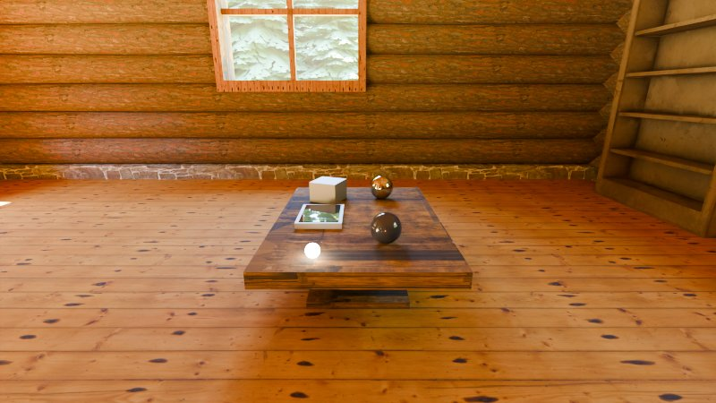

# Faults that fail a picture

Read the table, find the fault, then read its entry. Each fault here fails a picture, also when it is small, rare or
far away.

Each entry gives what the fault looks like, an example from this project with its view, hour and numbers, the test
that finds it, the reject rule, and the causes that a run proved. A cause is a place to look first, not a proof.
Prove the cause again with a run before you fix it.

Every number of Magic against the reference in this file was measured before the diffuse light was denoised with
NVIDIA NRD. Each one says what the fault looked like, not what Magic gives today. Measure again before you report a
number of your own.

The order of priority, the bar and the rules are in [SKILL.md](SKILL.md). The views, the hours, the commands and the
switches are in the Rendering part of [PROJECT.md](../PROJECT.md).

## The table

| Fault | Looks like | Test that finds it | Reject rule |
| --- | --- | --- | --- |
| [Light leak](#light-leak) | Pale light on a seam, a corner, a wall's foot or a reveal | The `leak at <point>` rows of the sealed room, the ratio map, the inside views at night | **Automatic fail.** Any light through a wall, a roof or a seam fails the picture |
| [Too dark or too bright inside](#too-dark-or-too-bright-inside) | A room that is flat, grey, dim or glowing | The patch ratio rows of an inside view at each hour | A median outside 0.9 to 1.1 fails |
| [Too dark or too bright outside](#too-dark-or-too-bright-outside) | A night that reads like dusk, or a blown-out day | The patch ratio rows of an outside view at each hour | A median outside 0.9 to 1.1 fails |
| [The wrong light for the hour](#the-wrong-light-for-the-hour) | Daylight at night, a morning that looks like noon | `query DeferredRendering.Sun`, the ratio at each hour | A sun height, colour or lux that does not fit the hour fails |
| [The indoor to outdoor ratio](#the-indoor-to-outdoor-ratio) | A room too bright or too dark against the view through its window | The patch ratio median of the inside view over the outside view's at the same hour | A ratio more than 1.2 times the reference's fails |
| [Light or shadows that do not fit a room](#light-or-shadows-that-do-not-fit-a-room) | No sun patch, no soft shadow under furniture, even light | The inside views against Cycles, the switches, the ratio map | A missing or wrong-shaped sun patch, or no contact darkening, fails |
| [Wrong colour](#wrong-colour) | A room too orange, a night too blue | The colour of each named point | r/g or b/g more than 5 % from the reference fails |
| [Black shadows and black corners](#black-shadows-and-black-corners) | Shadows with no detail, near pure black | The ratio in the shadow, the open-shadow lux check | An open shadow under 10 % of the sunlit light fails |
| [Light that changes with the camera](#light-that-changes-with-the-camera) | A surface that gets brighter as the camera turns | The point at three camera angles | More than 5 % between the three angles fails |
| [Light that ignores what is off screen](#light-that-ignores-what-is-off-screen) | Light that drops when its source leaves the screen | The point at three angles, the inside view against the outside view | Any light term that reads only the screen fails |
| [Soft or lit contact](#soft-or-lit-contact) | A gap of light where an object meets the floor | The split picture at full size, close up and far | A lit gap or an outline at a contact fails |
| [A bright rim at a silhouette](#a-bright-rim-at-a-silhouette) | A one-pixel bright line along a mesh's edge | The split picture at full size | Any rim fails |
| [Shadow acne and peter-panning](#shadow-acne-and-peter-panning) | Stripes on a lit surface, or a shadow that stands off its caster | The split picture, close up | Acne stripes, or a shadow off its caster, fail |
| [Streaks and dashes in motion](#streaks-and-dashes-in-motion) | Lit lines in a shadow while the camera turns | The turn frames of the visual tests | Any streak or dash fails |
| [Shadow swim and flicker](#shadow-swim-and-flicker) | A shadow edge that crawls or flickers while the view moves | The `flicker` row, the turn frames, the held frames | A shadow edge that moves under a still caster and a still light fails |
| [A shadow cut off](#a-shadow-cut-off) | A shadow that ends at a straight line on the ground | The outside and tree views at full size | A shadow that ends where no geometry ends fails |
| [A missing shadow](#a-missing-shadow) | A thin or small object with little or no shadow | The inside views against Cycles | An object with a shadow in Cycles and none in Magic fails |
| [Grain, blotches and fireflies](#grain-blotches-and-fireflies) | Grain on a flat wall, blobs that move, white dots | The `fireflies in a million` row, the turn frames at full size | Grain that the eye sees at full size fails |
| [Noise at the screen's edges](#noise-at-the-screens-edges) | Grain in the strip that comes into view while the camera turns | The edge noise of the four turns, the whole picture noise of the strafe | More than 1.5 times the still noise fails |
| [Smearing and ghosting](#smearing-and-ghosting) | White smears that trail a bright window or a moving object | The `mean FLIP` row and its map, the turn and strafe frames at full size | Any trail fails |
| [Slow settle](#slow-settle) | A picture that takes many frames to come right | The settle rows of each turn, of the strafe and of the light change | More than 10 frames fails |
| [Light that holds after a change](#light-that-holds-after-a-change) | Daylight that stays after the hour jumps | The settle row after the light change | More than 10 frames fails |
| [Reflections that look off](#reflections-that-look-off) | A mottled rough surface, sky indoors, a missing reflection | `cabin-surfaces`, the ratio map, the `Reflections` debug view | A reflection of what the scene does not hold fails |
| [Banding, shimmer and aliasing](#banding-shimmer-and-aliasing-far-away) | Bands in a gradient, shimmer on far detail | The `banding` row, the tree view at full size, still and in motion | Any band or shimmer fails |
| [Impostors and far geometry](#impostors-and-far-geometry) | Foliage that goes flat or black past a distance | The tree view at full size, still and in motion | A visible switch to an impostor fails |
| [Faceted or wrong light on a mesh](#faceted-or-wrong-light-on-a-mesh) | Facets on a curve, a lit gradient on a shadowed face | The split picture, the `Normal` debug view | Shading that the model's normals cause fails |
| [Resource warnings](#resource-warnings) | Light where it cannot be, at random runs | The log row of the visual tests | One warning or error in the log fails |
| [Floating or sunk objects](#floating-or-sunk-objects) | A trunk in the air, or a model that sinks into the ground | A low picture at ground level, the overlay | A trunk that floats, or a sink deeper than the ground's rise across it, fails |
| [Measurement faults](#measurement-faults) | Numbers that do not mean what they say | The checks in that part | A number from a broken measurement proves nothing |

## Light leak

A leak is an automatic fail. Light must not pass through a wall, a roof, a floor or a seam. It must not pass
through a corner, the foot of a wall, a window's reveal or a closed door. This holds at any hour, close up and far,
still and in motion.

- **Looks like:** pale or blue-white light in a room that the sun does not reach. It runs along a seam between two
  logs, in a corner, at the foot of a wall, beside a shelf or on a window's reveal. The light is flat, and it
  follows the shape of the seam, not the shape of a light source.
- **Example:** the cabin room by day at the window wall. Pale blue-white light runs along the wall's top, along each
  beam, in the corner behind the shelf and along the wall's foot. The user's words: "Lots of light leaking". A
  bright strip at the foot of every inside wall is still there with a shell that no ray escapes from. A ray test
  from inside the cabin lets 204 of 40,000 rays out, and all of them go through the doorway.
- **Example as a number:** the sealed room of the view `leak-room`, at hour 12. Cycles gives exactly 0 at each
  pixel, so each point of the room must be black. Magic gives up to 0.403 nits in a corner, and 4 of its 9 points
  are over 0.05 nits. What is right at that view and hour:

  
- **Test:** the `leak at <point>` rows of `leak-room`, which measure the light that Magic leaves at each point of a
  room that no light reaches. Then the inside views `cabin-wall`, `cabin-room` and `cabin-window-glow` at hour 22,
  when the sun and the moon stand on the other side of a wall. The ratio map and the picture must show no light on
  the wall's inner face. Read the seam points of each view: `logs at the foot of the wall`, `logs between the
  windows`, `floor in the corner` and `logs by the doorway`.
- **Reject rule:** one `leak at <point>` row that fails fails the picture. A picture with light on a surface that no
  light can reach fails. Do not accept a leak because the patch ratio passes. Do not darken a leak with ambient
  occlusion, with a clamp or with a shorter ray.
- **Causes proved:**
  - A diffuse or reflection ray that lands on a back face was counted as a hit with light. A ray that starts at a
    seam passes out through the wall and brings the sky in (`9a38099a`).
  - A probe's L1 harmonics spread a window's narrow lobe of light in every direction. A probe beside the window gave
    the sill 177 where its own rays found 28 (`d1d19fa6`).
  - The light of a probe is added at each ray hit, and the room's probes hold 3 to 10 times the traced light
    (`GetHitLight` in `Traced.slang`).
  - A diffuse ray that reached nothing within its range took the probes' light where it must take the sky
    (`8cc63416`).

## Brightness and the hour

### Too dark or too bright inside

- **Looks like:** a room that is flat, grey and dull, or a room that glows. The form of the logs is lost.
- **Example:** `cabin-wall` at hour 12 has a median of 0.551 against Cycles, a 10th percentile of 0.344 and a 90th
  of 0.877. At hour 22 the same view has a median of 1.691 and a 90th percentile of 3.529.
- **Test:** the patch ratio rows of each inside view at the hours 8, 12, 16 and 22. Also check
  the room against real light. A room at noon with one window has a bright sun patch, and the light falls off
  strongly from the window to the back wall.
- **Reject rule:** a median outside 0.9 to 1.1 fails. A 10th percentile under 0.8, or a 90th percentile over 1.25,
  fails.
- **Causes proved:**
  - A filter that averages the light through a curve such as `x/(1+x)` in absolute units holds the mean 2 to 3
    times too low. This happens when a few of the rays carry most of the light (`5a1ddce8`, `4199b876`).
  - A history clamp to the mean of the 3 by 3 neighbours held the history at about half the light. The trace gives
    2 rays a pixel (`4199b876`).
  - The room lacks the neutral light that comes in through its openings, so only the warm bounce of its own walls is
    left.

### Too dark or too bright outside

- **Looks like:** a night that reads like dusk, a day that blows out to white, or ground with no form.
- **Example:** `cabin-outside` at hour 22 has a median of 5.787 against Cycles and a 90th percentile of 52.416.
  Magic's night is about six times too bright. At hour 12 the same view is 0.919, so the day is near the bar and
  the night is not. The snow and the ground through the doorway blow out to white at noon.
- **Test:** the patch ratio median of `cabin-outside` and `cabin-trees` at each hour. Check the light against real
  values with `query DeferredRendering.Sun`:

  | Light | Real value |
  | --- | --- |
  | The noon sun, clear sky | About 100,000 lux on a surface that faces it |
  | An open shadow at noon | 10 to 20 % of the sunlit light |
  | Overcast or dusk | 1,000 to 10,000 lux |
  | A full moon | 0.1 to 0.3 lux |

- **Reject rule:** a median outside 0.9 to 1.1 fails. Light more than 2 times off a real value fails, also when
  Magic and the reference agree with each other.

### The wrong light for the hour

- **Looks like:** daylight at night, or a night that is too blue or too bright. Also a morning that looks like
  noon, or a sun at the wrong height or the wrong colour.
- **Example:** Magic draws no moon disc and no stars at night, although the code says that the sky draws the moon
  full. Magic's visible sun disc is dimmed to a twentieth (`Atmosphere.slang`, `* 0.05`). Magic scales the sky two ways.
  The sky that the camera sees takes all three channels, and the sky's light on the ground takes the red channel
  alone. Under the moon's blue light the two are 1.33 apart.
- **Measured:** the sky's light on a surface is scaled by the `Brightness` of the domain's `Sky` component, not by
  the setting `Rendering.SkyBrightness`. A doubled `Brightness` lifts a surface by 3.3, 7.5 and 17.8 % in red,
  green and blue. A doubled setting lifts it by 0.4 %, because that setting scales the sky that the air and the
  clouds take. To change the light that a room gets from the sky, change the component.
- **Test:** the console commands `set Day.Hour <hour>` and then `query DeferredRendering.Sun` print the light that
  lights the world at the hour, and `query ProceduralSky.Brightness` what the sky's light is multiplied by. Compare
  the sun's height and azimuth with the hour. Then run the view at that hour and read its median and its colour.
- **Reject rule:** a sun height, a sun colour or a lux value that does not fit the hour fails. Direct sunlight from
  a sun under the horizon fails. A night with the sky of a day fails.
- **Cause proved:** a `DayCycle` that starts anew begins from the rotation that its light has at that time. So
  "noon" was not noon, and every number before the fix was wrong (`99d2a205`, `DayCycle.Start`). The tools now hold
  the day at the hour with `set Day.Hour`, and the `DayCycle` stays.

### The indoor to outdoor ratio

- **Looks like:** a room far darker or far brighter than the meadow that its window shows, or a doorway that reads
  as a flat white hole.
- **Example:** at hour 12 `cabin-wall` is 0.551 and `cabin-outside` is 0.919. The room is about six tenths as
  bright as it must be against the same outside.
- **Test:** take the patch ratio median of the inside view and that of the outside view at the same hour. Divide one
  by the other. Do the same for the two Cycles references. The two ratios must agree.
- **Reject rule:** an inside to outside ratio more than 1.2 times the reference's fails.

### Light or shadows that do not fit a room

- **Looks like:** a room that light reaches in a way that its walls and its roof do not allow. Each of these fails:
  - Sun or sky light on a surface that the walls and the roof hide.
  - No sun patch on the floor or the wall from a window or the door. A patch of the wrong shape, or in the wrong
    place, fails too.
  - No soft shadow and no contact darkening under and behind the bench, the chair, the shelf and the carpet.
  - An object indoors lit as if it stands outside.
  - A lamp or a fire whose light does not fall off with distance, or that casts no shadow.
  - A room lit evenly, with no fall-off from its openings to its back wall.
- **Example:** a small pure-white blob of sunlight sits low on the cabin's inside wall over the floor. It is about
  30 cm tall, with a soft wavy outline, and no other part of a sun patch is near it. The user: "The way this light
  casts looks wrong". The rocking chair has almost no shadow. The inner corner where two log walls meet is brighter than
  the walls beside it.
- **Test:** the inside views `cabin-wall`, `cabin-room` and `cabin-window-glow` against Cycles at each hour. The
  ratio map shows the shape and the place of the sun patch and of each shadow. Turn off one term at a time with
  `GlobalIllumination.IsShadowFillOn`, `GlobalIllumination.IsHitProbeLightOn`, `GlobalIllumination.IsDiffuseSkyOn` and
  `GlobalIllumination.IsPixelProbeLightOn` to find the term that lights the room.
- **Reject rule:** a sun patch that Cycles has and Magic does not, a patch of another shape or place, or a contact
  with no darkening, fails.
- **Cause proved:** `Renderer.IsShadowless`, `PointLight.IsShadowless`, `SpotLight.IsShadowless` and
  `RectLight.IsShadowless` are read nowhere in the renderer. The flames and the lantern ask for no shadow and cast
  one.

### Wrong colour

- **Looks like:** a room too orange or too red. Also a night that is neutral where a fire lights it, or a sky that
  is too blue.
- **Example:** `cabin-wall` at hour 12 gives r/g 3.08 where Cycles gives 2.28. Its points are 0.27 to 0.63 off the
  reference's colour, where 0.05 is the limit. At hour 22 the reference is strongly fire-coloured, r/g 4.5 to 12,
  and Magic is nearly neutral, r/g 0.9 to 2.0. Something neutral, not the fire, lights Magic's room at night.
- **Test:** the colour rows of the visual tests. Each named point's r/g and b/g must be within 5 % of the
  reference's. Test the direct light first, on a sunlit surface, and then the indirect light.
- **Reject rule:** more than 5 % on r/g or b/g at a named point fails.
- **Causes to check:**
  - A texture decoded from sRGB two times.
  - The sun's colour or the sky's.
  - A room that lacks the neutral light from its openings.

### Black shadows and black corners

- **Looks like:** a shadow or a corner with no detail, near pure black, and a picture that reads as flat.
- **Example:** the user: "the image is quite flat. Should be more dynamic and the shadows shouldn't be such a deep
  black". The shelf's undersides measured 0.38 of the reference.
- **Test:** the ratio in the shadow and in the corners. Also the sky's light against real values. In the open at
  noon, an open shadow gets 10 to 20 % of the sunlit light.
- **Reject rule:** an open shadow under 10 % of the sunlit light fails. Do not hide a black area with a constant
  fill. Find the light that is missing.
- **Causes to check:** too little sky light, too few bounces, an albedo that is too low, and an indirect light term
  that is off.

## The camera

### Light that changes with the camera

The user's rule: light and shadows must not depend on where the camera looks. Only the exposure can adapt.

- **Looks like:** a surface that gets brighter or darker as the camera turns, although nothing in the world moves.
- **Example:** from inside, the cabin's room is 0.551 times the reference at noon. From outside, through the same
  windows and the same doorway, the room is 303 to 355 times the reference. At hour 22 the points of `cabin-wall`
  move 0.25 to 0.92 between the three angles, where 0.05 is the limit.
- **Test:** the "at three angles" rows of the visual tests. Each named point is measured at the view's angle and at
  15 degrees each side.
- **Reject rule:** more than 5 % between the three angles at any point fails.
- **Stages to turn off one at a time:**
  - The screen-space parts of the diffuse trace, its history and the upsample.
  - The probes' update around the camera.
  - The shadow maps' pages and cascades that follow the view, and the shadow history.
  - The reflections that read the screen.
  - The sky share and the temporal upscale.

### Light that ignores what is off screen

- **Looks like:** light or a reflection that drops, or comes back, when its source leaves the screen or the camera
  turns away. Also a reflection of a surface that the camera sees, in place of the surface that the mirror faces.
- **Test:** the "at three angles" rows, and the inside view against the outside view of the same room. A term that
  reads only the screen shows up as a large change between the two.
- **Reject rule:** a light or reflection term that reads only the screen fails. An ambient occlusion from the screen
  is allowed only within about 1 m, with a fade at the screen's edges, and on the indirect light alone.

## Shadows

### Soft or lit contact

- **Looks like:** a gap of light where an object meets the floor, or a soft edge where the shadow must be hard. The
  user: "there is an obvious outline around the question mark where no shadow is rendered". Also: "Shadows should
  be sharp at the base and blurry far away from the caster".
- **Test:** the split picture at full size, at the view's own zoom, close up and at a distance, still and in motion.
- **Reject rule:** a lit gap or a pale outline at a contact fails. A number from a crop never proves that it is
  gone. The shadow must touch the mesh along the whole silhouette in a full picture.
- **Causes proved:**
  - A shadow filter that blurred by a fixed number of pixels, not by the width of the soft edge at that pixel
    (`025329bd`).
  - A shadow ray that skipped front-face hits within 1 cm plus 4 pixels of view distance, so the lit zone grew with
    distance (`d21ecb3f`).
  - A shadowed side face drawn pale by the rise of the indirect specular towards edge-on (`2c7e0cb8`).

### A bright rim at a silhouette

- **Looks like:** a bright line, one to three pixels wide, along the edge of a mesh.
- **Example:** the question mark of the HelloWorld sample, a sample since removed, on its floor. A pale line one to
  three pixels wide ran
  along the mesh's silhouette, with pale flecks on the curved part, where the shadow must touch the mesh. The user
  called it "a HUGE visual artifact". The fix below took the bright line away, and a lighter fringe stayed after it.
- **Test:** the split picture at full size.
- **Reject rule:** any rim fails.
- **Cause proved:** a traced pixel was mapped to its picture pixel with float maths that fell one pixel short
  (`5cf34751`).

### Shadow acne and peter-panning

- **Looks like:** stripes or dashes on a lit surface, or a shadow that stands off from the foot of its caster.
- **Example:** lit red dashes lay in the black shadow on the block's top under the stem.
- **Test:** the split picture, close up, with the sun at a grazing angle.
- **Reject rule:** acne stripes fail. A shadow that does not start at its caster's foot fails.
- **Cause proved:** a shadow ray lifted towards the curve of its vertex normals started centimetres off a flat
  face. The model smoothed that face over a hard edge, and the ray passed its own mesh (`63aed878`).

### Streaks and dashes in motion

- **Looks like:** lit lines in a shadow, or dark dashes on lit ground beside an edge, only while the camera moves.
- **Test:** the frames that each run takes while the camera still turns, at each of the four speeds, and the frames
  of the strafe. No row reads these frames. They are for the eye, and this fault shows in them alone. Look at each
  one at full size.
- **Reject rule:** any streak or dash fails.
- **Causes proved:**
  - The history was fed from the first pass of the filter, not from the blend before any filter. So what the
    filter took across a silhouette stayed in the history and grew each frame (`65e9b56c`).
  - The history was read by velocity alone, without the jitter's move, so it was read between pixels and spread
    wider each frame (`ccbf81e6`).

### Shadow swim and flicker

- **Looks like:** a shadow edge that crawls, swims or flickers while the camera moves or the sun turns, although the
  caster stands still. The user: "shadows flicker A LOT, I want shadows stable and crisp".
- **Example:** a low view of the HelloWorld sample, a sample since removed, 32 frames, still, with the indirect
  light off. 1.55 % of the
  pixels at the shadow edges changed from frame to frame, by up to 30 of 255. After `65e9b56c` the same view gave
  0.06 %, by up to 4.4 of 255. While the camera turned, the specks a frame fell from 290 to 122.
- **Test:** the `flicker` row, which is how much the still frames of a still scene move from frame to frame. Then
  the turn frames and the frames held at the view's own pose after each move. Measure the frame-to-frame difference
  at the shadow edges over 30 frames of one run.
- **Reject rule:** a shadow edge that moves while its caster and its light stand still fails.

### A shadow cut off

- **Looks like:** a shadow on the ground that ends at a straight line where the ground's slope changes.
- **Example:** an aspen's shadow ends at a crease in the terrain, as if cut off.
- **Test:** `cabin-trees` and `cabin-outside` at full size.
- **Reject rule:** a shadow that ends where no geometry ends fails.
- **Causes to check:**
  - The filter's plane-distance weight, which rejects neighbours across a crease.
  - A group on the far side of a crease classed all lit.
  - A ray that starts under the next triangle.

### A missing shadow

- **Looks like:** a thin or small object with little or no shadow, such as a chair's legs and rails, or a leaf.
- **Example:** the user: "the shadow for the chair is almost non-existant, I'd expect the chair to have a shadow".
  A contact-hard shadow under the legs and a soft body shadow are the bar.
- **Test:** the inside views against Cycles. The ratio map shows a missing shadow as a bright shape.
- **Reject rule:** an object with a shadow in Cycles and none in Magic fails.
- **Causes to check:**
  - A ray start that passes thin legs.
  - A filter that washes a thin shadow out.
  - A trace at a part of the picture's scale, which misses thin occluders.

## Noise and time

### Grain, blotches and fireflies

- **Looks like:** grain on a flat wall, blobs that move on a face, and single white or orange dots near a window.
- **Example:** before the denoiser change, the still spread at `cabin-wall` was 0.361. After it, 0.018. Blocky
  orange fireflies and dark blotches showed on the log wall while the camera turned, and they were still there at
  frame 30. `cabin-outside` at hour 12 gives 59 fireflies in a million, where the proposed limit is 50.
- **Test:** the `fireflies in a million` row, which counts the pixels that are far brighter than the pixels about
  them in Magic and that the reference does not have. Then the turn frames at full size. The still spread of the
  frames, in `denoise.json`, gives the grain of a still picture.
- **Reject rule:** grain, a blotch or a firefly that the eye sees at full size fails. Do not cut noise with a filter
  that also lowers the mean.
- **Causes proved:**
  - A noisy value of 2 rays a pixel can cross a threshold, such as the share of rays that see the sky. It then
    gives single pixels a very bright term.
  - A rough surface traced for reflections draws a mottled pale face (`8e6b70c6`).
  - A history clamp so narrow that the grain of 2 rays fell outside it. The history was cut back to this frame's
    light each frame (`65474013`).

### Noise at the screen's edges

- **Looks like:** grain in the strip that comes into view at the screen's edge while the camera turns. Also grain
  in the floor that a mesh uncovers.
- **Example:** the user: "a TON of noise at the edges of the screen and when the images changes". The strip error
  was 0.093 against a still noise of 0.02 before the fix, and 0.005 to 0.035 after it. The four views and hours that
  ran last give 1.79 to 5.95 times the still noise, where 1.5 is the limit.
- **Test:** the edge noise rows, one for each of the four turn speeds, and the whole picture noise row of the
  strafe. A turn brings in one edge of the picture. The strafe uncovers what nearer things hid, over the whole
  picture, so its row reads the whole picture.
- **Reject rule:** edge noise or whole picture noise more than 1.5 times the still noise fails.
- **Causes proved:**
  - A pixel with no history started from one frame of 2 rays and blended at a fixed rate. It had no count of its
    frames and no clamp. Such a pixel needs a wide blur from a lower level of detail until its history builds.
  - The denoiser's build cache held one normal encoding while the trace wrote another, so the denoiser read wrong
    normals (`5f9dff48`).

### Smearing and ghosting

- **Looks like:** white smears that spread from a blown-out window onto a wall, with torn, streaky edges. Also a
  ghost that trails a moving object, and floor that keeps the light of the mesh that stood in front of it.
- **Example:** the user: "This weird light ghosting around windows seems to happen", "As the camera moves". White
  smears ran from both windows onto the log courses, and a white streak lay low on the floor.
- **Test:** the `mean FLIP` row, which is the error that a person sees over the whole picture, and its map
  `flip.png`, where black is no difference. Then the turn frames and the strafe frames at full size. The strafe
  gives the parallax that a turn does not, so it uncovers the floor that a mesh hid.
- **Reject rule:** any trail, smear or ghost fails. A `mean FLIP` over its limit fails.
- **Causes proved:**
  - A history texel was counted as the same surface within 10 % of the depth. Floor beside a mesh then took the
    history of the mesh's face (`96d03577`, now 2 %).
  - The filter weighed its neighbours by depth alone, so a face took the light of the face it meets at an edge.
    It now weighs them by how much the neighbour faces the pixel's way (`52dba182`).
  - A very bright history, such as a window or a sun patch, within a wide clamp, trails onto the wall as the view
    moves (`65474013`).

### Slow settle

- **Looks like:** a picture that takes many frames to come right after a turn, a move or a change of light. The
  user: "takes way too much time to settle during movement for a realtime renderer".
- **Example:** the settle after a turn runs from 17 to 31 frames over the four views and hours that ran last. The
  settle after the light change runs from 31 to 41 frames. The limit is 10. An earlier run took 38 frames after the
  sun moved from hour 12 to hour 8. It took 20 frames after the probes took 0.3 of their rays' light each update.
- **Test:** the settle rows: one for each turn, one for the strafe and one for the light change.
- **Reject rule:** more than 10 frames fails.
- **Cause proved:** the hit rays read the probes' slow mean, and the probes took only 0.1 of their rays' light each
  update (`4c3e2b21`).

### Light that holds after a change

- **Looks like:** daylight at night after the hour jumps, or a lamp's light that stays after the lamp goes off.
- **Example:** after the sun was set from day to night, the night's surfaces kept the day's light for about 460
  frames. That light is 100 times the moon's.
- **Test:** the settle row after the light change.
- **Reject rule:** more than 10 frames fails.
- **Cause proved:** the probes' mean waited for the variance that the drop itself made, and its catch-up had a floor
  (`0c749404`).

## Reflections

### Reflections that look off

- **Looks like:** any of these:
  - A rough surface with a mottled, pale sheen in place of a soft, broad reflection.
  - A reflection that is missing where the surface is smooth enough to have one.
  - Sky or outdoor light in a reflection indoors.
  - A reflection of a surface behind the camera, or outside the screen, that is wrong or missing.
  - A pane of glass that mirrors nothing, or that mirrors the room too strongly.
- **Example:** the user: "the horrible specular reflections". A shadowed side face seen along its face took a pale
  sheen from the rise of the indirect specular towards edge-on. It read as an outline with no shadow around the
  mesh. In the split picture of `cabin-outside` at hour 12, the Cycles window glass is a grey frosted
  pane and Magic's glass is clear. Magic's clear pane is the one that differs
  ([Reference views](../../DEBUGGING.md#reference-views)), so Magic does not light its translucent surfaces as their
  material says. A real window reflects about 8 % sharply and diffuses nothing. At hour 12 in `cabin-surfaces`,
  Cycles draws the polished steel ball as a mirror that shows the window, and Magic draws a flat brown ball. That
  view gives a patch ratio median of 0.615, 1,436 fireflies in a million and a mean FLIP of 0.594. What is right at
  that view and hour:

  
- **Test:** `cabin-surfaces`, which carries a table of surfaces from a mirror to a rough one. Then the ratio map,
  the `Reflections` debug view, and `Rendering.IsReflectionsOn false` to see what the reflections add.
- **Reject rule:** a reflection of something that the scene does not hold fails. A mottled rough surface fails.
- **Causes proved:**
  - Traced reflections on surfaces rougher than 0.3 were mottled, most of all in shadow (`8e6b70c6`).
  - The indirect specular rose towards edge-on on a surface too rough to trace (`2c7e0cb8`).

## Distance

### Banding, shimmer and aliasing far away

- **Looks like:** bands in a sky or a wall gradient, shimmer on far detail, and hard aliasing on a far edge. Also
  soft, evenly spaced light and dark stripes on a wall that local lamps light.
- **Example:** the walls of the Lights sample carried soft vertical stripes that the lamps lit. The stripes held
  their place on each wall while the camera moved, so they were in the world and not on the screen.
- **Test:** the `banding` row, which is the part of a gradient that Magic draws in flat steps where the reference
  draws it smoothly. Then `cabin-trees` and `cabin-outside` at full size, still and in motion.
- **Reject rule:** any band or shimmer fails. A `banding` row over its limit fails.
- **Cause proved:** a fog cell that held a wall blended in the sunlit air of 2,000 lux behind that wall. Each fog
  column now keeps its sample points in front of the surface that it sees (`ece2826c`).
- **Causes to check:**
  - A filter that does not cross a tile border.
  - A limit on the lights in a tile.
  - The probe cells and the cascade blend.

### Impostors and far geometry

- **Looks like:** foliage that goes flat, black or missing past a distance. The user: "trees are billboard too soon,
  billboards tend to have a lot of noise on them and are lit very flat, they tend to have black square artifacts
  flicker on them".
- **Example:** far trees lose their foliage past about 60 m. The foliage of a fir and an aspen is speckled with pure
  black pixels. The trunks and the leaf masses have one flat tone with no form.
- **Test:** `cabin-trees` at full size, still and in motion, and a walk towards the trees and away from them. That
  view looks across the clearing into the forest, so the switch at about 60 m is in its picture. Read its point
  `far foliage past the impostor switch`, which is 63.7 m away.
- **Reject rule:** a visible switch from a model to its impostor fails. Black speckles on foliage fail.
- **Cause proved:** a model turned into its impostor at half the size on screen. Rays then started from an
  impostor's pixels outside the leaves that the rays see in its place (`7e7e7c42`).

## Content and the engine

### Faceted or wrong light on a mesh

- **Looks like:** hard facets on a curved surface, or a lit gradient on a flat face that stands in shadow.
- **Test:** the split picture and the `Normal` debug view.
- **Reject rule:** shading that the model's normals cause fails. The fix is in the model, not in the shader.
- **Cause proved:** a model shaded one side band as a smooth ring. Flat faces then took normals bent 45 degrees
  towards their neighbours and the sun (`b2957fec`).

### Resource warnings

- **Looks like:** light where it cannot be, at random runs. For example the sun through the roof at noon.
- **Example:** two gems asked for the same named texture in two formats, so each ask freed the other's texture. The
  log warned 21,858 times in one run that a pass used a texture that is gone (the warning "A pass uses texture ...,
  which is gone." of `VulkanRecorder`).
- **Test:** the log row of the visual tests.
- **Reject rule:** one warning or error in the log fails the whole run. Fix the warning first. A run with a warning
  is not a valid picture, and its numbers prove nothing.
- **Cause proved:** the traced depth was asked in two formats (`7ded0b11`).

### Floating or sunk objects

- **Looks like:** a trunk that stands in the air over the ground, or a model that sinks into the ground.
- **Rule for the trees:** a trunk stands upright, and no trunk floats. A trunk's base sits at the lowest ground
  under the trunk's own edge, so the sink is the ground's rise across the trunk. The median sink is about 0.33 m on
  a terrain of 34 m faces. Trees on ground steeper than 45 degrees are dropped.
- **Test:** a picture at ground level at a tree's base, from `cabin-trees`, and the overlay against the reference.
- **Reject rule:** a trunk that floats fails. A sink deeper than the ground's rise across that trunk fails. A fixed
  limit such as 0.1 m is not the rule.

## Measurement faults

These faults are in the tools, not in the renderer. Each one made earlier numbers wrong.

- **A reference that drifts:** a running mean kept in half floats rounded down at each write and sank to 0.58 of the
  light (`d74e2746`). Every ratio before that fix was wrong.
- **The wrong time of day:** a `DayCycle` that starts anew begins from a sun that already turned, so "noon" was not
  noon (`99d2a205`). See [The wrong light for the hour](#the-wrong-light-for-the-hour).
- **Two pictures that do not compare:** two shots at different camera poses, or each with its own auto-exposure. The
  pose comes from the view's `ReferenceView` entity ([Reference views](../../DEBUGGING.md#reference-views)).
- **A rule below the noise:** a settle limit smaller than the noise of a still frame never passes.
- **A pretty but wrong reference:** the plain Standard tonemap makes a correct reference look flat. The comparison
  gives both halves one curve at one exposure ([Reference views](../../DEBUGGING.md#reference-views)).
- **A run that loads saved state:** a run that loads a saved world can come up at another hour. Check the hour in
  the picture before you trust its numbers.
- **A turn too slow to see the fault:** a tool that turned 0.1 degrees a frame found no edge noise. A mouse turn
  is 2 to 13 degrees a frame. The tests now turn at each speed of [PROJECT.md](../PROJECT.md), in the run's own
  frame time (`163edb41`). A slow turn alone never proves that a fault in motion is gone.
- **Frames with the same name:** two frames within one millisecond had the same file name, so frames were lost.
  Names now go to 100 ns (`163edb41`).
- **A window of another size:** two runs at different window sizes do not compare. The tools pin the window at
  1600 x 900 (`57e37ddc`).
- **A gap in the reference scene:** a difference that the Cycles scene leaves out is the tool's fault, not the
  renderer's. Read the list of what the scene cannot hold in [DEBUGGING.md](../../DEBUGGING.md#reference-views)
  before you call a difference a renderer fault.
- **A picture taken inside a move:** a run took its screenshots while the camera still turned, so the turn ran past
  its time and went up to 42 degrees too far. The two pictures then held different parts of the world, and the edge
  noise read 2,580 where the limit is 1.5. The camera is now set to the view's own pose when the move stops, and
  the one frame that carries that jump is dropped. Measure a move at the pose that the still frames hold.
- **A ratio against a reference of zero:** the sealed room is black in Cycles, so a ratio to it means nothing. One
  run printed a patch ratio median of 27,440 there. A point that states the light it may hold at most is judged by
  the light that Magic leaves there, not by a ratio.
- **A light that flickers under a still camera:** the fire and the lantern each hold a `Flicker` script, which moves
  their intensity every frame. Two still frames of the same scene then hold different light. Take that script off
  and set each lamp to the intensity of the limits file before a still picture, as the tests do.
- **A picture taken before the exposure settled:** after a change of the hour, the exposure needs 15 to 16 seconds.
  At hour 22 it still wanders by 2.5 % after that, so a row of that hour cannot read a change smaller than 2.5 %.
- **A count that is not steady:** the fireflies in one frame doubled between two runs of the same code, from 59 to
  119 in a million. A row whose spread over two runs is larger than the change you look for proves nothing. Run
  `-Repeat` and read the spread before you trust a row.

The GPU time of a frame is not a fault. The visual tests report it with no limit. A frame of the cabin costs 29.9 to
52.9 ms in `Debug` on this machine, over the four views and hours that ran last. Measure a change to it with the
[profiling skill](../profiling/SKILL.md).
