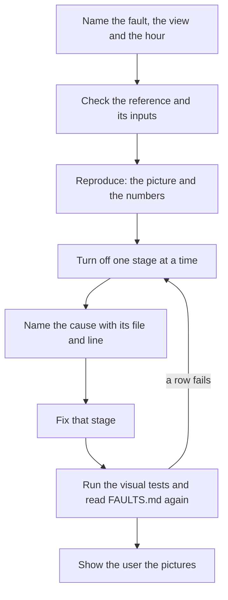
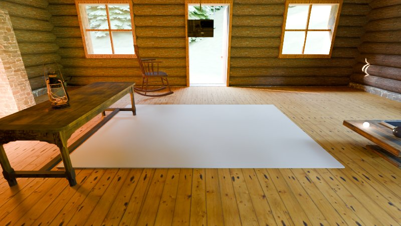
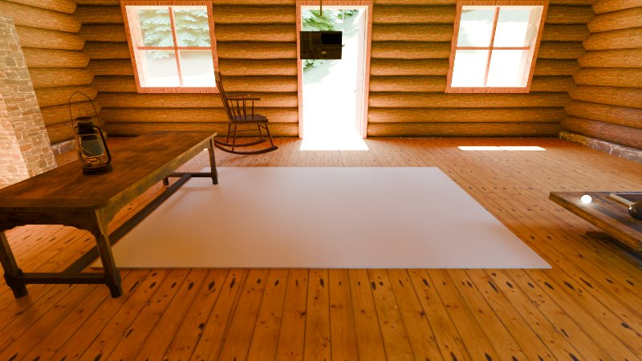
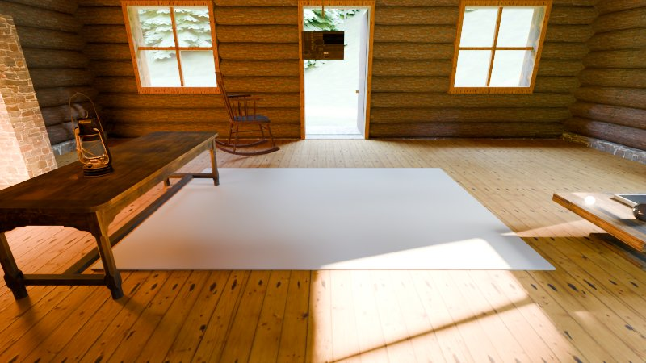
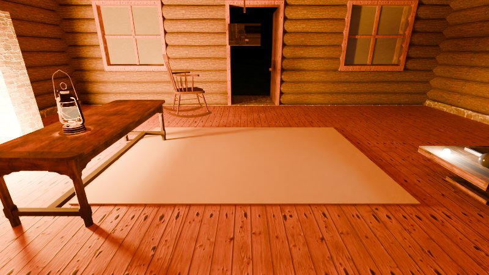
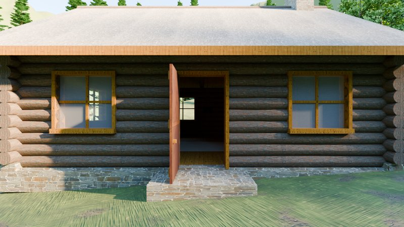
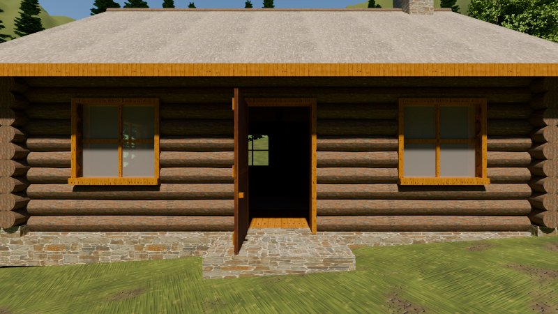
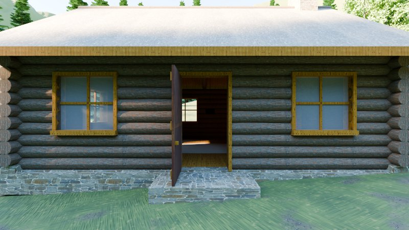
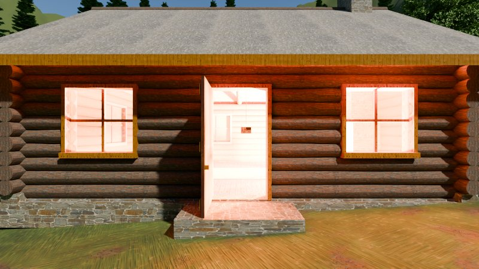
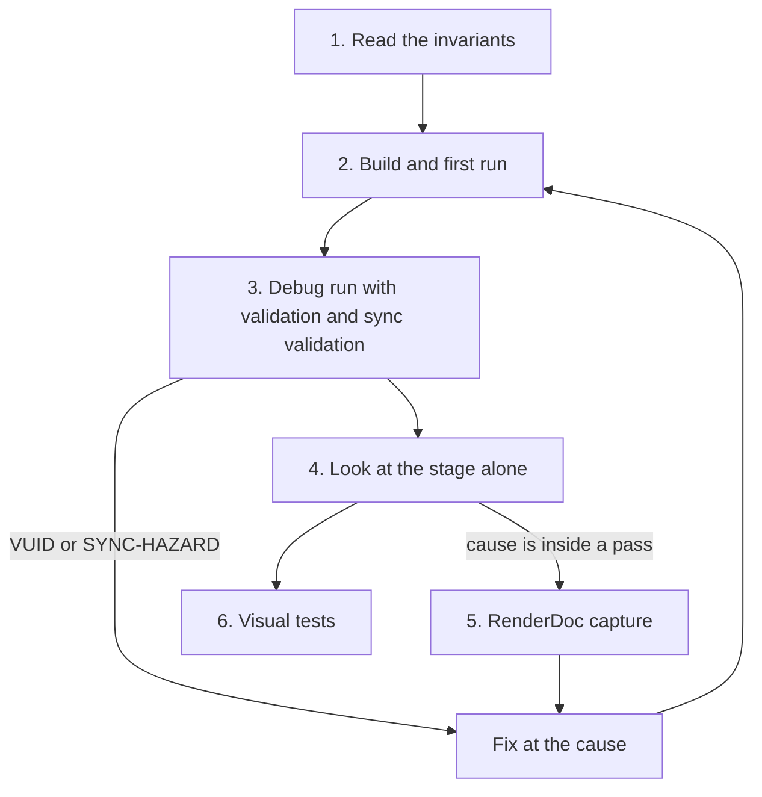

# Rendering

Use this skill for any work on what Magic draws. Start with the line that fits the work:

| The work | Start with |
| --- | --- |
| A change to the renderer, a shader, a material, or the light of a scene | [The order of priority](#1-the-order-of-priority) and [The rules](#6-the-rules). The [Verification loop](#7-verification-loop) must come clean and the visual tests must pass before you show the change. |
| A picture that looks wrong | The fault in [FAULTS.md](FAULTS.md). Then find its cause with the [investigate skill](../investigate/SKILL.md). |
| GPU time, VRAM or frame time | The [profiling skill](../profiling/SKILL.md). The GPU time row of the visual tests is a number to report, with no limit. |
| A review, a plan or a question | The bar, the rules and the fault list. Name the view, the hour and the number that you read. |

The commands, the views, the hours, the files, the switches and the time limits are in the Rendering part of
[PROJECT.md](../PROJECT.md). How the reference tools work, and how to read what they print, is in
[Reference views](../../DEBUGGING.md#reference-views). Every fault, its test and its reject rule are in
[FAULTS.md](FAULTS.md).

The [Verification loop](#7-verification-loop) runs inside the Fix and Check steps: the build, the validation layer and,
when a pass is the cause, a RenderDoc capture come before the visual tests.

## 1. The order of priority

Rules can pull two ways. When they do, the rule higher in this list wins.

1. **A light leak fails the picture.** This holds at any hour, close up and far, still and in motion. Never hide a
   leak with ambient occlusion, a clamp or a shorter ray. Find the ray or the probe that carries the light through
   the wall ([Light leak](FAULTS.md#light-leak)).
2. **A fault that the eye sees fails the picture, whatever the numbers say.** A row that passes does not excuse a
   fault in the picture. Look at each picture at full size yourself.
3. **A row that fails fails the picture, whatever the picture looks like.** Do not change a limit to make a row
   pass.
4. **No row gets worse than the baseline.** Each run after a baseline prints BETTER, SAME or WORSE beside PASS or
   FAIL. A fix must make the rows that it aims at BETTER and leave every other row SAME or BETTER. One WORSE row
   fails the fix, also when that row still passes its limit. The limits stay the goal: a run of all SAME rows that
   still fails a limit is not done ([The one command](#4-the-one-command)).
5. **The look of the picture is the user's decision.** The user picks a strength, a radius, a tonemap, an exposure,
   a grade, a pass limit and a new dependency ([Decisions that are the user's](#11-decisions-that-are-the-users)).
6. **Where this skill is stricter than [PROJECT.md](../PROJECT.md) or another skill, follow this skill, and say
   which rule is stricter.** This skill permits nothing that they forbid. It is stricter in three places: a leak is
   an automatic fail, a fix needs a run that proved its cause, and you never call a picture right before the user
   saw it.

## 2. The bar

The aim is high quality, crisp light: the lighting quality of UE5 Lumen and Nanite. "No errors", "same as before"
and "it looks normal" are not a pass.

A picture passes only when all of these are true:

- No light leak.
- The visual tests print PASS on every row, within the limits of the limits file, and no row is WORSE than the
  baseline.
- The picture looks like the preview of the same view and hour.
- It has no leak, blob, dot, line, band, halo, grain or flicker, close up and at a distance.
- It stays the same while the camera turns and moves. The light at a point must not change with where the camera
  looks. Only the exposure can adapt.
- It settles after a move or a change of light, with no trail. The pixels that come into view have no noise.

Crisp means four things that the rows above and the fault list already judge: no grain, a shadow that keeps its
hard edge where it meets its caster, no smear behind a bright thing, and a picture that settles. It is no limit of
its own.

The GPU time of a frame is a number that each report gives. No rule fails a picture or a fix for it. For a task on
the frame time, the VRAM or the GPU time, use the [profiling skill](../profiling/SKILL.md).

Never write "fixed", "gone" or "matches" before the user saw the pictures. Write what you measured and what you saw.

## 3. The reference

The reference is a render of the same scene in Blender Cycles, an external path tracer. A renderer that compares
against itself, or against its own path tracer, shares its own faults. The Blender script builds the scene from the
files that Magic loads, so the two are the same scene.

Before you blame the renderer, check the reference:

- **The same scene.** The geometry, the textures and the camera line up when you lay one picture over the other.
- **The same inputs.** The sun's direction and light, the sky, the lamps, the glass and the materials.
- **Real values.** The sun, the moon and the albedo of the materials hold measured real-world values. A reference
  with wrong inputs agrees with a renderer that is wrong in the same way.
- **The tool's own gaps.** A difference that the Cycles scene leaves out is the tool's, not the renderer's. The gaps
  are listed in [Reference views](../../DEBUGGING.md#reference-views).

Read every number in raw light, before the exposure and the grade. Two pictures at different exposures look
different when the light is the same.

### The look

The scene leans to stylized realism. The sky fill, the fire and the lantern are stronger than the real thing, and
the picture stays believable. The three values and their places are in the look table of the Rendering part of
[PROJECT.md](../PROJECT.md). The sun and the moon take no part in the look, so the real-value check of
[Too dark or too bright outside](FAULTS.md#too-dark-or-too-bright-outside) judges the two of them and the albedo of
the materials. A value of the look is right when it is the one in that table, not when it is the real-world one.

Each look value is in the scene's data, which Magic and the Blender script both read, so the reference stays an
exact copy of the scene. A value that lifts the light must go into that data. Never put a look value in the Blender
script, in the comparison alone, in one half of a picture, or in a fill that the renderer adds and the reference
does not read. A value that only one side reads makes the two scenes different scenes.

## 4. The one command

The visual tests command runs every view and hour and prints PASS or FAIL for each row. It must pass. Give it a list
of views and a list of hours to run part of the set. For each view and hour it measures:

| Row | What it tests |
| --- | --- |
| Patch ratio median | The brightness of the whole picture |
| Patch ratio 10th and 90th | The dark parts and the bright parts |
| Fireflies in a million | White dots that the reference does not have |
| Banding | A gradient that Magic draws in flat steps |
| Flicker | A still picture of a still scene that moves from frame to frame |
| Mean FLIP | The difference that a person sees, over the whole picture |
| Colour of each point | The hue of each named surface |
| Each point at three camera angles | Light that changes with where the camera looks |
| Leak at each point | The light that Magic leaves in a sealed room |
| Settle after each turn, the strafe and the light change | How fast the picture comes right |
| Edge noise of each turn | Noise in the strip that comes into view |
| Whole picture noise of the strafe | Noise in what a move uncovers all over the picture |
| Warnings and errors in the log | A run that is not a valid picture |
| GPU time of a frame | The cost, reported with no limit |

The patch rows compare patches of pixels, where the reference's own noise cancels. The same ratios per pixel are
printed beside them, and no limit judges them.

The pass limits are data in the limits file. A limit changes only when the user says so. The limits of the rows that
the file marks as proposals are the tools' first values, not the user's: report a row that fails one of them, and
do not change it.

The command also writes the split picture, the ratio map, the FLIP map, the preview and a report page of each view
and hour. Look at each one at full size. Where they are is in the Rendering part of [PROJECT.md](../PROJECT.md).

### The two tiers

The Quick tier takes the still frames and the two camera angles beside the view, in about 3 minutes for one view and
hour. The Full tier takes the turns, the strafe and the light change as well, in about twice that time. Quick judges
every row but the settle rows and the noise of a move, which need the frames of a move.

### The baseline

The baseline holds each row's value from a run whose pictures the user approved. Each run after it prints BETTER,
SAME or WORSE beside PASS or FAIL ([Reference views](../../DEBUGGING.md#reference-views)).

Write the baseline again only after the user approved the pictures of a full run. A baseline written from a run that
the user did not see hides the fault that it holds.

Before you read a change of a row as a fix, learn how much that row moves between two runs of the same code. Repeat
the run of that view and hour and read the spread that it prints.

## 5. The previews

The previews are the pictures that Magic must look like. There is one for each view and hour, in the previews folder
of [PROJECT.md](../PROJECT.md).

- Open the preview of the view and the hour beside Magic's half of the split picture.
- Judge the shape and the place of each sun patch, each shadow and each highlight, not only the brightness.
- A picture that passes every row but does not look like its preview fails. Say what is different.

An inside view and an outside view at the four hours:

| View | 8 | 12 | 16 | 22 |
| --- | --- | --- | --- | --- |
| `cabin-room` |  |  |  |  |
| `cabin-outside` |  |  |  |  |

No picture of Magic's half is stored. A run writes its own split picture.

## 6. The rules

Follow each of these. Each one comes from a fault that this project made, and names it. Read that fault before you
drop a rule: a rule holds while its fault can come back, and a library that replaces the stage the rule is about
takes the rule with it.

### Light

- Never bend a curve or a clamp in absolute units. The light in this scene runs from 0.1 to 100,000. Such a curve
  holds the mean of a few rays 2 to 3 times too low
  ([Too dark or too bright inside](FAULTS.md#too-dark-or-too-bright-inside)).
- A filter must not change the mean. Measure the mean before and after the filter
  ([Grain, blotches and fireflies](FAULTS.md#grain-blotches-and-fireflies)).
- A ray that reaches nothing within its range takes the sky, not the probes ([Light leak](FAULTS.md#light-leak)).
- A ray that lands on a back face is blocked. It carries no light ([Light leak](FAULTS.md#light-leak)).
- Light and shadow must not read only the screen. Ambient occlusion from the screen is allowed on the indirect light
  alone, within about 1 m, with a fade at the screen's edges
  ([Light that ignores what is off screen](FAULTS.md#light-that-ignores-what-is-off-screen)). A contact shadow is
  the other exception: a march of at most a few tens of centimetres through the depth buffer towards the light, which
  only multiplies a shadow map's result and fades at the screen's edges.

### Time

- A history needs a count of its frames. A pixel with a short history needs a wide blur, not a long blend
  ([Noise at the screen's edges](FAULTS.md#noise-at-the-screens-edges)).
- A history needs a clamp that keeps the mean
  ([Too dark or too bright inside](FAULTS.md#too-dark-or-too-bright-inside)), and a fast path that follows a change
  within a few frames ([Light that holds after a change](FAULTS.md#light-that-holds-after-a-change)).
- Read the history where the surface was, by its velocity and the jitter's move. A read between pixels spreads the
  history wider each frame ([Streaks and dashes in motion](FAULTS.md#streaks-and-dashes-in-motion)).
- Count a history texel as the same surface by its depth and its normal, not by its depth alone
  ([Smearing and ghosting](FAULTS.md#smearing-and-ghosting)).
- Feed the history from the blend before any filter, not from the filter's first pass
  ([Streaks and dashes in motion](FAULTS.md#streaks-and-dashes-in-motion)).

### Shadows

- Blur a shadow by the width of its soft edge at that pixel, never by a fixed number of pixels
  ([Soft or lit contact](FAULTS.md#soft-or-lit-contact)).
- A shadow is sharp where it meets its caster and soft far from it
  ([Soft or lit contact](FAULTS.md#soft-or-lit-contact)).
- Start a shadow ray on its own face. A lift towards the vertex normals takes the ray off a flat face that the model
  smoothed over a hard edge ([Shadow acne and peter-panning](FAULTS.md#shadow-acne-and-peter-panning)).

### Reflections

- Trace only a surface smooth enough for a traced reflection. Give a rougher surface its diffuse light as its sheen
  ([Reflections that look off](FAULTS.md#reflections-that-look-off)).
- Do not raise the indirect specular towards edge-on where nothing traces it
  ([Reflections that look off](FAULTS.md#reflections-that-look-off)).

### The tools

Each rule here keeps a measurement honest, so each one comes from
[Measurement faults](FAULTS.md#measurement-faults).

- Before you trust a number, read that part. The tools already do what it says. A measurement that you add must do
  the same.
- Judge a fault in motion at each turn speed of the views' values, and at the strafe. The slow turns show a trail
  and a shadow that swims. The fast turns show what a mouse turn does. The strafe gives the parallax that a turn
  does not.
- Take the "before" numbers with the same tool, the same view and the same hour, before you change code.
- If another app uses the GPU, a run can lose the device or change its timing. Say so in the report and run again.
- Never cut the reference's diffuse bounces. Four in place of twelve take 15.8 % of the light out of the room, and
  22 % off the logs over a window.
- Never turn the reference's caustics off. The run that cut the bounces turned them off with them, and the room lost
  the same 15.8 %.
- Never use Fast GI for the reference. It takes 55.5 % of the room's light away.
- **What Magic knows is asked from Magic through a command. A tool holds no copy of an engine rule.** This is the
  user's rule. Add a console command that prints what the tool needs, and read that
  ([Supported Commands and Options](../../CLI.md#supported-commands-and-options)). Never write a rule of the engine's a second time in a
  script. The copies that are still there are in [Reference views](../../DEBUGGING.md#reference-views).
- Hold the fire and the lantern still before a still picture. A `Flicker` script drives both of them each frame, so
  two frames of the same scene hold different light. The tests take that script off and set the intensity of each
  lamp from the limits file. They let both move again for the frames taken in motion, which no row reads.
- After a change of the hour, wait 15 to 16 seconds for the exposure. At hour 22 the exposure still wanders by
  2.5 %, which is the floor of a row of that hour.

### What is not proved by a run

Since the scripts were last taken apart, no run of Magic went through the capture. These are read from the code
alone:

- The settle wait, and the lights and the props held before it.
- The first still frames, which serve every move, in place of a still frame for each move.
- The window's size at the launch, as `--configure Window.Mode=Windowed "Window.WindowedSize=1600 900"`.
- The held scripts of the scene: the spin, the glide and the flicker.
- The Quick tier, which takes no frames of a move and so calls no measure of the settle or the noise.

The first rendering task that uses this skill runs the Quick tier on one view first and reads the report. Report
what it printed before you read any other number.

## 7. Verification loop

Run this loop for each change to rendering code, shaders included. Do the steps in order. A step that finds a fault
sends you back to the build after the fix. The commands are in [PROJECT.md](../PROJECT.md) and
[DEBUGGING.md](../../DEBUGGING.md).

1. **Pin the invariants.** Before you change rendering code, read the
   [Engine invariants](../PROJECT.md#engine-invariants) table. A change to one row is the user's decision.
2. **Build.** A shader compiles when the first run asks for its entry point, through the Slang API, with warnings as
   errors ([ShaderCompiler.cs:639-653](../../../src/Gems/SlangShaderCompiler/ShaderCompiler.cs#L639)). A failed
   compile logs one error: `The passes that run <entry point> are left out: <the compiler's text>`
   ([VulkanShaders.cs:246](../../../src/Gems/VulkanGraphics/VulkanShaders.cs#L246)). The compiler's text starts with
   `<path> does not compile`, `the program does not link` or `the entry does not compile to SPIR-V`
   ([ShaderCompiler.cs:540-548](../../../src/Gems/SlangShaderCompiler/ShaderCompiler.cs#L540),
   [ShaderCompiler.cs:704](../../../src/Gems/SlangShaderCompiler/ShaderCompiler.cs#L704)). That entry point stays
   failed and its passes do not run. So a build that passes proves no shader compiles: read the log of a run that
   reaches each entry point that you changed.
3. **Run in Debug with validation and sync validation on.** Set `Debug.IsSyncValidationOn=true`
   ([Vulkan validation](../../DEBUGGING.md#vulkan-validation)). Read the `GPU:` line of the log first: it must end
   with `validating with sync validation`. If it does not, the loader did not find the layer: fix that and run again.
   A run that did not validate proves nothing. Each `Log.Error` with a message ID in brackets, such as a `VUID-` or a `SYNC-HAZARD-` ID, is a
   fault ([Validation error or sync hazard](FAULTS.md#a-validation-error-or-sync-hazard)). Fix it at its cause
   before you trust a picture. A barrier comes from what a pass declares that it reads and writes, so the cause is
   usually a wrong declaration, not a missing barrier.
4. **Look at the stage alone.** Show one part of the frame with `DeferredRendering.RenderView`, and read the light
   before the exposure with `screenshot --hdr` ([PROJECT.md](../PROJECT.md), Debug views and switches).
5. **Capture, when the cause is inside a pass.** Use it for a wrong barrier, target or state, when steps 3 and 4 name
   no cause. The `capture` command works only when RenderDoc started Magic
   ([RenderDoc capture](../../DEBUGGING.md#renderdoc-capture)). RenderDoc is a tool that the user installs and starts,
   as the [profiling skill](../profiling/SKILL.md) says. Ask the user first, with the exact steps. Then read the
   capture file, in this order:
   - The pixel history of the wrong pixel: which draw or dispatch wrote it
     (`ReplayController.PixelHistory` in the
     [RenderDoc Python API](https://renderdoc.org/docs/python_api/renderdoc/replay.html)).
   - The inputs and outputs of that pass: its textures and buffers, and whether the one that you expect is bound.
   - The pipeline state of that pass (`ReplayController.GetPipelineState`, same page): depth test, blend, targets and
     formats.

   To read the file from a script, use RenderDoc's Python module. RenderDoc does not ship it ready to import: it is
   built for one Python version, and it needs `renderdoc.dll` on the path
   ([Python module](https://renderdoc.org/docs/python_api/python_module.html)). `rdc-cli`
   ([rdc-cli](https://github.com/BANANASJIM/rdc-cli), used by the
   [renderdoc-skill](https://github.com/rudybear/renderdoc-skill)) and
   [renderdoc-mcp](https://github.com/Linkingooo/renderdoc-mcp) wrap that module for an agent. Both are third-party.
   Each one is a new dependency, and needs the user's yes.
6. **Run the visual tests** ([The one command](#4-the-one-command)), and read [FAULTS.md](FAULTS.md) again.

The loop does not prove a picture right. Steps 2 to 5 find faults that the eye cannot see. Step 6 and the user's
look judge the picture.

## 8. Reproduce

1. Name the fault, the view and the hour from [FAULTS.md](FAULTS.md).
2. Run the visual tests for that view and that hour.
3. Read the rows that fail. Look at the split picture, the ratio map and the preview at full size.
4. If the fault is in motion, look at the turn frames of each speed.
5. If no view shows the fault, add a view ([Reference views](../../DEBUGGING.md#reference-views)). Never pose a
   camera in a scratch script. The next agent must measure the same thing.

## 9. Find the cause

Follow the [investigate skill](../investigate/SKILL.md). This skill is stricter in two ways:

- Do not fix from the code alone. Every cause comes from a run that turned off one stage at a time and saw the fault
  go.
- Measure each stage alone against the reference where you can. Know which stage is farthest from it before you fix
  anything.

Use the debug views and the switches that turn off one term of the light ([PROJECT.md](../PROJECT.md)). If no switch
exists for the stage, add one for the measurement. Write the cause in one sentence, with its file and line, before
you change code.

## 10. Fix and check

- Fix the stage that makes the fault. Do not hide it in a later stage.
- Prefer a proven technique or library over a new one of our own: a known denoiser, a known ambient occlusion, a
  known tonemap. Follow the reference engine of the project when you are not sure. A new dependency needs the
  user's yes.
- One fix changes one thing. Commit it alone, so it can be measured alone and reverted alone.

A fix that improves one row can break another. Check it in two steps, because a run of every view and hour takes
hours:

1. After each fix, run the Quick tier for the view and the hour that showed the fault, and for each view that the
   fix can change. Read the part of [FAULTS.md](FAULTS.md) that holds the faults the fix can bring back. The rows
   that the fix aims at must be BETTER, and no row is WORSE.
2. Before you show the work to the user, run the Full tier one time for every view and hour, and read the whole
   table of [FAULTS.md](FAULTS.md). Look at each picture at full size.

## 11. Decisions that are the user's

The look of the picture belongs to the user. Do not choose these for them:

- A strength, a radius or another value that changes how the picture looks.
- A tonemap, an exposure behaviour or a colour grade.
- A pass limit in the limits file.
- A new dependency.

Ask with two to four choices, the recommended one first, each with a picture and its measured cost.

## 12. Report

Give the user:

1. The fault and the cause, with its file and line, and how the run proved it.
2. What changed, by commit.
3. The visual tests table, before and after.
4. The pictures: the split picture and the preview beside it, still and in motion, at full size.
5. The GPU time, with its number.
6. What you did not check, and the faults that are still open.
