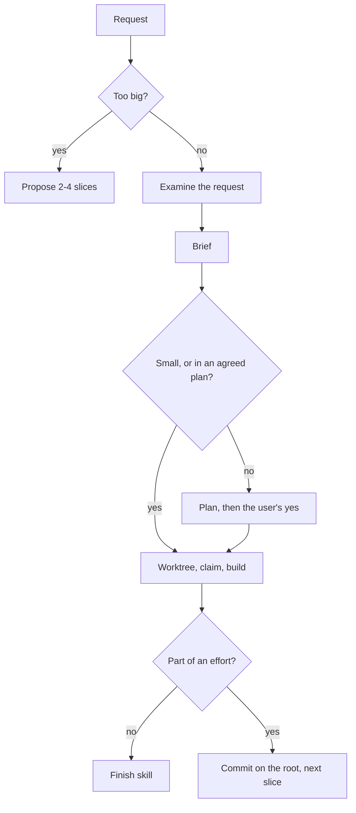

# Slice

The rules and commands are in [PROJECT.md](../PROJECT.md).

This diagram shows how a request becomes a built slice.



1. Take the slice that the user asks for, or the next slice of a list that the user approved. If the request is too
   big for one slice, use the [kickoff skill](../kickoff/SKILL.md).
2. Compare the slice with the slice size limit. If it is too big, tell the user. Propose two to four smaller slices.
   Stop until the user selects one.
3. Examine the request:
   - Compare what it assumes with the code and the docs. If the direction is wrong, show the user the evidence before
     you do other work.
   - Compare it with the goal and the decisions that the user approved. If it does not help them, tell the user.
   - If a current language or framework feature does the job better than the method in the request, tell the user.
   - Before you add a component, dependency, file format or tool, look for one that exists and that people maintain
     well. If you find one, prefer it, also when the request names a different method.
   - A change to a public API, a file format, a dependency, a plugin or the architecture is a decision. Get the
     user's yes.
4. Read only the code that the slice needs. Then write this brief:

   ```markdown
   ## Slice: <verb + what the user can see or run>
   Mode: spike | prototype | production
   Time-box: <one session, or less>
   Validation level: <level>

   Goal: <one sentence>
   Serves: <the larger goal that it helps>

   In scope: <the files and folders that it changes, as it will claim them>
   Out of scope: <the next step that you will not do, by name>

   Works when: <one check: a command, a sample and what it shows, or a test name. For docs or comments alone: none>
   /goal (only when it fits): /goal <end state> - shown by the validate and stamp command at <level> and the review
   in a fresh context returning VERDICT: PASS - <what must not change> - or stop after <n> turns
   ```

   Add the `/goal` line only when the slice needs many turns to get to an end state in the transcript. Do not add it
   when the slice needs decisions from the user. Give the reason in one sentence. Only the user can type the line.
5. If the change is Small, or the slice is in a plan or a list that the user agreed to, write the brief in the chat.
   Do not wait.
6. If not, agree on a plan with the user before the first edit:
   1. Write the brief and the plan in one message. The plan is the path that you will take, and the alternatives if
      there are any.
   2. Ask only the questions whose answer changes the path, four or fewer.
   3. Do not edit until the user agrees to the plan.

   The user's yes is the approval to build all that the plan covers, up to the user's review. Do not propose, plan
   or ask again for a slice or a step that the plan covers. Ask again only when the work leaves the plan: a decision
   that is hard to reverse, or scope that the plan did not name. The yes does not cover the merge into the main
   checkout's branch. That merge waits for the user's review and a separate yes.

   For a sweeping change, the plan is a proposal. In Claude Code, write it in plan mode. It gives:
   1. The method.
   2. The smallest version that can work, the alternatives, and why the selected one is the simplest.
   3. For a new thing, the libraries and tools that exist and that you examined.
   4. The assumption with the most risk, what you did not check, and what can change your recommendation.
   5. Code before and after, and a data-flow diagram in Mermaid. Draw it as the
      [ste-docs skill](../ste-docs/SKILL.md), section 7, says.
7. Build the slice:
   1. For a slice of an effort, work in the worktree of its root branch, on the root branch. Otherwise, make a
      worktree with a branch from the main checkout's branch (Branches and merges). A worker of a swarm makes the
      worktree that its prompt gives. Then claim the scope of the brief (Worktrees and claims). In an effort, claim
      only the scope of this slice: the new claim replaces the claim of the slice before.
   2. If the claim reports an overlap, stop and ask the user.
   3. Build the slice. Check a position, height or size that you work out from data against the running engine
      (`get`, a probe or a screenshot) before a later step depends on it.
8. When the slice is built:
   - For a single slice, use the [finish skill](../finish/SKILL.md).
   - For a slice of an effort, run its "Works when" check and commit on the root branch. Start the next approved
     slice in the same worktree. When the last one is in, use the [finish skill](../finish/SKILL.md) on the root branch. Do not
     merge into the main checkout's branch before that.
