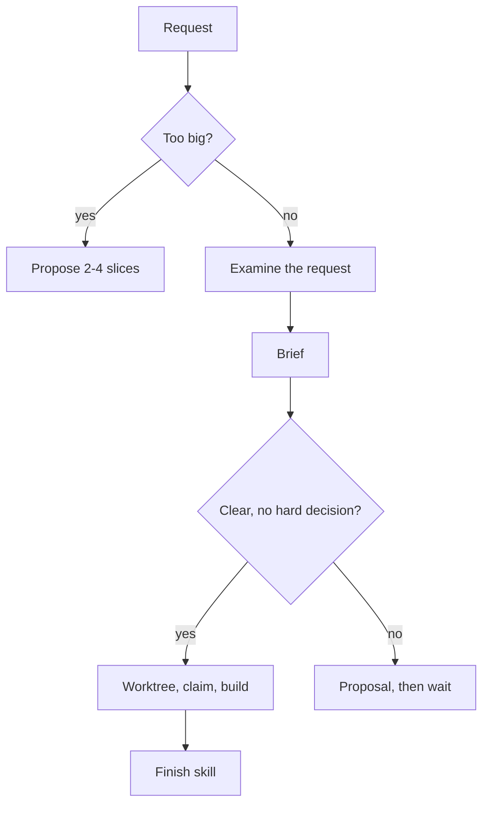

# Slice

The rules and commands are in [PROJECT.md](../PROJECT.md).

This diagram shows how a request becomes a built slice or a proposal.



1. Take the slice that the user asks for, or the next slice of a list that the user approved. If the request is too
   big for one slice, use the [kickoff skill](../kickoff/SKILL.md).
2. Compare the slice with the slice size limit. If it is too big, tell the user. Propose two to four smaller slices.
   Stop until the user selects one.
3. Examine the request:
   - Compare what it assumes with the code and the docs. If the direction is wrong, show the user the evidence before
     you do other work.
   - Compare it with the goal and the decisions that the user approved. If it does not help them, tell the user.
   - If a current language or framework feature does the job better than the method in the request, tell the user.
   - Before you add a component, dependency, file format or tool, look for one that exists and that people maintain
     well. If you find one, prefer it, also when the request names a different method.
   - A change to a public API, a file format, a dependency, a plugin or the architecture is a decision. Get the
     user's yes.
4. Read only the code that the slice needs. Then write this brief:

   ```markdown
   ## Slice: <verb + what the user can see or run>
   Mode: spike | prototype | production
   Time-box: <one session, or less>
   Validation level: <level>

   Goal: <one sentence>
   Serves: <the larger goal that it helps>

   In scope: <the files and folders that it changes, as it will claim them>
   Out of scope: <the next step that you will not do, by name>

   Works when: <a command, a sample and what it shows, or a test name>
   /goal (only when it fits): /goal <end state> - shown by the validate and stamp command at <level> and the review
   in a fresh context returning VERDICT: PASS - <what must not change> - or stop after <n> turns
   ```

   Add the `/goal` line only when the slice needs many turns to get to an end state in the transcript. Do not add it
   when the slice needs decisions from the user. Give the reason in one sentence. Only the user can type the line.
5. If the request is clear and needs no decision that is hard to reverse:
   1. Write the brief in the chat. Do not wait for approval. The request, or the user's yes to the slice list, is the
      approval.
   2. Make the worktree. Then claim the scope of the brief (Worktrees and claims).
   3. If the claim reports an overlap, stop and ask the user.
   4. Build the slice.
6. If not, write a proposal that starts with the brief. Do not edit until the user approves, trims or splits it. The
   proposal gives:
   1. The method.
   2. The smallest version that can work, the alternatives, and why the selected one is the simplest.
   3. For a new thing, the libraries and tools that exist and that you examined.
   4. The assumption with the most risk, what you did not check, and what can change your recommendation.
   5. For a sweeping change, code before and after, and a data-flow diagram in Mermaid. Draw it as the
      [ste-docs skill](../ste-docs/SKILL.md), section 7, says.

   In Claude Code, write the proposal in plan mode. In other tools, write it in the chat and wait.
7. When the slice is built, use the [finish skill](../finish/SKILL.md).
