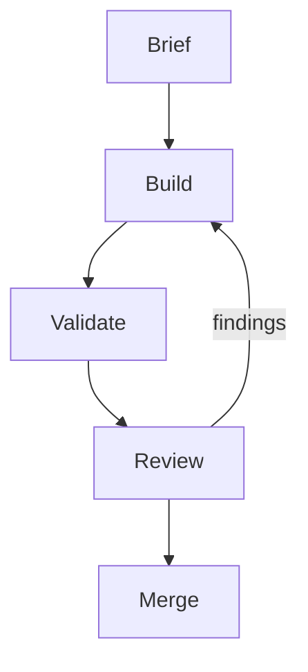

# STE docs

Write documentation, summaries, replies and comments in ASD-STE100 Simplified Technical English (STE). The goal: short text
that a reader who is not a native speaker understands on the first read.

Use this skill each time you write text for a reader, also when the user does not ask for it:

- Docs: README, guide, design note, changelog, API doc, skill, plan.
- Code comments: XML doc comments (`/// <summary>`) and inline comments (`//`).
- Summaries: summaries of work, changes, code reviews, files or discussions.
- Replies to the user: answers, plans, status updates and questions.
- Rewrites and reviews of docs, comments or summaries.

Do not apply it to code, identifiers, quoted text or quoted error messages.

The examples in this skill are generic. Do not copy their names or facts into real docs. Get names and facts only
from the real code.

## 1. Steps

1. Find the reader and the purpose. Ask: "What must the reader do or know after this text?"
2. Sort each part of the text into one of two types:
   - **Procedure:** steps that the reader does, for example install, build or add a dependency.
   - **Description:** what a thing does and how to use it.
3. Write the text with the rules in section 2.
4. Do the checklist in section 8 on each paragraph.
5. When you rewrite a text, keep each fact that the reader needs. Remove the words and facts that the reader does not
   need.

## 2. Rules

### Content: what it does, not what it uses

- Say what the thing does and how to use it. This is the most important rule.
- Do not say what it uses inside: libraries, patterns, frameworks, internal types or algorithms. Add one only if the
  reader must know it to use the thing correctly.
- Do not add fluff: no praise, no marketing words, no history.
  - Bad: "A service that uses `HttpClient` and a retry policy built on the decorator pattern."
  - Good: "Sends an HTTP request. If the request fails, it tries again up to 3 times."

### Words

- Use one word for one meaning. Use one name for one thing. Do not change between synonyms, for example "plugin",
  "module" and "extension" for the same thing.
- Use simple, common words. Use the word table in section 3.
- Technical names are permitted: type names, method names, file names, commands and product names. Write them exactly
  as in the code, in backticks.
- Do not make a cluster of more than 3 nouns. Break it up with "of", "for" or a short clause.
  - Bad: "database connection pool timeout value"
  - Good: "the timeout value for the database connection pool"
- Use articles ("a", "an", "the") and "this" or "these". Do not remove words to make a text shorter.
- In a rule, use "must", "do not" and "can". Do not use "should", "may" or "might".

### Verbs

- Use the active voice. Name who or what does the action. In a description, use the passive voice only when the actor
  is not known or not important.
- Use only simple tenses: present, past, future ("will"), and the imperative.
- Do not use "-ing" forms as verbs or nouns, except in technical names.
  - Bad: "After loading the file, the method starts parsing."
  - Good: "After the method loads the file, it starts to parse the data."
- Do not hide a verb in a noun.
  - Bad: "Perform the registration of the service."
  - Good: "Register the service."

### Sentences

- A sentence in a procedure has **20 words or fewer**.
- A sentence in a description has **25 words or fewer**.
- Write one topic in each sentence.
- Use a vertical list in place of a long sentence with many items or clauses.
- Do not use semicolons. Make two sentences.

### Procedures

- Write each instruction as a command: "Run the tests."
- Write one instruction in each step. Put two actions in one step only if the reader must do them at the same time.
- Put the condition before the instruction: "If the build fails, delete the `obj` folder."
- Number the steps. Put each step on its own line.
- If the reader must see a result, write it in a separate sentence after the step: "The output shows
  `Build succeeded`."

### Descriptions

- Write what the thing does first. Then write how to use it.
- Write one topic in each paragraph.
- A paragraph has **6 sentences or fewer**.
- Use headings to separate topics. Make the headings short and specific.

### Warnings and cautions

- Start with a short, clear command. Then give the risk in a separate sentence.
  - Good: "Do not change a `List<T>` in a `foreach` loop over that list. The loop throws an
    `InvalidOperationException`."
- Use `> **Warning:**` for a risk of lost data or a crash. Use `> **Note:**` for other important information.

## 3. Word table

This is not the full STE dictionary. Use the simple word on the right. If a word is not in the table, use the most
simple and common word that has the correct meaning.

| Do not use | Use |
| --- | --- |
| utilize, leverage, employ | use |
| ensure, verify | make sure |
| in order to | to |
| prior to | before |
| subsequently, thereafter | then, after |
| commence, initiate | start |
| terminate, cease | stop |
| facilitate | help, let |
| approximately | about |
| sufficient | enough |
| additional | more |
| numerous | many |
| require | need, must |
| obtain, retrieve | get |
| perform, execute (as general verbs) | do, run |
| in the event that | if |
| due to the fact that | because |
| at this point in time | now |
| a number of | some, many |
| in addition | also |
| e.g., i.e. | for example, that is |
| simply, just, easily, obviously | (remove) |
| leverages the power of, seamlessly, robust, powerful | (remove) |

## 4. Code comments

### XML doc comments

- `<summary>`: one sentence, 25 words or fewer. Say what the member does. Start with a verb for a method ("Reads the
  file from disk.") and with a noun phrase or verb for a type ("Sends email messages to one or more recipients.").
- Do not say what the member uses inside. Do not repeat the member name. Do not describe the code line by line.
- `<param>` and `<returns>`: a short phrase. Say what the value is, not its type.
- `<remarks>`: use it only when the reader needs more than the summary to use the member. Follow the rules for
  descriptions.
- `<exception>`: start with "If": "If `path` is empty."
- Write a limit for performance or threads as a clear rule: "Do not call this method from more than one thread at a
  time."

### Inline comments

- Write a comment only when the code does not show the reason. Say why, not what.
- Write one or two short sentences. Follow the rules for descriptions.
- Write a limit as a clear rule: "Do not allocate here. This method runs in a hot loop."
- Start a `TODO` or `HACK` comment with the tag. Then write one sentence about the problem.

## 5. Summaries

- Write what the thing does or what changed first, in one sentence. Then write how to use it, if the reader needs it.
- Do not list the libraries, patterns or internal types that it uses.
- Use a vertical list for more than 2 items. Write one item on each line.
- Each item is one sentence or a short phrase.
- Keep only the facts that the reader needs. Do not tell the steps that you did, unless the reader asks.
- Use the same name for each thing as the code and the docs.

## 6. Replies

1. Write the answer or the result first, in one sentence.
2. Then give only the details that the user needs:
   - Use a short list for separate items.
   - Use a table to compare items on the same attributes.
   - Use a diagram for a flow, a sequence, states or a structure (section 7).
3. Write a plan as numbered steps, with one action in each step.
4. Use headings only when the reply has more than three parts.
5. To give the reason for a decision, use short sentences in the active voice. The other rules can relax there.
6. Do not repeat what the user can see, such as tool output or a file that you sent.
7. Do not tell the steps that you did, unless the user asks.
8. End with one question or one next step, if there is one. Do not end with a list of offers.

## 7. Diagrams

Use a diagram when it shows a flow, a sequence, states or a structure better than text.

- Write it as Mermaid in a `mermaid` code block. Do not draw a diagram with ASCII characters.
- Use `flowchart` for a flow or a structure, `sequenceDiagram` for messages between parts, and `stateDiagram-v2` for
  states.
- Keep each label to a few words in STE. Use the names from the code.
- Keep a diagram to about 12 nodes. Split a larger one.
- Use `flowchart TD` (top to bottom) when the flow has more than 4 nodes. A wide `LR` diagram shrinks to fit the
  page, and then the reader cannot read the labels.
- Do not put subgraphs side by side. Stack them from top to bottom.
- Write one sentence before the diagram that says what it shows.

### Full-size view

The reader must be able to open each diagram at full size:

1. If your tool can show a diagram that the reader can expand or zoom, use it.
2. If not, also write the diagram to an HTML file and give the reader the file path. Put the file in a temporary
   folder, not in the repository. A browser shows the diagram at full width, and the reader can zoom it.
3. In a document in the repository, use only the `mermaid` code block. The document viewer shows it.

HTML file for a diagram:

```html
<!doctype html>
<meta charset="utf-8">
<title>Diagram</title>
<style>body { margin: 0 } .mermaid svg { width: 100vw; max-width: none; height: auto }</style>
<pre class="mermaid">
flowchart TD
    Brief --> Build --> Validate --> Review --> Merge
    Review -- findings --> Build
</pre>
<script type="module">
    import mermaid from "https://cdn.jsdelivr.net/npm/mermaid@11/dist/mermaid.esm.min.mjs";
    mermaid.initialize({ startOnLoad: true });
</script>
```

Example:



## 8. Checklist

Do this on each paragraph before you finish:

- [ ] The text says what the thing does and how to use it.
- [ ] The text does not say what the thing uses inside, unless the reader must know it.
- [ ] No fluff: no praise, history or marketing words.
- [ ] Each sentence in a procedure has 20 words or fewer. Each sentence in a description has 25 words or fewer.
- [ ] Each paragraph has 6 sentences or fewer and one topic.
- [ ] Each instruction is a command, with one instruction in each step.
- [ ] No passive voice in a procedure. Little or no passive voice in a description.
- [ ] No "-ing" verb forms, except in technical names.
- [ ] No noun cluster of more than 3 words.
- [ ] No semicolons.
- [ ] Each thing has one name in all the text.
- [ ] No words from the left column of the word table.
- [ ] Each technical name is in backticks and matches the code.

## 9. Example

This example uses a generic ASP.NET Core app. `IOrderValidator` and `MyValidator` are example names only.

Before. The text has 2 long sentences, and it says what the app uses, not what the validator does:

> In order to facilitate the validation of incoming orders, the application utilizes dependency injection which, upon
> startup, resolves implementations of `IOrderValidator`; it is important to ensure that each validator is registered
> in the service collection. Validators that are not registered will subsequently cause an exception to be thrown when
> the service is being resolved by the container.

After:

> An `IOrderValidator` checks each new order before the application accepts it.
>
> To add a validator:
>
> 1. Make a class that implements `IOrderValidator`.
> 2. Register the class in `Program.cs`: `builder.Services.AddScoped<IOrderValidator, MyValidator>();`
>
> > **Warning:** If you do not register the class, the application cannot make the validator. The application throws
> > an `InvalidOperationException`.

## 10. When to break a rule

Break a rule only if the STE text is wrong or not clear, for example a quoted error message or a code identifier with
"-ing" in it. Do not break a rule only to make the text sound more natural.
